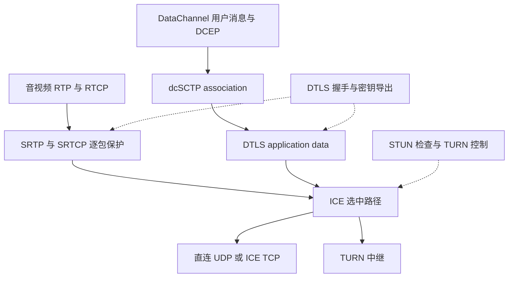

# WebRTC 传输架构与拥塞控制源码指南

这套文档面向需要接入、修改、排查 WebRTC 传输实现的工程师。阅读目标是能够从一次 API 调用或一条抓包记录，找到负责它的对象、线程、状态机、队列和下一层调用，而不是只记住协议名称。

## 1. 源码基线与适用范围

- 源码目录：[`../webrtc_src/`](../webrtc_src/)。本目录是工作区根目录的 `docs/`，与上游源码自带的 `webrtc_src/docs/` 分开。
- 基线提交：`9310b29acd9e0985ab65f454959122336e3b7e78`。
- 提交标题：`Fix race conditions in RTCPeerConnectionFactoryTests`。
- 文档核查日期：2026-10-19。
- 核查开始时，源码仓库没有已跟踪文件的本地修改。
- 范围：原生 C++ PeerConnection 的网络传输、DataChannel/dcSCTP、媒体 GCC/TCC 和链路统计；编解码算法、浏览器 JavaScript 绑定和信令服务器实现不在展开范围内。

这里的“默认路径”指本基线内置工厂在相应功能已构建、未注入替代实现、未开启改变该路径的实验参数时的行为，不代表任意应用的实际运行配置。应用注入的工厂、SDP 协商、GN 参数和 Field Trials 都可能改变实现。

本工程使用 GN 的 `BUILD.gn` 描述这些模块。阅读构建关系时应看对应目标，不能假设存在同名 CMake target。

## 2. 阅读导航

1. [总体架构与工程入口](webrtc-architecture.md)：模块边界、对象所有权、线程、协商、BUNDLE 和生命周期。
2. [Socket、ICE、STUN 与 TURN](socket-ice-stun-turn.md)：从 Socket 创建到候选收集、连通性检查和选路，再到直连与中继的收发。
3. [DTLS、SRTP 与完整报文路径](dtls-srtp-packet-flow.md)：握手、指纹校验、密钥导出、加解密、接收分流与安全状态。
4. [DataChannel 与 dcSCTP](datachannel-dcsctp.md)：API、DCEP、association、stream、分片重组、收发和关闭。
5. [dcSCTP 拥塞控制与可靠传输](dcsctp-congestion-control.md)：拥塞窗口、接收窗口、SACK、RTT/RTO、重传、部分可靠和调度。
6. [GCC 与 TCC](gcc-tcc.md)：媒体传输反馈、带宽估计、延迟与丢包算法、探测、pacing 和码率执行。
7. [链路网络指标](network-metrics.md)：RTT、丢包、jitter、上行抖动及上行时延的公式、单位、窗口与统计映射。
8. [传输源码 FAQ](transport-faq.md)：六类常见问题的直接答案、实际调用链、条件与调试入口。

第一次阅读建议按 1 → 2 → 3 建立传输骨架，然后按业务选择 4 → 5 或 6 → 7。排查具体问题可以直接从 FAQ 跳转。

## 3. 首先建立正确的协议关系



DTLS 在这里承担两种用途：保护 SCTP 应用数据，以及为媒体导出 SRTP 密钥。正常媒体数据经 SRTP 保护后不再装入 DTLS application-data record。STUN 也不是每个媒体包都必须经过的一层业务封装。

## 4. 文档中的证据约定

- **实现事实**：以本提交的类、函数、字段、构造位置和调用方为依据；每篇提供相对源码链接。
- **协议规则**：用官方规范补充报文语义，不把规范的全部可选能力当作当前实现已经支持。
- **示例**：数值演算和示意配置用于解释算法，不是运行日志或性能测试结果。
- **条件分支**：明确标注协商、配置、工厂注入、平台宏和实验参数的影响。

源码链接直接指向本地文件。正文中的函数名是稳定检索入口，标注的行号只对本提交有效。源码更新后，应优先用函数名定位，再复核行为。

图中的实线通常表示调用或数据流，虚线表示反馈、状态通知或非拥有引用；对象所有权图会单独标出“拥有”“引用计数”“非拥有引用”，不能把数据流箭头当作所有权关系。

Mermaid 图可在支持 Mermaid 的 Markdown 阅读器中渲染；不支持的阅读器仍能查看文本图源。状态图标签避免使用冒号和布尔运算符，以降低渲染器版本差异带来的歧义。

## 5. 按症状定位

- **没有本地候选**：先看网络接口、allocator session、Port 和 Socket 创建，不从 DTLS 开始查。[候选收集](socket-ice-stun-turn.md)
- **有候选但不可写**：检查远端候选、ICE 凭据、STUN 请求响应、角色冲突和选中的 `Connection`。[ICE 选路](socket-ice-stun-turn.md)
- **ICE 已连通但 DTLS 未连接**：检查角色、证书指纹、握手收发和超时。[安全建链](dtls-srtp-packet-flow.md)
- **DTLS 已连接但媒体被丢弃**：检查 SRTP profile、密钥方向、SRTP 保护/认证和 RTP demux。[媒体路径](dtls-srtp-packet-flow.md)
- **媒体正常但 DataChannel 不可用**：检查 SCTP 参数、association、SID、DCEP 和通道状态。[DataChannel](datachannel-dcsctp.md)
- **DataChannel 吞吐低或延迟持续增加**：区分应用积压、未发送队列、在途数据、接收窗口与丢包恢复。[SCTP 控制](dcsctp-congestion-control.md)
- **视频码率不升或突然下降**：检查反馈是否到达、ALR、探测结果、delay/loss estimate、配置上限与最终 encoder/pacer 输出。[GCC/TCC](gcc-tcc.md)
- **两个页面的 RTT 或丢包率对不上**：核实测量协议、方向、时间单位、统计窗口和被统计的包集合。[网络指标](network-metrics.md)

## 6. 本版本特别容易误读的地方

1. 内部 DTLS 实现是 `DtlsTransportInternalImpl`，位于 `p2p/dtls/`；`p2p/base/dtls_transport*.h` 是迁移兼容头，`pc::` 目录下的 `DtlsTransport` 是 API 信息包装对象。这里的 `pc/` 是目录，不是 C++ 命名空间。
2. 本版本中的大量传输类位于 `webrtc` 命名空间。旧资料中的 `rtc::`、`cricket::` 限定名不能直接套到本地源码。
3. GCC 的算法与 TCC 的反馈协议必须分开理解。媒体 GCC 与 SCTP 拥塞控制也不是同一个控制器。
4. BUNDLE 复用、RTCP mux、Port 的 shared socket 是三个不同维度；“都用了 UDP”不足以证明是同一个 Socket。
5. `Send` 返回成功、队列下降、Socket 接受数据、对端收到包、对端应用收到消息，是不同事件。
6. `uplink delay` 并非这份源码中的一个统一统计字段，不能不看来源就用 `RTT / 2` 解释。

## 7. 自行复核的最小操作

在工作区根目录执行以下只读命令，可确认版本与关键入口：

```sh
git -C webrtc_src rev-parse HEAD
git -C webrtc_src status --short
rg -n 'MaybeCreateJsepTransport|CreateDtlsTransport' webrtc_src/pc/jsep_transport_controller.cc
rg -n 'SendPacketWithStatus' webrtc_src/media/sctp/dcsctp_transport.cc
rg -n 'OnTransportPacketsFeedback' webrtc_src/modules/congestion_controller/goog_cc/goog_cc_network_control.cc
```

如需验证具体行为，先阅读专题列出的单元测试与对应 `BUILD.gn`，再使用本地已配置且启用测试的输出目录构建。文档生成过程没有执行完整 WebRTC 编译、网络互通或性能基准测试，因此文中的测试入口不代表本次已运行测试结果。

## 8. 规范入口

下列原始资料用于核对术语和协议语义，具体实现仍以本地代码为准：

- [RFC 8445 — ICE](https://www.rfc-editor.org/rfc/rfc8445)、[RFC 8489 — STUN](https://www.rfc-editor.org/rfc/rfc8489)、[RFC 8656 — TURN](https://www.rfc-editor.org/rfc/rfc8656)。
- [RFC 5764 — DTLS-SRTP](https://www.rfc-editor.org/rfc/rfc5764)。
- [RFC 8831 — WebRTC Data Channels](https://www.rfc-editor.org/rfc/rfc8831)、[RFC 8832 — DCEP](https://www.rfc-editor.org/rfc/rfc8832)、[RFC 8261 — SCTP over DTLS](https://www.rfc-editor.org/rfc/rfc8261)。
- [RFC 8260 — SCTP 消息交织](https://www.rfc-editor.org/rfc/rfc8260)、[RFC 3758 — 部分可靠 SCTP](https://www.rfc-editor.org/rfc/rfc3758)。
- [RFC 3550 — RTP/RTCP](https://www.rfc-editor.org/rfc/rfc3550)、[RFC 3611 — RTCP XR](https://www.rfc-editor.org/rfc/rfc3611)、[RFC 8888 — RTCP 拥塞反馈](https://www.rfc-editor.org/rfc/rfc8888)。
- [W3C WebRTC Statistics](https://www.w3.org/TR/webrtc-stats/)。

## 9. 本次文档验证记录

2026-10-19 对九篇 Markdown 文档完成以下检查：

- 467 个本地引用的目标文件或目录存在；带源码行号的链接未超出文件范围。
- 50 张 Mermaid 图通过 Mermaid `11.17.2` 解析及独立无头浏览器渲染，并抽查关键图的文字与布局。
- 代码围栏、行尾空白和未完成占位检查通过。
- 对传输所有权、虚调用、TCP/UDP 分支、SCTP 窗口与 RTT/RTO、GCC 默认算法和指标数值例子进行了交叉源码复核。

验证范围是文档结构、图示与源码解释，不包含 C++ 编译、测试二进制执行或真实网络性能测量。源码仓库保持不变。
