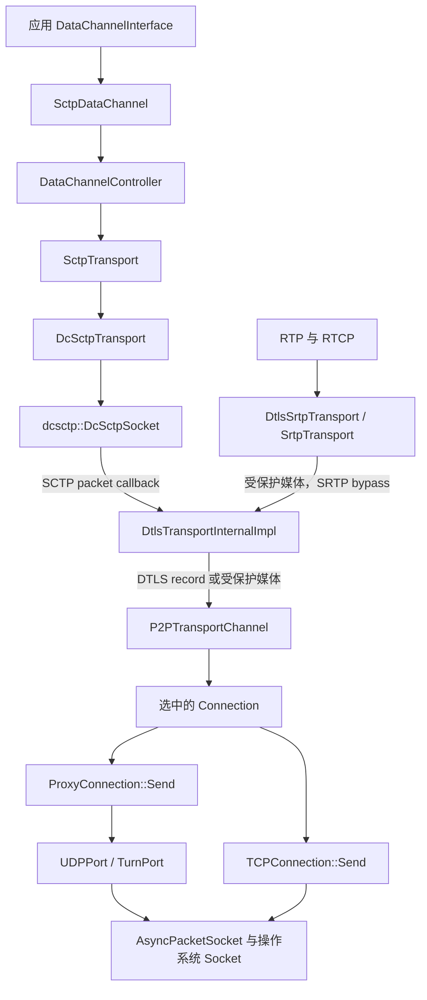
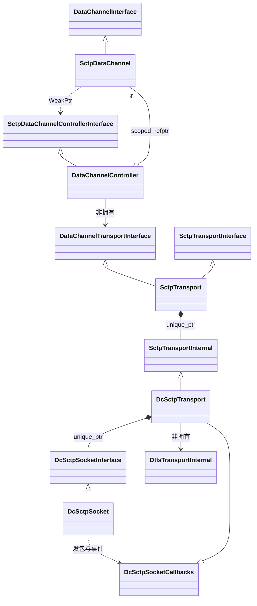
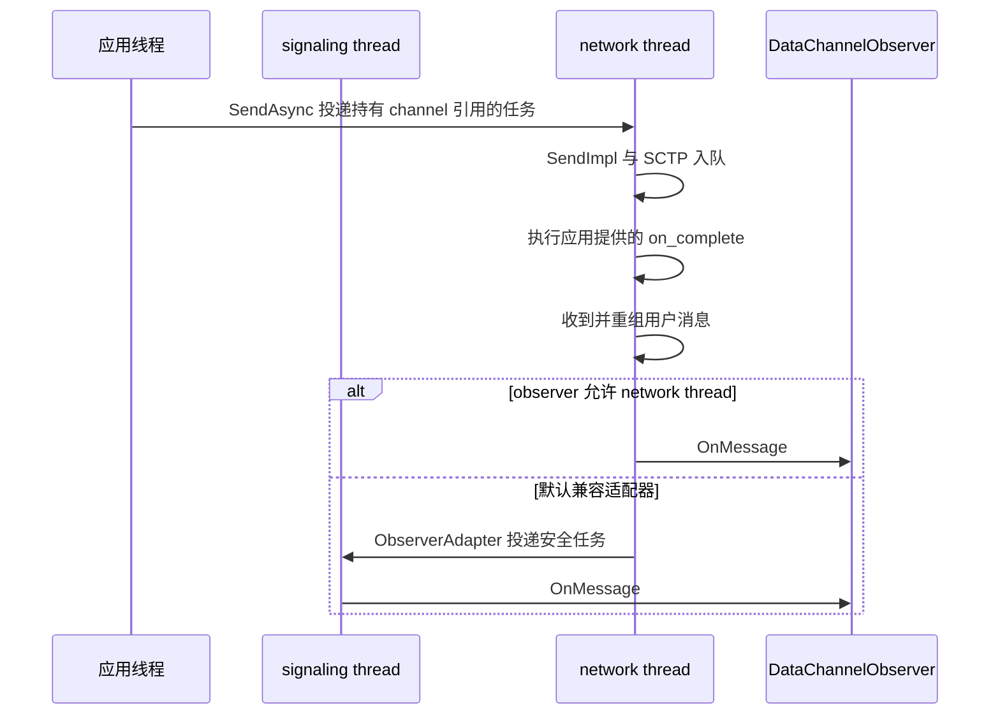
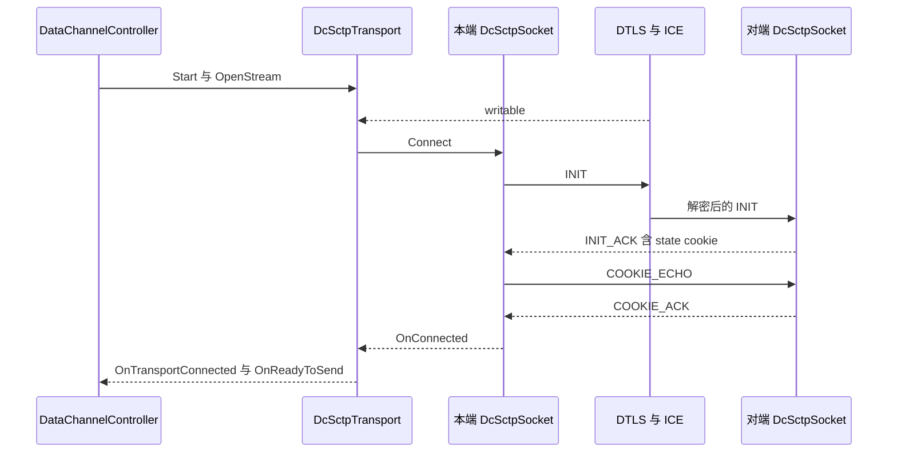
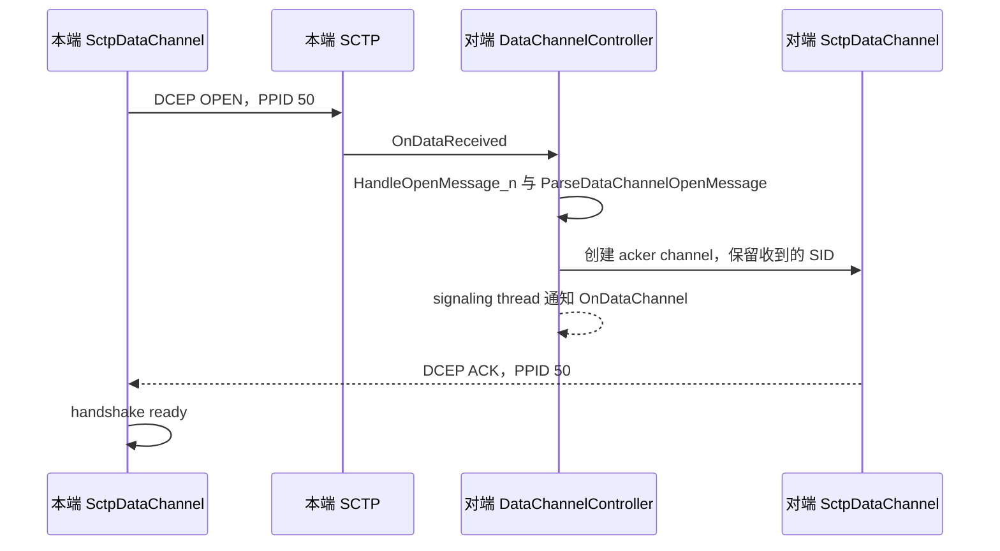
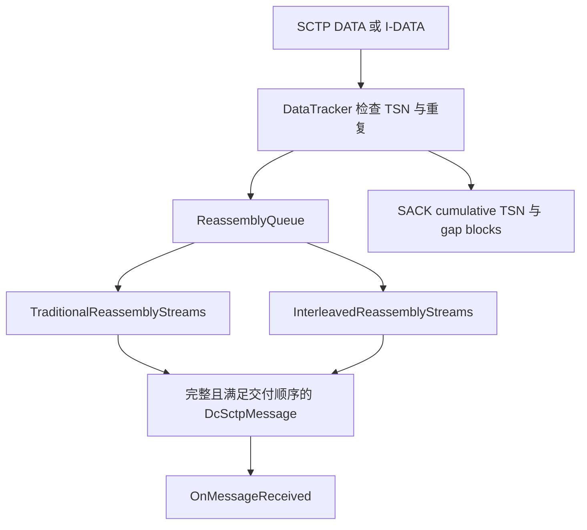
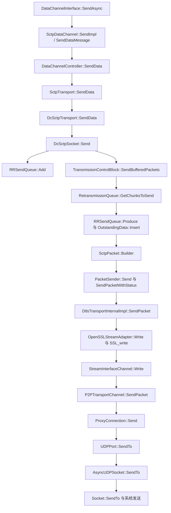
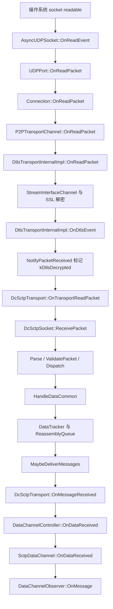
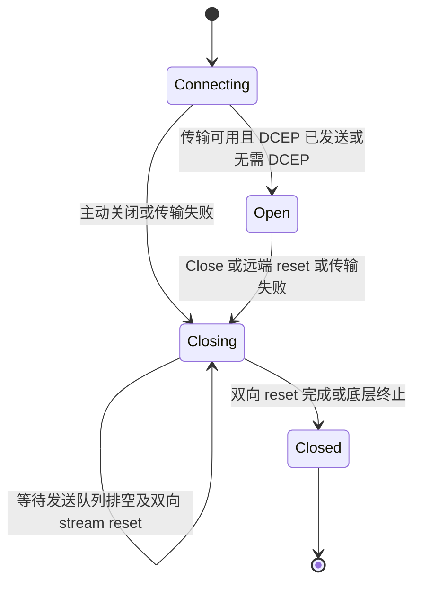

# DataChannel 与 dcSCTP 技术架构

本文面向需要定位源码、扩展数据传输或排查线上问题的工程师。源码基线为 `webrtc_src` 提交 `9310b29acd9e0985ab65f454959122336e3b7e78`。以下默认使用该版本原生 PeerConnection、内置 dcSCTP 后端与普通 SCTP 握手；实验开关和可选分支单独说明。

阅读导航：[总览](README.md) · [整体架构](webrtc-architecture.md) · [Socket/ICE](socket-ice-stun-turn.md) · [DTLS/SRTP](dtls-srtp-packet-flow.md) · [dcSCTP 拥塞控制](dcsctp-congestion-control.md) · [传输 FAQ](transport-faq.md)。

## 1. 先确定 DataChannel 在传输栈中的位置

DataChannel 提供 **保留消息边界、可选顺序与可靠性、一个连接内多路复用** 的双向消息服务。它没有独立创建一个操作系统 SCTP socket，也不通过 SRTP 发送数据。dcSCTP 是用户态协议库，序列化的 SCTP packet 交给 DTLS，DTLS 再交给 ICE 选中的底层路径。

图中的合流表示同一 ICE/DTLS transport 被复用时的情况，不表示任何 PeerConnection 都只创建一个 UDP socket。BUNDLE、候选收集、不同网络接口、TURN 和 ICE 切换都影响实际对象数量，详见 [Socket/ICE](socket-ice-stun-turn.md)。

媒体与 DataChannel 即便共用路径，也使用不同的可靠性与拥塞控制。媒体 GCC 调整媒体发送，dcSCTP 通过 SACK、重传和 `cwnd` 控制 SCTP association；没有一个由 SCTP 自动共享给媒体的统一带宽额度，详见 [GCC/TCC](gcc-tcc.md)。

## 2. 类职责、持有关系与线程

### 2.1 从接口到实现

- `DataChannelInterface` 是应用持有的引用计数接口，定义 `SendAsync`、`Close`、状态、统计和 observer。返回给调用方的对象通常是代理。
- `SctpDataChannel` 对应一个逻辑 channel，持有配置、DCEP 状态、接收暂存队列和统计；通过弱引用访问 controller。
- `DataChannelController` 管理该 PeerConnection 的 channel 集合、SID 分配、传输绑定，按 SID 分发消息，并处理对端发来的 DCEP OPEN。
- `DataChannelTransportInterface` 定义 controller 所需的消息级服务；`SctpTransport` 实现它，同时实现公开的 `SctpTransportInterface`。
- `SctpTransport` 用 `unique_ptr<SctpTransportInternal>` 拥有内部后端，向外暴露 association 状态、最大消息大小、最大 channel 数与 DTLS transport。
- `SctpTransportInternal` 是内部 SCTP 抽象；本版本默认工厂创建 `DcSctpTransport`，编译受 `WEBRTC_HAVE_DCSCTP` 控制。
- `DcSctpTransport` 把 WebRTC 的 SID、消息类型、可靠性参数映射到 dcSCTP；实现 `DcSctpSocketCallbacks`，提供发包、时钟、随机数和定时器。
- `dcsctp::DcSctpSocket` 实现 association 状态机、chunk 解析、发送排队、拥塞控制、重传与重组。它通过回调访问网络，不持有 UDP fd。

源码入口：[工厂](../webrtc_src/media/sctp/sctp_transport_factory.cc#L30)、[SctpTransport 定义](../webrtc_src/pc/sctp_transport.h#L45)、[DcSctpTransport 定义](../webrtc_src/media/sctp/dcsctp_transport.h#L55)、[DataChannelController 定义](../webrtc_src/pc/data_channel_controller.h)、[SctpDataChannel 定义](../webrtc_src/pc/sctp_data_channel.h)。

### 2.2 线程模型不能沿用旧版本印象

本版本 `SctpDataChannel` 的可变传输状态主要在 **network thread** 上维护；controller 的 channel 集合、`SctpTransport`、`DcSctpTransport` 和 dcSCTP 也在该线程执行。signaling thread 负责 PeerConnection API 协作与默认应用通知。不要把当前实现写成 “DataChannel 所有逻辑都在 signaling thread”。

代理将同步 `Send`、`Close`、`buffered_amount` 等操作转到 network thread。`SendAsync` 绕过代理方法分发，但自身总是 `PostTask` 到 network thread，并捕获 `scoped_refptr<SctpDataChannel>` 保持对象存活。完成回调表示本地发送请求处理结果，不表示对端已确认消息。

`DataChannelObserver::IsOkToCallOnTheNetworkThread()` 决定是否直接在 network thread 回调。默认不允许时，`ObserverAdapter` 把事件投递到 signaling thread，使用安全标志屏蔽失效任务，并缓存事件时刻的状态，避免回调中查询状态得到后来变化的值。

`on_complete` 在 network thread 执行，调用方需要自行完成线程切换。源码：[代理映射](../webrtc_src/pc/sctp_data_channel.cc#L57)、[observer 适配](../webrtc_src/pc/sctp_data_channel.cc#L180)、[SendAsync](../webrtc_src/pc/sctp_data_channel.cc#L603)。

## 3. 三层标识与协商边界

### 3.1 Association、stream、channel

一个 SCTP association 是两端 SCTP 实例之间的协议关联，拥有本方向 TSN 空间、拥塞窗口、接收窗口反馈、RTT/RTO 和重传状态。一个 association 内有多个单向 SCTP stream；WebRTC 用相同 SID 的一对相反方向 stream 表达一个双向 DataChannel。

- `SID` 标识 stream。不同 channel 通常使用不同 SID。
- `TSN` 标识本方向每个 DATA/I-DATA chunk，跨 stream 共享，服务于确认和重传。
- 传统 DATA 的 `SSN` 表达某个 stream 内有序消息序号。
- I-DATA 的 `MID` 标识消息，`FSN` 标识消息分片；有序与无序消息维护对应的编号状态。
- channel 的 `label`、`protocol` 是应用元数据；它们不是网络地址或路由键。
- SCTP header 的 source/destination port 是 SCTP 逻辑端口，例如 `5000`；不是 ICE UDP socket 的本地和远端端口。

多 channel 可以隔离有序交付关系，却仍然共享 association 的 `cwnd`、`rwnd`、网络路径和发送机会。创建更多 channel 不会自动得到更多总带宽。

### 3.2 SDP 配置 association，DCEP 配置 channel

典型 application media section 包含 `UDP/DTLS/SCTP webrtc-datachannel`、`a=sctp-port`、`a=max-message-size`，同时继承该传输的 ICE、DTLS fingerprint、setup 与 BUNDLE 关系。它协商 SCTP transport，不为每个 DataChannel 新建一个 media section。

完整本地/远端 offer-answer 存在后，`SdpOfferAnswerHandler` 调用 `StartSctpTransport`，下推 `SctpOptions`：本地端口、远端端口、最大消息大小、最大 stream 数，以及可选 `sctp-init` connection token。

本版本最大消息大小取本地与远端上限的较小值；远端值为 `0` 时表示远端不指定上限，使用本地上限。`SctpOptions` 默认本地上限是 `256 KiB`，真正生效值必须查看协商结果。它与每 stream 的发送排队上限、SCTP packet MTU 是三个不同概念。

源码：[SDP 下推](../webrtc_src/pc/sdp_offer_answer.cc#L5500)、[SctpOptions](../webrtc_src/api/sctp_transport_interface.h#L159)、[DcSctpTransport::Start](../webrtc_src/media/sctp/dcsctp_transport.cc#L197)。

### 3.3 SID 分配与 DTLS 角色

`SctpSidAllocator::AllocateSid` 按 DTLS 角色分配：client 取偶数 SID，server 取奇数 SID，以避免双方同时建 channel 冲突。DTLS client/server 与 SDP offerer/answerer、ICE controlling/controlled 不是同一角色。

DTLS 角色尚未确定时，channel 可以先存在而 SID 尚未分配；随后 `AllocateSctpSids` 补齐。应用预协商 channel 显式使用的 SID 走保留与范围检查，调用方必须保证两端配置一致。当前允许的最大 SID 为 `65534`，还受 association 实际协商的 stream 数约束。

源码：[SID 分配](../webrtc_src/pc/sctp_data_channel.cc#L141)、[ReserveOrAllocateSid](../webrtc_src/pc/data_channel_controller.cc#L360)、[AllocateSctpSids](../webrtc_src/pc/data_channel_controller.cc#L471)。

## 4. 从建链到 channel open

### 4.1 SCTP 握手

`DcSctpTransport::Start` 创建 socket，但只有底层 DTLS transport 可写且 socket 为 closed 时，`MaybeConnectSocket` 才调用 `Connect`。因此 “已创建 channel”“ICE 已连接”“DTLS 已连接”“SCTP association 已连接”“channel 已 open” 是不同状态。

INIT/INIT_ACK 交换 verification tag、初始 TSN、接收窗口、stream 数和扩展能力。COOKIE 用于验证建链状态；`DcSctpSocket` 处理同时打开、重试、重启等分支。上述 SCTP 报文均封装在 DTLS application data 内，不是裸 SCTP/IP。

当前版本另有 `ConnectWithConnectionToken`：当双方 `local_init`、`remote_init` 都存在时，使用经信令交换的初始化 token 建立状态。这是明确的可选分支，不能拿四报文握手覆盖所有运行配置，也不能因本端存在 token 就认定该分支已启用。

源码：[普通连接](../webrtc_src/net/dcsctp/socket/dcsctp_socket.cc#L316)、[token 连接](../webrtc_src/net/dcsctp/socket/dcsctp_socket.cc#L367)、[连接触发条件](../webrtc_src/media/sctp/dcsctp_transport.cc#L759)。

### 4.2 DCEP OPEN/ACK

`negotiated=false` 使用 DCEP。OPEN 包含消息类型、channel type、priority、reliability parameter、label 长度、protocol 长度及内容。channel type 同时表达 ordered/unordered 与可靠、按重传次数或按时间限制的可靠性。

有两个实现细节直接影响抓包解释：

1. 本端 OPEN 成功交给 transport 后进入 `kHandshakeWaitingForAck`，`UpdateState` 就可以把 channel 设置为 `kOpen`，不要求先收到 ACK。
2. 对于配置为 unordered 的 channel，在 ACK 或首个用户消息到来前，用户数据仍强制 ordered，保证对端先处理 OPEN。收到 ACK 或用户消息后才能解除这一保护。

DCEP 控制消息不继承用户数据的重传次数/时间限制；OPEN 强制 ordered。源码：[编解码](../webrtc_src/pc/sctp_utils.cc#L62)、[open 状态推进](../webrtc_src/pc/sctp_data_channel.cc#L805)、[控制消息发送](../webrtc_src/pc/sctp_data_channel.cc#L985)、[ACK 处理](../webrtc_src/pc/sctp_data_channel.cc#L712)。

### 4.3 应用预协商

`negotiated=true` 把握手角色置为 `kNone`，不发送 DCEP OPEN/ACK。两端应用必须自行约定 SID、语义和配置，并分别创建 channel；对端不会通过收到 OPEN 自动生成 `OnDataChannel` 事件。它仍然需要 ICE、DTLS、SCTP association 可用，不是绕过底层握手。

源码：[InternalDataChannelInit](../webrtc_src/pc/sctp_data_channel.cc#L89)、[对应测试](../webrtc_src/pc/sctp_data_channel_unittest.cc#L400)。

## 5. 消息类型与可靠性如何编码

`DcSctpTransport::SendData` 把 `DataMessageType` 转换成 PPID：DCEP 为 `50`，非空文本为 `51`，非空二进制为 `53`，空文本为 `56`，空二进制为 `57`。SCTP 不发送零长度用户消息，所以空消息实际携带一个零字节；接收端依据空 PPID 还原为空 payload。

`52`、`54` 是旧式部分消息 PPID，本版本接收类型转换兼容这些值，但发送不使用这种分片方式。正常大消息分片在 SCTP DATA/I-DATA 层完成，不能把旧 PPID partial 与 PR-SCTP 的部分可靠性混为一谈。

消息参数独立决定两个维度：

- `ordered=true` 要求本 stream 内有序交付，默认使用此值；`ordered=false` 允许完整消息越过尚未完整交付的其他消息。
- 未指定可靠性限制时按可靠消息处理。
- `maxRetransmits=N` 限制丢失后最多再重传 N 次；`0` 仍有首次发送，不表示完全绕过拥塞控制。
- `maxRetransmitTime=T` 映射到 `SendOptions::lifetime`，以本地 SCTP 入队时刻计时，不是远端交付时限或绝对单向延迟保证。
- 两种可靠性限制不能同时指定；`InternalDataChannelInit::IsValid` 会拒绝该组合。

部分可靠性必须经 association 能力协商。未协商成功时，`RetransmissionQueue` 不对已分配 TSN 的数据实施有限重传/前移 TSN；它按无限重传处理这些 chunk。发送队列中尚未开始的过期消息仍可能由 `RRSendQueue` 本地丢弃。这一边界比简单写成 “配置超时就一定按时丢包” 更准确。

源码：[PPID 与空消息](../webrtc_src/media/sctp/dcsctp_transport.cc#L73)、[SendOptions 映射](../webrtc_src/media/sctp/dcsctp_transport.cc#L351)、[配置互斥](../webrtc_src/pc/sctp_data_channel.cc#L125)、[可靠性能力使用](../webrtc_src/net/dcsctp/tx/retransmission_queue.cc#L493)。

## 6. SCTP packet、分片与重组

### 6.1 报文层次

一个 SCTP packet 由 12 字节 common header 和一个或多个 chunk 组成。common header 是 source port、destination port、verification tag、CRC32c。chunk 公共头包含 type、flags、length，序列化按 4 字节对齐。

传统 DATA chunk 的头部为 16 字节，包含 TSN、SID、SSN、PPID；I-DATA 头部为 20 字节，使用 MID、FSN 与首片 PPID 的编码关系表达交织消息。B/E 标记消息开始与结束，U 标记无序，I 标记要求立即 SACK。

SCTP CRC32c 用于报文错误检测，不替代 DTLS 的身份验证、机密性和认证。当前默认检查 CRC；库支持经协商的 zero-checksum 选项，但 `DcSctpTransport::CreateDcSctpOptions` 没有默认开启。不能因为下层是 DTLS 就认定本工程已经省略 CRC。

源码：[packet header 与 builder](../webrtc_src/net/dcsctp/packet/sctp_packet.h#L28)、[CRC 与解析](../webrtc_src/net/dcsctp/packet/sctp_packet.cc#L92)、[DATA](../webrtc_src/net/dcsctp/packet/chunk/data_chunk.h)、[I-DATA](../webrtc_src/net/dcsctp/packet/chunk/idata_chunk.h)。

### 6.2 MTU 不是 max-message-size

默认 SCTP packet MTU 为 `1191` 字节，不包含 IP、UDP、TURN、DTLS 头。这个保守值从 IPv6 的 1280 字节最小 MTU，减去 IPv6、UDP、假定 DTLS/GCM 与 TURN ChannelData 开销得到。它是本实现的配置值，不是对所有密码套件和网络路径实测得到的 PMTU。

`SctpPacket::Builder` 预留 common header，`RetransmissionQueue` 根据 packet 剩余空间、`cwnd` 和 `rwnd` 限制可取的 chunk 大小。`RRSendQueue::OutgoingStream::Produce` 才按预算产生用户消息分片。packet 可以合并多个 chunk，也可以合并 SACK 等控制 chunk，所以不能把一次应用 `Send`、一个 SCTP chunk、一个 DTLS record、一个 UDP datagram 视为相同单位。

源码：[MTU 配置](../webrtc_src/net/dcsctp/public/dcsctp_options.h#L21)、[分片产生](../webrtc_src/net/dcsctp/tx/rr_send_queue.cc#L148)。

### 6.3 DATA 与 I-DATA 的协商

本版本 WebRTC 适配层只有在 Field Trial `WebRTC-DataChannelMessageInterleaving` enabled 时，才打开本地 `enable_message_interleaving`。`ComputeCapabilities` 还要求对端支持 I-DATA 与 I-FORWARD-TSN，两项都满足才启用。

未启用时，发送调度以完整消息为边界，同一大消息的多个 DATA fragment 连续占用调度机会。启用时，多个 stream 的 I-DATA fragment 可以交织，减轻大消息对小消息的发送阻塞。它不会取消同一 ordered stream 内的顺序要求，也不会消除共享拥塞窗口。

重组由 `ReassemblyQueue` 按协商结果选择实现。默认接收缓存上限为 `5 MiB`。达到高水位后优先接受能补齐 cumulative TSN 的 chunk；满且没有可交付完整消息时会因资源耗尽中止 association。本适配层默认使用回调交付，不启用库的 receive pull mode；完整消息被向上取走后释放重组队列占用。

源码：[能力交集](../webrtc_src/net/dcsctp/socket/dcsctp_socket.cc#L99)、[Field Trial 映射](../webrtc_src/media/sctp/dcsctp_transport.cc#L775)、[重组实现选择](../webrtc_src/net/dcsctp/rx/reassembly_queue.cc#L40)、[接收内存保护](../webrtc_src/net/dcsctp/socket/dcsctp_socket.cc#L1132)。

## 7. 发送方向的完整调用链

以 BUNDLE 后选中 UDP 直连的普通数据消息为例：

`DcSctpTransport::SendPacketWithStatus` 的 `transport_` 静态类型是 `DtlsTransportInternal*`。普通工厂装配下动态实现是 `DtlsTransportInternalImpl`，调用 flags 为 `0`，所以走 DTLS 加密分支。媒体已经过 SRTP 保护时使用的 `PF_SRTP_BYPASS` 分支与这里不同。

`DcSctpSocket::Send` 返回 success 的语义是请求通过校验并进入发送处理；没有窗口时消息留在 `RRSendQueue`。packet callback 返回 success 也不等于收到远端 SACK，更不等于远端应用消费了消息。

本版本 `PacketSender` 对 `kTemporaryFailure` 返回失败，没有额外保存完整 packet 进行底层就绪重发；后续恢复依赖协议中已保存的数据及重传/握手定时器。`StreamInterfaceChannel::Write` 还存在调用 ICE `SendPacket` 后直接报告写入成功的边界，因此不能假设每层返回值都等价于操作系统成功发送。

源码：[应用发送](../webrtc_src/pc/sctp_data_channel.cc#L579)、[controller 发送](../webrtc_src/pc/data_channel_controller.cc#L73)、[wrapper 发送](../webrtc_src/pc/sctp_transport.cc#L96)、[packet 回调](../webrtc_src/media/sctp/dcsctp_transport.cc#L447)、[PacketSender](../webrtc_src/net/dcsctp/socket/packet_sender.cc#L30)、[DTLS 写入](../webrtc_src/p2p/dtls/dtls_transport.cc#L640)、[下层 adapter](../webrtc_src/p2p/dtls/dtls_transport.cc#L180)、[ICE 发送](../webrtc_src/p2p/base/p2p_transport_channel.cc#L1627)、[连接发送](../webrtc_src/p2p/base/connection.cc#L1905)、[UDPPort](../webrtc_src/p2p/base/stun_port.cc#L311)。

## 8. 接收方向的完整调用链

接收侧至少经过四次不同性质的分流：

1. Socket/Port 按地址、STUN 事务和连接识别数据来源。
2. DTLS transport 区分 DTLS record 与 SRTP 媒体；解密的 application data 标为 `kDtlsDecrypted`。
3. `DcSctpTransport::OnTransportReadPacket` 只接受该标记；dcSCTP 校验长度、CRC、verification tag，按 chunk type 分发。SACK、INIT、RE-CONFIG 等不会直接变成应用消息。
4. 完整用户消息按 PPID 还原 control/text/binary，然后 controller 先检查 DCEP OPEN，再按 SID 找 channel。未知 PPID 会被丢弃。

`DataTracker` 的确认代表 SCTP 收到了 chunk，独立于应用 observer 是否运行。未注册 observer 或 channel 暂不能交付时，`SctpDataChannel` 可以暂存完整消息，当前上限为 `16 MiB`，溢出会关闭该 channel。这与 SCTP 重组缓存的 `5 MiB` 是不同层的额度。

源码：[UDP 接收](../webrtc_src/rtc_base/async_udp_socket.cc#L137)、[Port 分发](../webrtc_src/p2p/base/stun_port.cc#L404)、[DTLS 解密输出](../webrtc_src/p2p/dtls/dtls_transport.cc#L991)、[SCTP 输入过滤](../webrtc_src/media/sctp/dcsctp_transport.cc#L743)、[socket 接收](../webrtc_src/net/dcsctp/socket/dcsctp_socket.cc#L842)、[用户消息交付](../webrtc_src/net/dcsctp/socket/dcsctp_socket.cc#L1553)、[channel 接收](../webrtc_src/pc/sctp_data_channel.cc#L712)。

TURN 中继时 Port 层先处理 TURN 封装，TCP 时先恢复报文边界，再向 ICE 提交内部报文；上面的 SCTP 与 DataChannel 层次保持成立，底部具体 Socket 路径按候选类型变化。

## 9. `buffered_amount`、背压和应用发送策略

`buffered_amount` 通过 channel → controller → transport → socket 查询到 `RRSendQueue` 中该 stream 尚未产生并交给传输的数据字节。`OutgoingStream::Produce` 每取出 fragment 就扣减计数，**已发送但尚未 SACK 确认的字节不计入该值**；它们由 `OutstandingData` 管理。

因此 `buffered_amount == 0` 不能证明消息已到达，更不能证明业务执行成功。需要此语义的应用应在消息协议中增加业务确认、超时与去重。

当前 WebRTC 适配层设置：

- per-stream queue limit 为 `DataChannelInterface::MaxSendQueueSize()`，即 `16 MiB`。
- 全 association 的 `max_send_buffer_size` 设置为 `size_t` 最大值，因此不能误引 dcSCTP 库默认值 `2,000,000` 字节作为当前 WebRTC 全局限制。
- `InternalSend` 检查的是入队前队列是否已经达到上限，不能把该数值解释成逐字节绝不超过的硬内存预算。
- 上层 buffered amount 通知有批量合并；当前 `MaybeSendOnBufferedAmountChanged` 使用 `100 KiB` 差值或归零触发。旧注释里出现的其他数值不应覆盖实际常量。

工程上应控制单次消息大小和待发送字节，按低水位恢复生产，避免一直 `Send` 到队列耗尽。本版本 `SctpDataChannel::SendDataMessage` 的任何 transport 发送错误都会走 `CloseAbruptlyWithError`；虽然函数仍带有旧式 `queue_if_blocked` 参数和历史注释，却没有相应的自动重排队分支。不要把队列满时的返回值当成 “稍后重试即可且 channel 保持 open” 的承诺。

源码：[队列扣减](../webrtc_src/net/dcsctp/tx/rr_send_queue.cc#L198)、[入队检查](../webrtc_src/net/dcsctp/socket/dcsctp_socket.cc#L577)、[适配层配置](../webrtc_src/media/sctp/dcsctp_transport.cc#L775)、[发送错误行为](../webrtc_src/pc/sctp_data_channel.cc#L943)、[通知合并](../webrtc_src/pc/sctp_data_channel.cc#L897)。

## 10. Channel 关闭、传输失败与对象销毁

主动 `Close` 先进入 closing，等待该 stream 的发送队列归零，再调用 controller `RemoveSctpDataStream` → `SctpTransport::CloseChannel` → `DcSctpTransport::ResetStream` → `DcSctpSocket::ResetStreams`。

SCTP 使用 RE-CONFIG 与 stream reset 协议，不用 DCEP CLOSE 报文。重置包含 sender last assigned TSN 等约束，保证对端处理关闭前的数据；`ReassemblyQueue` 必要时暂存 reset 之后的数据，直到累计确认到达对应位置。每个方向的 reset 完成都有独立回调。

`DcSctpTransport::StreamState` 记录 `closure_initiated`、`incoming_reset_done`、`outgoing_reset_done`。收到远端 reset 时，本端也重置相反方向；两个方向完成才通知 channel closed，controller 释放 SID。一个 channel 关闭不要求关闭整个 association。stream reset 依赖对端协商 RE-CONFIG 能力；`DcSctpSocket::ResetStreams` 在未支持时返回 `kNotSupported`。当前 `DcSctpTransport::ResetStream` 没有把这个返回值继续映射为同步关闭结果，所以排查关闭停留时也必须检查能力与错误日志，不能假定任何对端都能完成正常 reset。

传输中止时，`OnAborted` 构造包含 `SCTP_FAILURE` 的 `RTCError`；controller 向所有关联 channel 传播关闭。DTLS 状态重新变为 new 时，`DcSctpTransport` 清空旧 socket，之后重新创建/连接，避免继续使用旧 association 状态与新 DTLS 身份混传。

销毁时 controller 先停止 signaling 任务、解除 transport sink、关闭 channel 集合并使弱引用失效；`SctpTransport::Clear` 释放内部后端，`DcSctpTransport` 关闭其 socket。阅读自定义装配代码时要核对回调的生命周期：`transport_` 是非拥有指针，不能假定 `DcSctpTransport` 拥有并独立销毁 DTLS transport。当前定义了 `DisconnectTransportSignals`，但该函数不能作为“析构必定逐项取消订阅”的证据，析构实现只直接关闭 socket。

源码：[channel 关闭状态推进](../webrtc_src/pc/sctp_data_channel.cc#L805)、[双向 reset 完成](../webrtc_src/media/sctp/dcsctp_transport.cc#L591)、[controller teardown](../webrtc_src/pc/data_channel_controller.cc#L272)、[SctpTransport::Clear](../webrtc_src/pc/sctp_transport.cc#L163)、[DcSctpTransport 析构](../webrtc_src/media/sctp/dcsctp_transport.cc#L180)、[DTLS restart](../webrtc_src/media/sctp/dcsctp_transport.cc#L714)。

## 11. 调试与验证入口

排查 “channel open 但收不到消息” 时，按以下顺序缩小范围：

1. 确认 `negotiated` 与 SID，两端是否都创建了正确 channel，是否收到 DCEP OPEN/ACK。
2. 确认 `SctpTransport::Information` 与 DTLS 可写状态；不能只看 ICE connected。
3. 记录 `SendAsync` 完成结果、channel error、`buffered_amount`，区分校验失败、排队和已发未确认。
4. 在 dcSCTP 日志观察 TSN、SACK cumulative/gap、`cwnd`、`rwnd`、T3-rtx；大消息长时间阻塞时检查 interleaving 是否实际协商成功。
5. 观察完整消息是否已到 `OnMessageReceived`、SID 是否存在、observer 回调线程是否被阻塞。

源码自带的 `TextPcapPacketObserver` 在 verbose 日志条件下提供 SCTP 层报文观察点。真实网络抓包通常只能看到 DTLS 密文，不能直接从 UDP payload 读出 TSN 或 DCEP；需要匹配层次正确的日志与测试注入点。

已核对的行为测试入口：

- [DCEP 与 ordered 保护测试](../webrtc_src/pc/sctp_data_channel_unittest.cc#L254)。
- [预协商不发 OPEN 测试](../webrtc_src/pc/sctp_data_channel_unittest.cc#L400)。
- [双向与同时关闭测试](../webrtc_src/media/sctp/dcsctp_transport_unittest.cc#L122)。
- [传输销毁时存在待发数据测试](../webrtc_src/pc/sctp_data_channel_unittest.cc#L585)。
- [stream 调度和加权公平测试](../webrtc_src/net/dcsctp/tx/stream_scheduler_test.cc#L402)。

构建归属分别是 [pc:sctp_data_channel](../webrtc_src/pc/BUILD.gn#L852)、[pc:data_channel_controller](../webrtc_src/pc/BUILD.gn#L928)、[pc:sctp_transport](../webrtc_src/pc/BUILD.gn#L659)、[media:rtc_data_dcsctp_transport](../webrtc_src/media/BUILD.gn#L725)、[net/dcsctp/socket:dcsctp_socket](../webrtc_src/net/dcsctp/socket/BUILD.gn#L117)。这也是修改后的最小构建与测试定位起点；本文为源码说明，没有宣称运行这些测试。

规范补充：[WebRTC Data Channels / RFC 8831](https://www.rfc-editor.org/rfc/rfc8831)、[DCEP / RFC 8832](https://www.rfc-editor.org/rfc/rfc8832)、[SCTP over DTLS / RFC 8261](https://www.rfc-editor.org/rfc/rfc8261)、[消息交织 / RFC 8260](https://www.rfc-editor.org/rfc/rfc8260)。规范说明协议约束，本工程的默认值和启用条件以上述源码为准。
