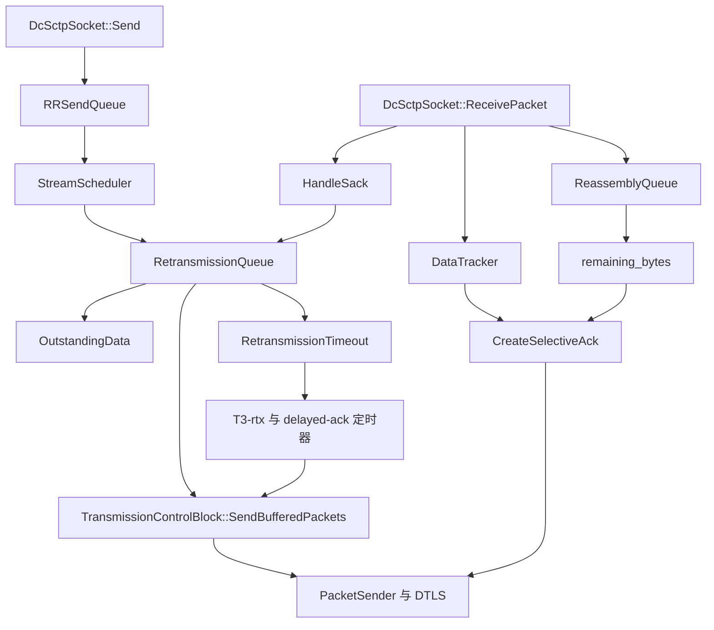
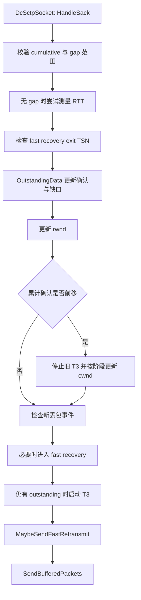
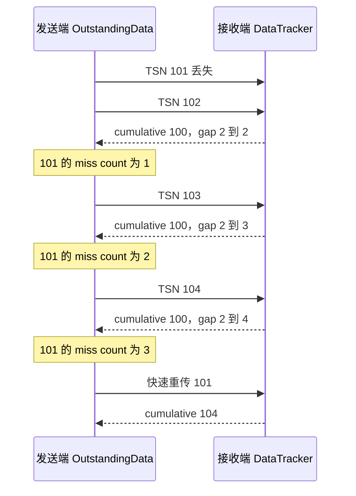
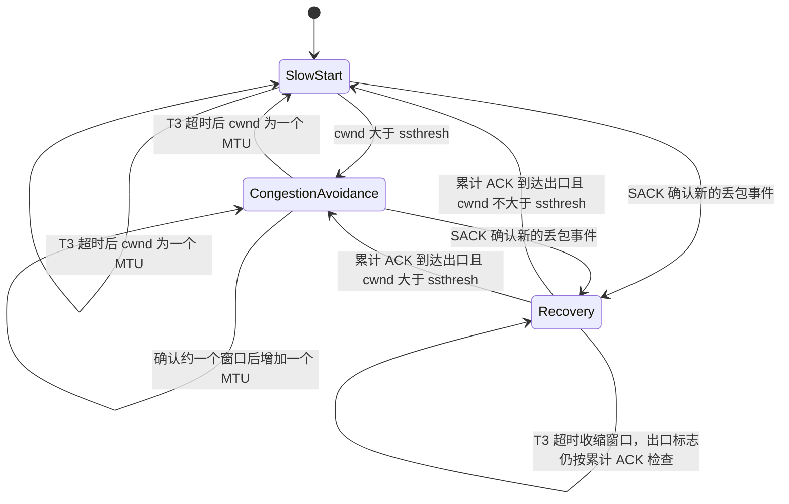
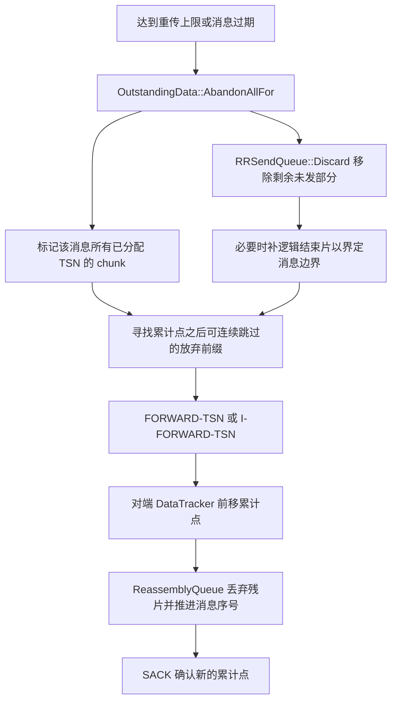
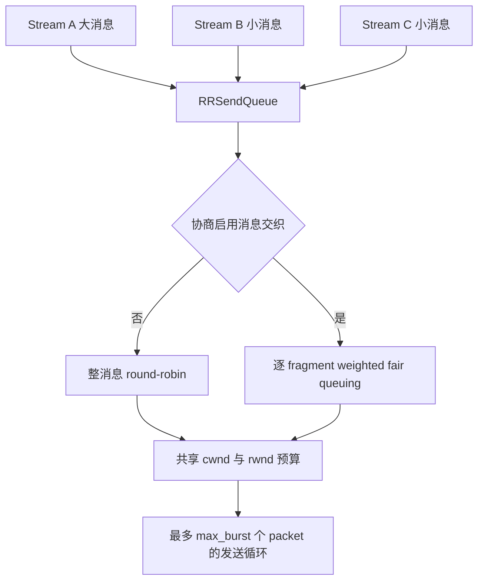

# dcSCTP 拥塞控制、可靠性与队列调度

本文分析提交 `9310b29acd9e0985ab65f454959122336e3b7e78` 中的实际实现。关注点是工程师如何从队列、窗口、ACK、定时器与消息配置，解释吞吐量、卡顿、重传和内存占用。这里的 dcSCTP 是 DataChannel 使用的用户态 SCTP 后端；基础架构见 [DataChannel 与 dcSCTP](datachannel-dcsctp.md)。

阅读导航：[总览](README.md) · [整体架构](webrtc-architecture.md) · [GCC/TCC](gcc-tcc.md) · [网络指标](network-metrics.md) · [传输 FAQ](transport-faq.md)。

## 1. 控制对象是 association，不是单个 channel

同一 association 中，本端向对端发送的多个 DataChannel 共享一个发送拥塞控制状态。`cwnd`、`ssthresh`、在途字节、RTT/RTO、SACK 处理与发送端看到的 `rwnd` 都在这个范围内。反方向由对端自己的发送状态控制，不与本方向共用一个 `cwnd`。

本实现采用 **慢启动、拥塞避免、SACK 驱动的快速重传/恢复，以及 T3-rtx 超时收缩** 的窗口控制。它没有调用媒体的 `GoogCcNetworkController`，没有用 RTP transport sequence number 或 RTCP TCC 给 SCTP 数据做带宽估计，也不是基于 delay trend 的 GCC。

应用观测到的发送能力至少受到四个条件约束：

1. 网络拥塞窗口是否允许新增在途数据。
2. 接收方可用接收窗口是否足够。
3. 发送队列是否有可调度消息、是否在等待 stream reset。
4. DTLS/ICE/Socket 是否可用。

`buffered_amount` 只描述本地待发送用户数据，不是上述条件的综合值。单看它无法判断拥塞、对端消费停滞或底层断链。

## 2. 核心对象如何形成反馈闭环



职责边界如下：

- `DcSctpSocket` 管 association 状态、入口校验、chunk 分发和上层回调。
- `RRSendQueue` 持有各 stream 的原始消息，直到分片被取走；内部调度由 `StreamScheduler` 实现。
- `TransmissionControlBlock`，下文简称 TCB，聚合一个已建立 association 的收发状态，组装并发送 packet，拥有 `DataTracker`、`ReassemblyQueue`、`RetransmissionQueue`、RTT 估计与相关 timer。
- `RetransmissionQueue` 计算发送预算、维护拥塞状态、处理 SACK，并协调新数据和重传数据。
- `OutstandingData` 按已分配 TSN 保存 chunk 状态、发送时间、重传计数、确认/放弃状态以及重传候选集合。
- `DataTracker` 跟踪收到的 TSN 与 gap，决定何时发送 SACK。
- `ReassemblyQueue` 保存待重组及可交付消息，向 SACK 提供本端剩余接收空间。
- `RetransmissionTimeout` 将 RTT 样本平滑为 SRTT、RTTVAR 与 RTO；`Timer` 实现超时调度和退避。

这些对象在 WebRTC 的 network thread 串行运行。`DcSctpTransport` 用 `TaskQueueTimeoutFactory` 将 timeout ID 的到期映射到 `DcSctpSocket::HandleTimeout`，不是每个 stream 创建一个操作系统线程或 timer thread。

源码：[TCB 构造与连接关系](../webrtc_src/net/dcsctp/socket/transmission_control_block.cc#L52)、[DcSctpTransport timer 适配](../webrtc_src/media/sctp/dcsctp_transport.cc#L151)、[RetransmissionQueue](../webrtc_src/net/dcsctp/tx/retransmission_queue.h)、[OutstandingData](../webrtc_src/net/dcsctp/tx/outstanding_data.h)。

## 3. 字节口径、默认参数与发送预算

### 3.1 几个容易混淆的量

`cwnd` 是本方向允许占用网络的拥塞窗口。`ssthresh` 决定窗口增长阶段。`unacked_packet_bytes` 是当前计为在途的 DATA/I-DATA 序列化 chunk 字节，包含 chunk header 与 4 字节对齐；不包含 SCTP common header、DTLS、UDP、IP 开销。

`unacked_payload_bytes` 只计对应用户 payload，用来扣除对端公告的 `a_rwnd` 中已被在途消息占用的空间。被判定丢失并标记待重传、被放弃或被确认的 chunk 会改变在途计数，不能把 “OutstandingData 容器中仍有记录” 直接等同于 “全部都占 flight size”。

`a_rwnd` 是对端 SACK 公告的接收空间；本端 `rwnd` 是扣除仍在途用户 payload 后的视图：

```text
rwnd = max(0, a_rwnd - unacked_payload_bytes)
```

本地 `buffered_amount` 是 `RRSendQueue` 尚未取出的用户字节。在途数据由另外的 `OutstandingData` 保存，应用不能将这两种统计混用。

源码：[UpdateReceiverWindow](../webrtc_src/net/dcsctp/tx/retransmission_queue.cc#L202)、[NackItem 的计数调整](../webrtc_src/net/dcsctp/tx/outstanding_data.cc#L275)、[发送队列计数扣减](../webrtc_src/net/dcsctp/tx/rr_send_queue.cc#L198)。

### 3.2 当前默认值及 WebRTC 覆盖项

`DcSctpOptions` 的基础值包括：

- SCTP packet MTU `1191` 字节。
- 初始 `cwnd = 10 × MTU = 11910` 字节。
- SACK 丢包事件后最小 `cwnd = 4 × MTU = 4764` 字节。
- 初始 RTO `500 ms`，RTO 最小 `400 ms`，最大 `60000 ms`。
- 每次发送循环 `max_burst = 4` 个 packet。
- delayed ACK 最大 `200 ms`，运行时取 `min(RTO / 2, 200 ms)`。
- 默认接收重组容量 `5 MiB`，高水位为容量的 `90%`。
- 部分可靠性本地支持默认开启；消息交织库默认关闭。

WebRTC 的 `CreateDcSctpOptions` 额外覆盖：timer backoff 最大 `3000 ms`；association 重传失败次数与 INIT 重试次数设为不限制；每 stream 待发送队列设为 `16 MiB`；总待发送队列上限设为 `size_t` 最大值；消息交织由 Field Trial 控制。

这里的 “association 重传次数不限制” 与用户消息 `maxRetransmits` 不是同一配置。前者避免暂时网络故障导致 association 自动终止，后者仍可让某条消息在丢失后被放弃。

源码：[DcSctpOptions](../webrtc_src/net/dcsctp/public/dcsctp_options.h#L21)、[WebRTC 覆盖项](../webrtc_src/media/sctp/dcsctp_transport.cc#L775)。

### 3.3 一次取包的预算

`RetransmissionQueue::GetChunksToSend` 先计算当前 packet 还能容纳多少数据，再从可重传集合中取 chunk，最后才从 `RRSendQueue` 产生新数据：

```text
B_cwnd = max(0, cwnd - unacked_packet_bytes)
B_rwnd = round_up_4(rwnd + data_chunk_header_size)
B_packet = builder.bytes_remaining()
B_send = round_down_4(min(B_cwnd, B_rwnd, B_packet))
```

若当前没有未确认 chunk，即使 `rwnd` 为零也允许一个受 `cwnd` 约束的 DATA chunk 在途，源码把接收窗口预算放宽到一个 MTU。这是零窗口探测/防止停滞所需的特例，不是忽略接收窗口。

例如 `cwnd=12000`，计入在途的 chunk 为 `10000`，packet 剩余 `1176` 字节，对端还有 `5000` 字节接收预算，则本轮最多使用 `1176` 字节 chunk 空间；若 flight 增至 `12000`，普通新数据预算为零。一次快速重传的特定 packet 可以绕过 `cwnd`，见第 6 节。

源码：[GetChunksToSend](../webrtc_src/net/dcsctp/tx/retransmission_queue.cc#L453)。

## 4. SACK 如何驱动整个发送端

### 4.1 SACK 表达什么

SACK 包含累计确认 TSN、公告接收窗口、gap ACK blocks 与重复 TSN。累计确认意味着截至该 TSN 的所有数据已处理；gap blocks 相对于累计点表达后续已收到的区间，并不表示缺口已补齐。

例如累计点为 `100`，接收端已收到 `102`、`103`、`105`，gap blocks 是 `(2,3)` 与 `(5,5)`。发送端由此得知 `101` 和 `104` 尚未确认，但不会仅凭这一个 SACK 就立即重传所有缺口。

`DataTracker` 把连续 TSN 合并为区间，去重，限制反馈中的区间和重复列表数量；`CreateSelectiveAck` 用 `ReassemblyQueue::remaining_bytes` 填 `a_rwnd`。接收端 SCTP 确认不等于应用 observer 已处理消息。

### 4.2 ACK 触发条件

以下情况会要求立即 SACK：association 的首个 DATA、发现 TSN 缺口、重复数据、DATA 的 I bit、延迟 ACK timer 到期等。正常连续数据通常至少每两个 packet 确认一次；注意这里是 packet，不是同一 packet 中的两个 DATA chunk。

如果本端正好要发送数据，TCB 可以把尚处于 delayed 状态的 SACK 搭载在第一份 outbound packet 中。低窗口下，发送端默认在 `cwnd < 10 × MTU` 时设置 I bit，以减少 ACK 延迟导致的停顿。

源码：[DataTracker::Observe](../webrtc_src/net/dcsctp/rx/data_tracker.cc#L137)、[ObservePacketEnd](../webrtc_src/net/dcsctp/rx/data_tracker.cc#L328)、[ACK 搭载和 I bit](../webrtc_src/net/dcsctp/socket/transmission_control_block.cc#L218)。

### 4.3 处理次序影响窗口与 RTT



旧累计确认点的 SACK 被丢弃；累计点相同的 SACK 仍可能包含新的 gap 信息，不能全部过滤。累计 ACK 或 gap 的末端超过本端最高已分配 TSN 的反馈也会被拒绝。

只有 **累计确认前移** 才进入窗口增长逻辑。收到新 gap ACK 可以释放对应在途额度，但不等价于慢启动增加 `cwnd`。这一点常用于解释 “一直在收到 SACK，窗口却不增长”。

源码：[SACK 有效性和处理](../webrtc_src/net/dcsctp/tx/retransmission_queue.cc#L234)、[socket 触发后续发送](../webrtc_src/net/dcsctp/socket/dcsctp_socket.cc#L1583)。

## 5. 慢启动与拥塞避免的实际公式

初始化时 `cwnd = cwnd_mtus_initial × MTU`，`ssthresh` 取对端初始接收窗口。阶段判定是 `cwnd <= ssthresh` 为慢启动，否则为拥塞避免；等号归入慢启动。

为避免 packet/chunk 开销及小碎片影响，本实现把如下条件视为窗口充分利用：

```text
fully_utilized = old_unacked_packet_bytes + MTU >= cwnd
```

### 5.1 慢启动

累计确认前移、窗口充分利用且不处于 fast recovery 时：

```text
cwnd_new = cwnd_old + min(newly_acked_chunk_bytes, MTU)
```

每个符合条件的 SACK 最多增长一个 MTU，而非每确认一个 chunk 就增长一个 MTU。ACK 合并、delayed ACK、应用发送不足、丢包缺口都会影响实际增长速度，因此不应把“每 RTT 严格翻倍”写成代码保证。

例如 `MTU=1191`、`cwnd=11910`、此前 flight 为 `11500`，累计前移的 SACK 新确认 `2400` 字节，则窗口变为 `13101`。如果此前 flight 只有 `2000`，窗口利用条件不成立，`cwnd` 保持不变。

### 5.2 拥塞避免

累计确认前移时，先把该 SACK 新确认的字节计入 `partial_bytes_acked`。只有累计字节达到一个旧窗口且窗口充分利用，才增加一个 MTU：

```text
partial_bytes_acked += newly_acked_chunk_bytes
if partial_bytes_acked >= cwnd and fully_utilized:
    partial_bytes_acked -= cwnd
    cwnd += MTU
```

源码先减旧 `cwnd` 再增加 MTU，并且每次执行一次 `if`，不是循环重复增长。直观上是在充分发送的情况下，每确认约一个窗口的数据增加一个 MTU。

例如已经处于拥塞避免，`cwnd=23820`、`partial_bytes_acked=22000`，此次新确认 `3000` 字节且充分利用，更新后 `partial_bytes_acked=1180`、`cwnd=25011`。若累计确认不前移，本次连 `partial_bytes_acked` 都不按这条路径增加。

源码：[phase 判定](../webrtc_src/net/dcsctp/tx/retransmission_queue.h#L207)、[HandleIncreasedCumulativeTsnAck](../webrtc_src/net/dcsctp/tx/retransmission_queue.cc#L112)。

## 6. 丢包判定、快速重传与快速恢复

### 6.1 不是三个相同 SACK 就重传

`OutstandingData::Item::Nack` 的阈值是三次 miss indication。通常只对 **本次新确认的最高 TSN 之前** 的缺口增加计数：需要持续有新数据被确认，才能积累缺失证据。反复收到完全相同的 gap block，不会无限增加缺口计数。

快速恢复期间，若累计确认点前移，缺口计数规则会扩展到本次报告的缺口范围。没有足够后续数据时，尾部丢包通常不能通过这条路径快速发现，只能等待 T3-rtx。



对应回归测试直接区分了 [相同反馈不触发重传](../webrtc_src/net/dcsctp/tx/outstanding_data_test.cc#L151) 与 [三次有效缺失触发重传](../webrtc_src/net/dcsctp/tx/outstanding_data_test.cc#L174)。

### 6.2 首次进入恢复时收缩一次

未处于 fast recovery 时检测到新的丢包事件：

```text
ssthresh = max(cwnd / 2, cwnd_mtus_min × MTU)
cwnd = ssthresh
partial_bytes_acked = 0
fast_recovery_exit_tsn = highest_outstanding_tsn
```

本版本 `cwnd_mtus_min=4`。例如 `cwnd=23820` 时减为 `11910`；`cwnd=6000` 时减为下限 `4764`。fast recovery 的出口记录发生丢包时最高的 outstanding TSN。

恢复期间后续快速重传事件不再次减半。累计确认到达或越过记录的出口 TSN 才退出 fast recovery。窗口增长阶段与 fast recovery 标志是两个维度：并不是只有一个单独的 “快恢复窗口公式”。

`MaybeSendFastRetransmit` 单独构造一份 MTU 内 packet，放最早需要快速重传的 chunk，允许该 packet 忽略 `cwnd`，避免窗口收缩后连修补缺口都发不出去。剩余重传恢复到正常预算控制。

源码：[缺口处理](../webrtc_src/net/dcsctp/tx/outstanding_data.cc#L227)、[进入/退出快速恢复](../webrtc_src/net/dcsctp/tx/retransmission_queue.cc#L98)、[HandlePacketLoss](../webrtc_src/net/dcsctp/tx/retransmission_queue.cc#L165)、[快速重传 packet](../webrtc_src/net/dcsctp/socket/transmission_control_block.cc#L191)。

## 7. RTT、RTO、T3-rtx 与超时收缩

### 7.1 RTT 样本来源

SACK 路径在无 gap block 时，尝试用该 cumulative TSN 对应 chunk 的当前时刻减首次发送时刻取样。`OutstandingData::MeasureRTT` 排除已重传过的 chunk，遵循 Karn 规则，避免无法区分 ACK 对应原包还是重传包。

心跳路径也可以向同一 `RetransmissionTimeout` 提供 RTT：HEARTBEAT 信息包含本地发送时间，HEARTBEAT_ACK 到达后解析回显时间并计算差值。空闲心跳默认间隔为 30 秒，实际可加当前 RTO；收到 ACK 取样还需通过内容格式和时间有效性校验。

SACK RTT 包含对端 delayed ACK 等待，不能直接等同于 STUN RTT 或单向网络时延。多个协议测出的 RTT 不同通常有测量口径原因，详见 [网络指标](network-metrics.md)。

源码：[SACK 取样](../webrtc_src/net/dcsctp/tx/retransmission_queue.cc#L342)、[Karn 判断](../webrtc_src/net/dcsctp/tx/outstanding_data.cc#L509)、[heartbeat RTT](../webrtc_src/net/dcsctp/socket/heartbeat_handler.cc#L141)。

### 7.2 平滑公式与容易遗漏的方差下限

首个有效 RTT 样本 `R`：

```text
SRTT = R
RTTVAR = R / 2
```

后续样本先使用旧 SRTT 更新方差，再更新均值：

```text
RTTVAR = 0.75 × RTTVAR_old + 0.25 × abs(SRTT_old - R)
SRTT = 0.875 × SRTT_old + 0.125 × R
RTTVAR = max(RTTVAR, min_rtt_variance / 8)
RTO = clamp(SRTT + 4 × RTTVAR, rto_min, rto_max)
```

本版本 `min_rtt_variance=220 ms`，代码还除以 8，因此真正的 RTTVAR 下限为 `27.5 ms`，对 RTO 的贡献下限为 `110 ms`。直接照配置名写 “方差最小 220 ms” 会得到错误结论。

RTT 为负或大于默认 `60000 ms` 时丢弃。默认首次测得 `100 ms`，得到 `SRTT=100 ms`、`RTTVAR=50 ms`，计算值 `300 ms` 被 `rto_min` 提升为 `400 ms`。随后样本 `140 ms` 得到 `SRTT=105 ms`、`RTTVAR=47.5 ms`，计算值 `295 ms` 仍使用 `400 ms`。即使真实 RTT 很小，超时重传仍可能等待较久，这是代码默认值的直接结果。

源码：[RetransmissionTimeout::ObserveRTT](../webrtc_src/net/dcsctp/tx/retransmission_timeout.cc#L39)、[稳定/变化 RTT 测试](../webrtc_src/net/dcsctp/tx/retransmission_timeout_test.cc#L89)。

### 7.3 T3-rtx 生命周期

首次发送有在途数据且 T3 未运行时启动 timer；累计 ACK 前移后停止旧 timer，若仍有 outstanding 则按当前 RTO 重启；所有数据确认完毕后不再启动。快速重传最早未确认 TSN 时同样重启 T3。

T3 到期后：

```text
ssthresh = max(cwnd / 2, 4 × MTU)
cwnd = MTU
partial_bytes_acked = 0
OutstandingData::NackAll()
```

所有未确认 chunk 进入重传或按可靠性约束放弃，发送预算通常只容纳最早的一份 packet。与 SACK 丢包处理不同，这里源码的下限直接写为 `4 × MTU`，且 `cwnd` 收缩至 **一个 MTU**。

指数退避由通用 `Timer` 执行，不是 `HandleT3RtxTimerExpiry` 再手动乘一次。WebRTC 适配层把 backoff 时长上限设为 `3000 ms`，与 RTT 估计器的 `rto_max=60000 ms` 属于不同控制层。`Timer::Start` 直接使用基础 duration，backoff 上限在超时后的指数退避计算中生效，因此不能断言任何一次 timer 等待都绝不超过 3 秒；排查时应同时查看实际 timer 时长和估计 RTO。

COOKIE_ECHO 阶段由 T1-cookie 管重发，TCB 会避免同时由 T3 执行同一阶段的数据重发。协议重试用统一 network task queue 调度，线程阻塞会推迟实际触发时间。



这张图把恢复标志的额外维度保留出来：当前 `HandleT3RtxTimerExpiry` 不直接清空 `fast_recovery_exit_tsn_`，不能画成超时无条件清除所有 recovery 状态。

源码：[T3 到期处理](../webrtc_src/net/dcsctp/tx/retransmission_queue.cc#L359)、[TCB 超时回调](../webrtc_src/net/dcsctp/socket/transmission_control_block.cc#L137)、[Timer 实现](../webrtc_src/net/dcsctp/timer/timer.cc)。

## 8. 部分可靠消息如何真正被放弃

### 8.1 配置起点和生效阶段

`max_retransmissions=N` 约束初次发送之后的重发次数；当三次有效缺失或 T3 超时需要重传时，计数达到上限则放弃整条消息。`N=0` 表示初次发后不再重传，仍然要等待 SCTP 识别缺失，不能视为 UDP 直接发送模式。

`lifetime=T` 从 `RRSendQueue::Add` 入队计时，实际到期时刻为 `now + T + 1 ms`，这样 `T=0` 仍可以在当前时刻被首次发送。未开始分片的消息过期时，队列可以直接丢弃，因为尚未分配 TSN，不需要通知远端跳过一个不存在的 TSN。

已经分片的消息更复杂：`OutstandingData::ExpireOutstandingChunks` 不盲目到时删除所有在途数据，而从累计点之后检查被 NACK 且过期的前缀；当前仍在途而可能已被接收、ACK 尚未到达的 chunk，不按这条路径直接过期。生成新的 chunk 时发现其生命周期已结束，也会进入整条消息放弃。

所以 lifetime 是发送/重传策略，不是远端应用必须在 `T` 毫秒内收到的 SLA。

### 8.2 为什么需要 FORWARD-TSN

某个 TSN 被永久放弃后，接收端仍可能等待缺口；ordered stream 也可能被缺少的消息序号阻塞。发送端必须用 FORWARD-TSN 通知新的累计跳过点及各受影响 stream 的消息序号，接收端才能释放残片并允许后续消息交付。



`AbandonAllFor` 同时清理该消息待产生的剩余部分与已在 outstanding 中的所有 fragment。若发送队列还剩未产生的消息尾部，会创建一个立刻放弃的逻辑结束片占位，保证远端能明确跨过旧消息边界，而不是把后续消息误拼进去。

传统 FORWARD-TSN 携带受影响 ordered stream 的 SSN；I-FORWARD-TSN 使用 ordered/unordered 标识、SID 和 MID，匹配消息交织后的编号空间。当前实现仅从 outstanding 头部连续的已放弃数据构建推进范围，并避开 stream reset 断点，不允许越过仍需可靠交付的前序数据。

TCB 限制重复 FORWARD-TSN 的发送间隔为 `min(200 ms, SRTT)`。推进报文本身也可能丢失，后续发送/定时器再次触发时仍需重发，直到 SACK 反映接收端累计点已前移。

源码：[入队寿命](../webrtc_src/net/dcsctp/tx/rr_send_queue.cc#L362)、[整消息放弃](../webrtc_src/net/dcsctp/tx/outstanding_data.cc#L312)、[过期处理](../webrtc_src/net/dcsctp/tx/outstanding_data.cc#L423)、[推进 TSN 构建](../webrtc_src/net/dcsctp/tx/outstanding_data.cc#L552)、[发送节流](../webrtc_src/net/dcsctp/socket/transmission_control_block.cc#L171)。

### 8.3 能力未协商时的边界

本地 `enable_partial_reliability=true` 还需要对端 INIT/INIT_ACK 声明 Forward-TSN 支持。若能力交集不支持，`RetransmissionQueue::GetChunksToSend` 为已分配 TSN 的数据使用无限重传与无限过期时刻，不生成 FORWARD-TSN；不能让接收端等待一个本端擅自放弃的洞。

队列尚未开始的消息仍可按本地 lifetime 丢弃，它没有建立远端序号依赖。对应测试 [LimitedRetransmissionOnlyWithRfc3758Support](../webrtc_src/net/dcsctp/tx/retransmission_queue_test.cc#L463) 覆盖协商约束。

## 9. 流量控制、零窗口与接收侧内存

网络没有丢包，也可能因接收窗口不足停发。`cwnd` 反映网络允许的在途量，`rwnd` 反映对端 SCTP 的缓存承受能力；两者由不同反馈与事件更新。

`ReassemblyQueue` 的占用包括未完成分片、按序等待的数据、已重组等待上层取走的消息以及部分 reset 暂存。默认达到 `90%` 高水位后，优先接收能填补 cumulative TSN 缺口的数据，以尽快完成消息释放内存；无助于补洞的新数据会被拒绝并触发立即 SACK。

满队列若有完整消息等待 pull，库可以丢弃新数据等待上层取走；若没有可交付完整消息，继续等待无法释放资源，会 ABORT association。WebRTC 当前适配层默认 push 回调模式，pull 是库级可选能力。

当对端公告 `a_rwnd=0`，发送端通常暂停新数据。但没有在途 chunk 时允许一份探测数据，经 SACK 得到新的窗口信息，避免窗口更新丢失造成永久停滞。已有在途 chunk 时则通过现有确认与重传机制继续驱动。

SCTP `a_rwnd` 不自动覆盖应用层 `SctpDataChannel` 收到完整消息后的暂存队列。因此即使应用 observer 缺失、应用排队持续变大，SCTP 重组缓存仍可能很快被取空。必须同时观察 [DataChannel 层接收队列](datachannel-dcsctp.md#8-接收方向的完整调用链)。

源码：[接收容量保护](../webrtc_src/net/dcsctp/socket/dcsctp_socket.cc#L1132)、[重组出队释放字节](../webrtc_src/net/dcsctp/rx/reassembly_queue.cc#L156)、[零窗口预算例外](../webrtc_src/net/dcsctp/tx/retransmission_queue.cc#L471)。

## 10. 多 stream 调度与消息交织

### 10.1 `RRSendQueue` 的名字不代表所有模式都一样

`RRSendQueue` 为每个 stream 保存消息队列，`StreamScheduler` 选择本轮从哪条 stream 取 fragment。默认非交织模式下，一个消息一旦开始发送，直到其末片才重新选择 stream；消息之间按 round-robin 调度。

因此一个 `256 KiB` 大消息可能在多个拥塞窗口周期内持续占用下一片发送资格，其他 channel 的小消息即使 unordered，也未必马上被发送。这是发送调度阻塞，与接收端 ordered stream 等前序消息的交付阻塞不同。

### 10.2 I-DATA 模式中的加权公平

协商消息交织后，每个 I-DATA chunk 都可以重新调度，调度器以虚拟完成时间实现 weighted fair queuing：

```text
inverse_weight = 1 / max(priority_value, 0.000001)
virtual_finish = current_virtual_time + bytes_to_send × inverse_weight
```

优先选择虚拟完成时间最小的活跃 stream。激活新 stream 时，以当前全局 virtual time 作为起点，避免空闲很久的 stream 恢复后凭旧时间无界抢占。

相同消息片大小、持续有数据且其他条件相同，priority value 为 `512` 的 stream，其虚拟时间增长约为 `256` 的一半，长期可得到约两倍字节份额。这个比例解释的是 scheduler 内部的共享机会，不保证瞬时带宽、业务完成时间或跨 association 公平性。

**未启用消息交织时，该实现按完整消息 round-robin，不使用上述权重公式。** 仅设置 DataChannel priority 或看到 OPEN 中携带 priority，不能证明线上已有片级加权调度。



`max_burst=4` 仅限制单次 `SendBufferedPackets` 循环，不是像媒体 pacer 一样按时间间隔平滑发送。应用连续调用 `Send`、SACK 连续到来都可以再次进入循环，因此不能从这个常量推导固定包速率。

`avoid_fragmentation_cwnd_mtus` 等配置应以当前调用处是否实际使用为准；当前 `GetChunksToSend` 的核心限制是窗口、packet 余量和 chunk header，不能仅从 option 注释推导一个本版本未执行的完整小包抑制算法。

源码：[StreamScheduler::Produce](../webrtc_src/net/dcsctp/tx/stream_scheduler.cc#L37)、[虚拟完成时间](../webrtc_src/net/dcsctp/tx/stream_scheduler.cc#L115)、[权重](../webrtc_src/net/dcsctp/tx/stream_scheduler.h#L64)、[调度测试](../webrtc_src/net/dcsctp/tx/stream_scheduler_test.cc#L459)、[burst 循环](../webrtc_src/net/dcsctp/socket/transmission_control_block.cc#L218)。

## 11. 与媒体 GCC 的关系及性能诊断

SCTP 和媒体通常共享瓶颈网络，可能还共享 UDP socket，但各自维护独立控制环。SCTP 的发送和 SACK 可能在瓶颈排队中延迟媒体；媒体反馈的排队趋势、丢包又会促使 GCC 调整。此时是通过实际网络产生间接耦合，不是两个控制器直接交换一个 `cwnd`。

如果 DataChannel 用于文件传输而媒体用于实时通话，应用应按产品目标限制待发量和发送速率。创建新的 channel、配置 unordered 或提高 priority 都不能直接预留媒体带宽；partial reliability 也不能替代全局流量预算。具体媒体反馈闭环见 [GCC/TCC](gcc-tcc.md)。

性能排查建议把同一时间轴上的证据对应起来：

- **发送队列大、flight 接近 cwnd**：网络窗口受限，继续确认是否进入 recovery、是否 T3 频繁超时。
- **cwnd 充足、rwnd 接近零**：对端接收空间受限，检查重组缺口、大消息与上层取消息过程。
- **cwnd 充足、队列存在但某 SID 长时间不产出**：检查非交织大消息、stream reset 暂停和调度状态。
- **SACK 持续到达但 cwnd 不增长**：检查 cumulative 是否前移、窗口是否充分利用、是否仍在 recovery。
- **RTT 很低而丢尾包恢复慢**：检查 RTO 最小值、没有足够后续 TSN 触发快速重传、delayed ACK 与 timer 调度延迟。
- **buffered amount 为零但业务未完成**：检查 outstanding、对端 observer 与业务 ACK，不能以发送队列清空证明交付。
- **网络恢复后 association 仍存在但暂时没有进展**：检查指数退避中的 T3/T1、DTLS 可写状态与 ICE 路径是否真正恢复。

吞吐量的粗略窗口上限可用 `min(cwnd, 有效接收窗口) / RTT` 辅助判断，但这里的窗口字节口径、ACK 延迟、重传、packet 开销和应用供给都会使真实业务吞吐低于估计。它只是诊断近似，不是实现中的带宽估计公式。

## 12. 源码与测试复核清单

要修改算法，至少同时阅读以下实现和测试，不能只改一行窗口公式：

- [RetransmissionQueue](../webrtc_src/net/dcsctp/tx/retransmission_queue.cc) 与 [对应测试](../webrtc_src/net/dcsctp/tx/retransmission_queue_test.cc)：SACK、预算、窗口、T3、部分可靠性。
- [OutstandingData](../webrtc_src/net/dcsctp/tx/outstanding_data.cc) 与 [对应测试](../webrtc_src/net/dcsctp/tx/outstanding_data_test.cc)：TSN 状态、重复反馈、重传计数、整消息放弃、FORWARD-TSN。
- [RetransmissionTimeout](../webrtc_src/net/dcsctp/tx/retransmission_timeout.cc) 与 [对应测试](../webrtc_src/net/dcsctp/tx/retransmission_timeout_test.cc)：首样本、负值/极端值、上下限与平滑收敛。
- [RRSendQueue](../webrtc_src/net/dcsctp/tx/rr_send_queue.cc) 与 [对应测试](../webrtc_src/net/dcsctp/tx/rr_send_queue_test.cc)：分片、buffered amount、寿命、reset。
- [StreamScheduler](../webrtc_src/net/dcsctp/tx/stream_scheduler.cc) 与 [对应测试](../webrtc_src/net/dcsctp/tx/stream_scheduler_test.cc)：非交织 round-robin、WFQ、优先级、公平性。
- [DataTracker](../webrtc_src/net/dcsctp/rx/data_tracker.cc) 与 [对应测试](../webrtc_src/net/dcsctp/rx/data_tracker_test.cc)：TSN gap、重复包、ACK timing。
- [ReassemblyQueue](../webrtc_src/net/dcsctp/rx/reassembly_queue.cc) 与 [对应测试](../webrtc_src/net/dcsctp/rx/reassembly_queue_test.cc)：重组内存、reset、丢弃、交付顺序。
- [socket 网络测试](../webrtc_src/net/dcsctp/socket/dcsctp_socket_network_test.cc)：带延迟、丢包等网络条件的组合行为。

构建入口由 [tx/BUILD.gn](../webrtc_src/net/dcsctp/tx/BUILD.gn)、[rx/BUILD.gn](../webrtc_src/net/dcsctp/rx/BUILD.gn)、[socket/BUILD.gn](../webrtc_src/net/dcsctp/socket/BUILD.gn) 定义；相关测试 source set 分别为 `dcsctp_tx_unittests`、`dcsctp_rx_unittests`、`dcsctp_socket_unittests`，应从已有构建配置选择包含它们的测试可执行目标。本文核对了源码和相关测试断言，没有把 source set 当作可直接运行的二进制，也没有宣称完成了性能压测。

规范补充：[部分可靠性 / RFC 3758](https://www.rfc-editor.org/rfc/rfc3758)、[消息交织与调度 / RFC 8260](https://www.rfc-editor.org/rfc/rfc8260)。当前窗口初值、RTO 下限、消息交织开关、队列限制与 timer 上限均以本工程源码为准。
