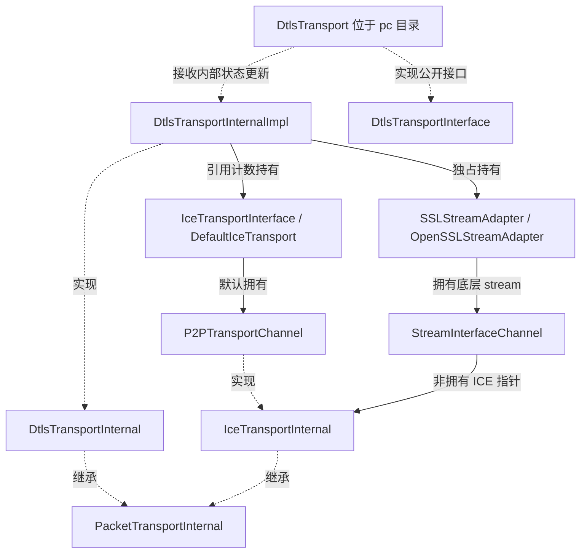
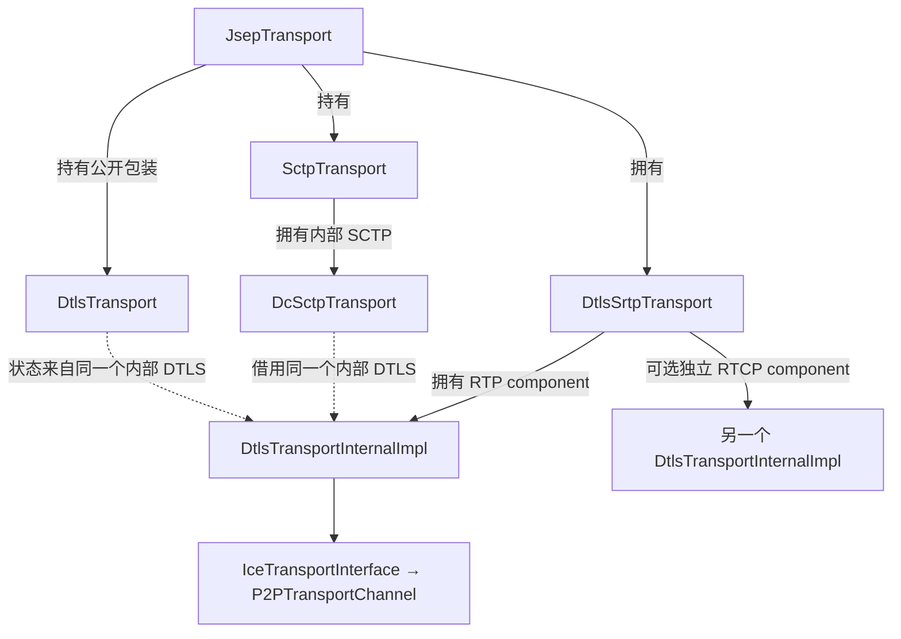
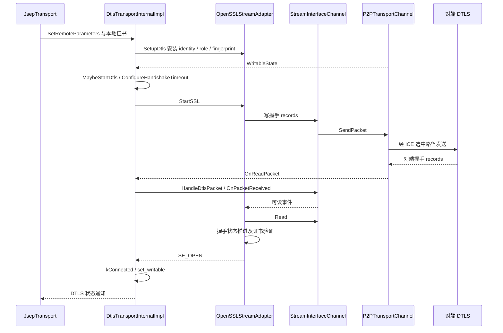
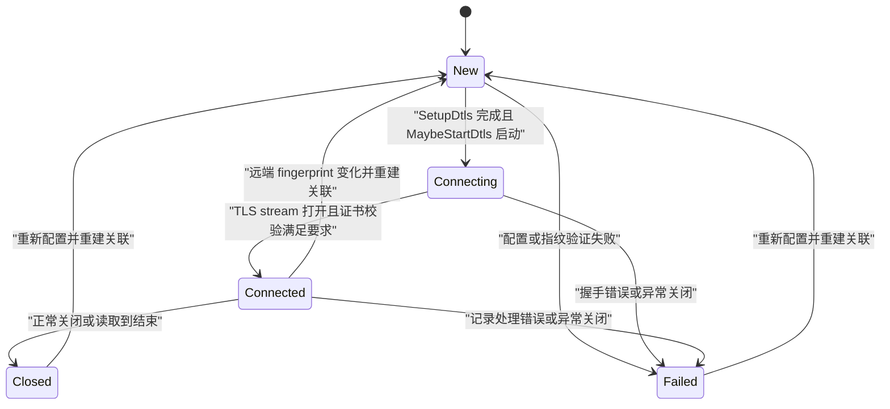
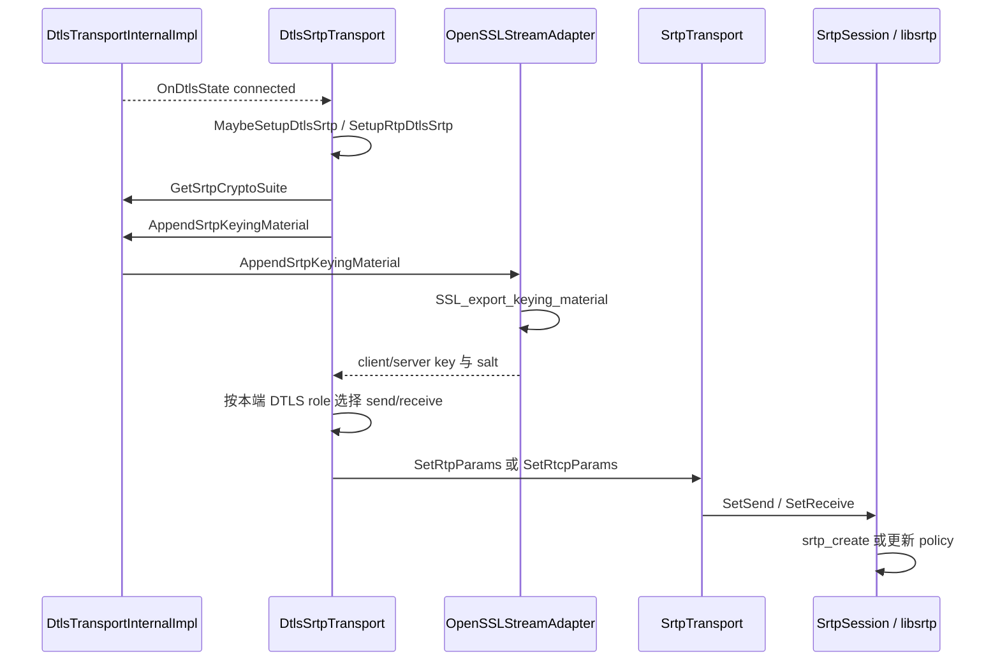
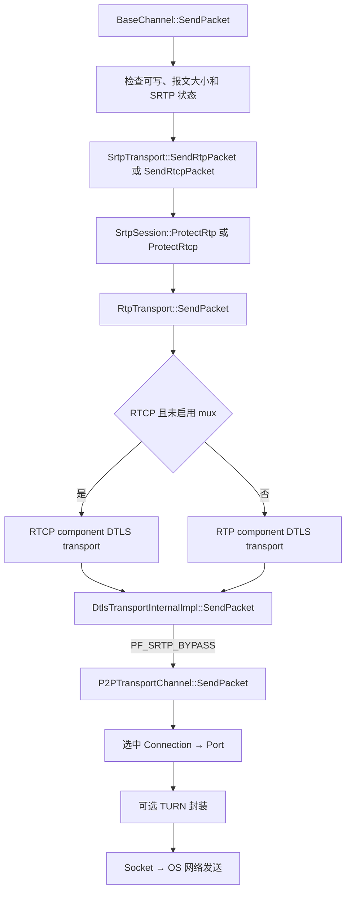
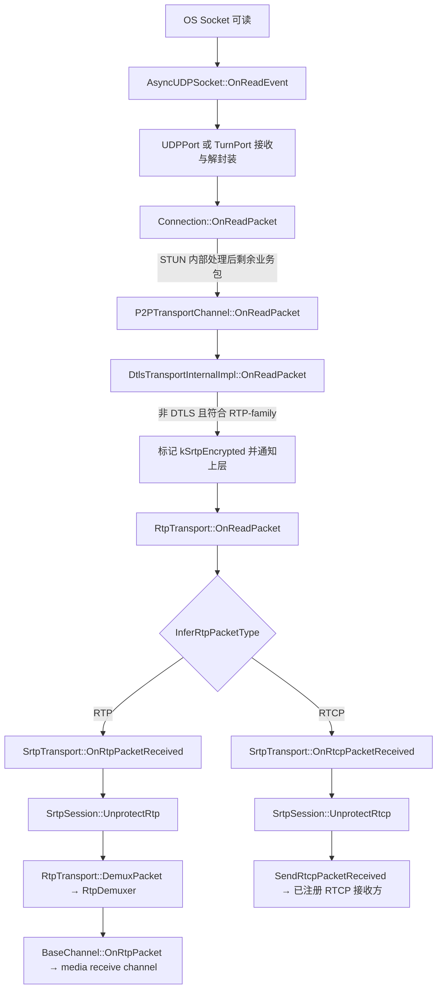
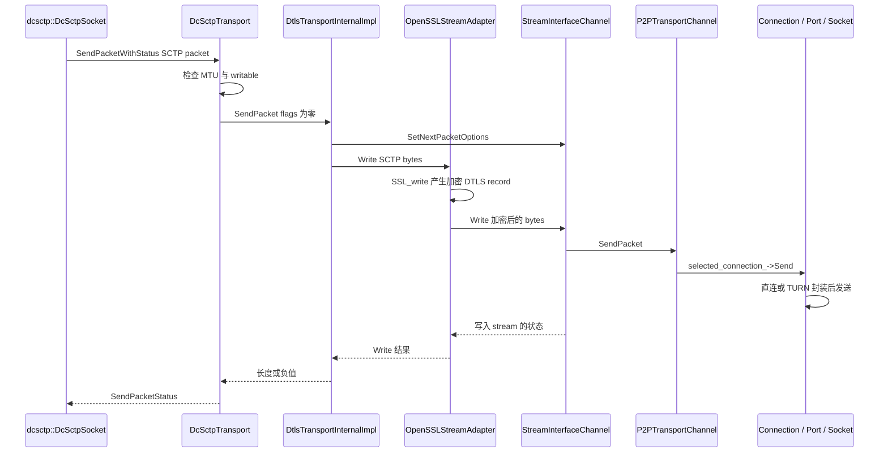
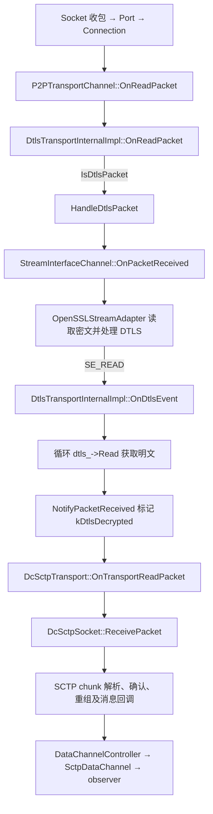

# DTLS、SRTP 与双向报文传输流程

源码基线为 `9310b29acd9e0985ab65f454959122336e3b7e78`。本篇从已经装配好的 ICE transport 向上解释安全协议、对象关系和收发路径；Socket、STUN、TURN 与选路机制见 [Socket 与 ICE](socket-ice-stun-turn.md)。文中的行号对应当前提交，函数名是后续版本回查的主要依据。

## 1. 两条业务路径和一条密钥建立路径

媒体与 DataChannel 使用不同的逐包保护方式。RTP/RTCP 经 SRTP/SRTCP 保护后进入 ICE；DataChannel 消息先经 dcSCTP 组织为 SCTP 报文，再作为 DTLS application data 加密后进入 ICE。DTLS 握手还向 SRTP 导出密钥，但媒体报文本身通常不再套一层 DTLS record。

```mermaid
flowchart TB
    M["音视频 RTP / RTCP"] --> S["SrtpTransport → SRTP / SRTCP"]
    D["SctpDataChannel"] --> DC["DcSctpTransport → DcSctpSocket"]
    DC --> DR["DTLS application data"]
    H["DTLS 握手、证书验证、密码协商"] -.->|"导出 SRTP 密钥"| S
    H -.->|"建立 DTLS record 安全上下文"| DR
    S --> B["DtlsTransportInternalImpl 的 PF_SRTP_BYPASS 分支"]
    B --> I["P2PTransportChannel / ICE"]
    DR --> I
    I --> C["选中的 Connection"]
    C --> P["UDPPort / TurnPort / TCPConnection"]
    P --> SO["Socket 和 OS 网络栈"]
```



图中的虚线是密钥或上下文依赖，实线才是业务数据路径。所谓 “DTLS-SRTP” 表示用 DTLS 协商并导出 SRTP 所需材料，不表示 RTP payload 先经 SRTP 加密再总是经 DTLS 加密。

DTLS 保留数据报语义，不负责为应用数据实现可靠传输或有序交付。DataChannel 的可靠性、重传、分片重组、部分可靠和拥塞窗口由 SCTP 提供；SRTP 同样不提供媒体重传或拥塞控制，相关机制位于 RTP/RTCP、媒体接收器和 [GCC/TCC](gcc-tcc.md)。

## 2. 当前版本容易混淆的三个 DTLS 类

`DtlsTransportInternal` 是继承 `PacketTransportInternal` 的内部抽象接口，声明证书、DTLS 状态、角色、密钥导出及 `ice_transport()` 等能力。定义在 [p2p/dtls/dtls_transport_internal.h](../webrtc_src/p2p/dtls/dtls_transport_internal.h) 第 49 行。

`DtlsTransportInternalImpl` 才是默认的 DTLS 报文实现，定义在 [p2p/dtls/dtls_transport.h](../webrtc_src/p2p/dtls/dtls_transport.h) 第 137 行。它持有 ICE 接口和 `SSLStreamAdapter`，组合 `StreamInterfaceChannel` 把 TLS 库的流式适配接口与 ICE 的 packet 接口衔接起来。

`pc/DtlsTransport` 是对外 `DtlsTransportInterface` 的包装对象，定义在 [pc/dtls_transport.h](../webrtc_src/pc/dtls_transport.h) 第 30 行。它发布 `Information()`、状态和 observer 通知，并暴露 ICE transport；它不是在 `DcSctpTransport::SendPacketWithStatus()` 中处理字节加密的那个对象。

本版本 `p2p/base/dtls_transport.h` 和 `dtls_transport_internal.h` 是兼容转发头。阅读旧资料时看到内部实现叫 `DtlsTransport`，必须先与本提交的路径和类名对齐。



源码中公开包装类的完整名字是 `webrtc::DtlsTransport`，没有 `webrtc::pc` 命名空间。`DtlsTransportInternalImpl` 与 `P2PTransportChannel` 之间是组合关系，并非父子类关系。

## 3. 谁创建这些对象，谁共享它们

[JsepTransportController::CreateDtlsTransport](../webrtc_src/pc/jsep_transport_controller.cc) 第 536 行先创建 ICE，再调用注入的 DTLS factory；没有自定义工厂时，构造 `DtlsTransportInternalImpl`。随后安装本地证书并订阅可写、接收、握手错误等事件。

同文件的 `MaybeCreateJsepTransport()` 第 1163 行完成业务装配：创建 RTP component 的 DTLS transport，把所有权交给 RTP/SRTP transport；把同一内部 DTLS 指针交给 SCTP factory；再创建公开 `DtlsTransport` 包装对象。

在要求独立 RTCP component 的配置中还会创建另一个 DTLS/ICE transport；开启 RTCP mux 后 RTCP 改用 RTP transport。BUNDLE 成员又映射到同一个 `JsepTransport`，因此 m-section 的数量不等于 DTLS 对象或 UDP Socket 的数量。



所有权的原始注释就在 `jsep_transport_controller.cc` 第 1204～1215 行。它也是回答“媒体与 DataChannel 是否共用网络路径”最直接的代码证据。

## 4. SDP 参数、DTLS 角色与指纹

本地证书携带身份公钥和私钥；信令交换的是证书摘要 fingerprint 以及 `setup` 角色属性，不是把私钥发给对端。`JsepTransport::NegotiateAndSetDtlsParameters()`，见 [jsep_transport.cc](../webrtc_src/pc/jsep_transport.cc) 第 403 行，把协商得到的角色与远端 fingerprint 下推给内部 transport。

`NegotiateDtlsRole()` 第 471 行处理 `actpass`、`active`、`passive` 及已有会话角色约束。active 端发起 ClientHello，成为 DTLS client；passive 端成为 server。ICE controlling/controlled 决定连通性提名，不直接决定这一角色。

`DtlsTransportInternalImpl::SetRemoteParameters()` 在 [dtls_transport.cc](../webrtc_src/p2p/dtls/dtls_transport.cc) 第 396 行先设置角色，再应用 fingerprint。原因是应用 fingerprint 可能立即触发 `SetupDtls()`，后者需要知道 client/server。

`SetupDtls()` 第 522 行安装本地 identity、协议版本上限、server role、对端证书摘要、SRTP profile 列表、握手事件回调及密钥交换相关配置。实际协商结果依赖双方能力与配置，不能仅凭本地列表断言某次连接使用了哪套密码算法。

证书与 fingerprint 不匹配会使 DTLS 进入 failed。特别是“早到 ClientHello 导致握手先于远端 fingerprint 设置”的场景，后续 `SetPeerCertificateDigest()` 可能发现验证失败；源码允许把这一情况报告为 DTLS 状态失败，而不一定让 `SetRemoteDescription()` 因 fingerprint 格式错误而直接失败。

信令层的远端身份可信度不由 fingerprint 算法独立解决；在这里 fingerprint 的职责是把收到的 DTLS 证书与已接受的 SDP 参数绑定。

## 5. 从 ICE 可写到 DTLS 握手完成

默认分支中，ICE 可写意味着有可用的候选对；DTLS 还必须完成握手才能允许 SCTP application data。`MaybeStartDtls()` 第 1065 行要求已创建 `dtls_`，且 ICE 可写或启用了 DTLS-in-STUN 分支，然后调用 `StartSSL()`。



默认 `SSLStreamAdapter::Create()` 返回 `OpenSSLStreamAdapter`，见 [ssl_stream_adapter.cc](../webrtc_src/rtc_base/ssl_stream_adapter.cc) 第 88～101 行。该类名沿用 OpenSSL 命名，底层构建可使用 BoringSSL；不能把源码中的 `OpenSSLStreamAdapter` 误写成不存在的 `BoringSSLStreamAdapter`。

协议握手消息的密码学处理在 TLS 库中实现，WebRTC 负责接入数据报、配置身份、超时和事件。典型 DTLS 1.2 握手涉及 ClientHello、服务端协商/证书和密钥交换消息、客户端应答以及 Finished；是否存在 cookie 交换、会话恢复、具体消息排列与密码套件相关，不能把一张固定消息清单当作所有协商版本的唯一流程。

本提交的 `JsepTransportController::Config::ssl_max_version` 初始化为 `SSL_PROTOCOL_DTLS_12`，见 [jsep_transport_controller.h](../webrtc_src/pc/jsep_transport_controller.h) 第 104 行。源码及测试包含 DTLS 1.3 处理分支；它们说明能力存在，不说明每个默认 PeerConnection 都已使用 1.3。

## 6. Record、数据报与握手重传边界

DTLS 1.2 record 头部含 content type、版本、epoch、record sequence number 和长度，头部固定 13 字节。这里的 record 序号服务于 DTLS 安全处理，与 SCTP TSN、RTP sequence number、TCC transport sequence number 是不同编号空间。

一个底层 UDP datagram 可携带多个 DTLS records。`OnDtlsEvent()` 第 991 行在收到可读事件后循环 `dtls_->Read()`，直到不能继续读，避免只处理第一个 record。DataChannel 消息边界由 SCTP 消息层恢复，不由一次 UDP read 直接决定。

DTLS 握手按协议处理丢包与重传；建立后的 application data 不因此自动变成可靠流。WebRTC 的 `ConfigureHandshakeTimeout()` 第 1214 行可使用 ICE RTT 估计设置初始握手重传超时，公式是对 `2 × RTT` 施加上下界。这里使用的是 ICE RTT，不是 SCTP SACK RTT 或媒体 RTCP RTT。

`StreamInterfaceChannel` 的接收队列保存密文数据报，TLS adapter 从中读出协议数据。收到早于本地 setup 的 ClientHello 时，`OnReadPacket()` 第 905 行分支可缓存它，并在已有本地证书时尝试 server setup；远端 fingerprint 到达后仍必须验证证书。

## 7. DTLS 状态与 ICE 状态的关系



图中的 New/Connecting/Connected 对应 `DtlsTransportState`，并非 ICE connection state。状态转换入口包括 `SetRemoteFingerprint()`、`MaybeStartDtls()` 和 `OnDtlsEvent()`。

DTLS connected 表示安全关联已建立，不等于网络此刻始终可发送。ICE 网络路径可以暂时失效或发生切换，而 DTLS 安全关联保留；`OnWritableState()` 第 814 行负责组合底层 ICE 与握手状态。DTLS-in-STUN 即使提早完成握手，也会在 ICE 尚未曾可写时推迟对上层报告可写，见 `set_writable()` 第 1130 行附近。

ICE restart 以 ICE 凭据变化为核心；DTLS restart 的这里一个重要触发条件是远端 fingerprint 变化。`SetRemoteFingerprint()` 会拆除旧 `dtls_`、回到 kNew、撤销可写并重建。不能在文档中把每次 ICE 候选切换都描述成重做证书握手。

## 8. DTLS-in-STUN 是可选握手优化

本版支持 `DtlsStunPiggybackController`：将部分握手数据随 ICE STUN 检查携带，利用检查调度减少串行等待。`IceConfig::dtls_handshake_in_stun` 的结构默认值是 false，见 [ice_transport_internal.h](../webrtc_src/p2p/base/ice_transport_internal.h) 第 210 行。

实际 JSEP 配置路径在 `JsepTransport::NegotiateAndSetDtlsParameters()` 第 454 行附近，读取本地 transport description 中的 `ICE_OPTION_GOOG_SPED_V1`，更新 ICE config。收到对端扩展后的能力判断、缓存和退回常规发送则由 piggyback controller 等代码处理，因此不能只看结构默认值就断言具体产品永远关闭。

开启后，`SetupDtls()` 可把 DTLS MTU 设置为 900，使握手片段更适合放入 STUN 属性；`MaybeStartDtls()` 允许 ICE 尚未可写时启动握手。`StreamInterfaceChannel::Write()` 对 TLS 库产生的握手包执行捕获，ICE callbacks 交换相应扩展数据。

`ConfigureHandshakeTimeout()` 在这一分支无 RTT 时设置较大的握手超时，主要让缓存的握手包由 ICE 节奏重发；`UpdateHandshakeTimeout()` 处理发现对端不支持时的超时调整。完成或销毁时 `CompleteDtlsInStun()` 撤销回调。

这项优化改变的是握手承载和启动时机，不会把日常 SCTP application data 改写成 STUN，也不会使媒体 SRTP 的常规收发路径消失。相关源码为 [dtls_stun_piggyback_controller.cc](../webrtc_src/p2p/dtls/dtls_stun_piggyback_controller.cc) 与 `dtls_transport.cc` 第 522、1214、1260 行之后的分支。

## 9. DTLS 如何为 SRTP 生成收发密钥

SRTP profile 通过 DTLS 的 DTLS-SRTP 扩展协商。`CryptoOptions` 提供支持的 suites，`SetupDtls()` 通过 `SetDtlsSrtpCryptoSuites()` 配置 TLS adapter。DTLS record cipher 与 SRTP profile 是两个相关但独立的协商结果，不应仅凭一个 cipher 名称推断另一个。

`DtlsSrtpTransport::OnDtlsState()` 在 [dtls_srtp_transport.cc](../webrtc_src/pc/dtls_srtp_transport.cc) 第 325 行附近接收状态变化，非 connected 时重置 SRTP 参数，然后 `MaybeSetupDtlsSrtp()` 判断是否可安装密钥。



`ExtractParams()` 第 231 行先获取 profile，再确定 key 和 salt 长度，导出总计 `2 × key_len + 2 × salt_len` 字节。布局为：

```text
client_write_key | server_write_key | client_write_salt | server_write_salt
```

client 使用 client write key/salt 发送、server write key/salt 接收；server 反过来。方向取决于 DTLS 角色，不取决于哪端正在共享屏幕或发送音频。

[OpenSSLStreamAdapter::AppendSrtpKeyingMaterial](../webrtc_src/rtc_base/openssl_stream_adapter.cc) 第 474 行调用 `SSL_export_keying_material()`，使用标签 `EXTRACTOR-dtls_srtp`，本实现不使用 exporter context。导出的密钥是专供 SRTP 的材料，不是把 DTLS record 使用的密钥直接复制过去。

RTCP mux 时 RTP/RTCP 共用承载 transport，SRTP/SRTCP 仍使用各自协议处理。没有 RTCP mux 且存在独立 DTLS transport 时，`SetupRtcpDtlsSrtp()` 第 202 行从相应 transport 获取参数。移除 RTCP transport 因为启用 mux 时，代码避免错误重置仍有效的 RTP SRTP session。

## 10. SRTP/SRTCP 逐包处理和重放保护

`SrtpTransport` 把媒体报文交给 `SrtpSession`，后者调用 libsrtp。发送入口为 `ProtectRtp()`、`ProtectRtcp()`；接收入口为 `UnprotectRtp()`、`UnprotectRtcp()`。对应 [srtp_session.cc](../webrtc_src/pc/srtp_session.cc) 第 187、230、264、294 行。

RTP 报文的序号会回绕，SRTP 使用扩展的包索引及 rollover counter 等状态建立加密与重放语义；这些状态与 SSRC、方向和安全上下文有关。RTP 的基本可路由头部保持可识别，payload 由 SRTP 保护；协商指定的 RTP header extensions 还可单独加密。

SRTCP 有自己的索引和保护规则，不等于把 RTCP 当成某种 RTP payload。`srtp_protect_rtcp()` 和 `srtp_unprotect_rtcp()` 是独立 API。认证标签长度、密钥长度和 salt 长度由选中的 profile 决定，不应统一写成所有包增加固定 N 字节。

本版 [SrtpSession::DoSetKey](../webrtc_src/pc/srtp_session.cc) 的 policy 构造段在第 348～384 行附近设置 `window_size=1024`、`allow_repeat_tx=1`。前者是接收重放窗口配置；后者允许发送侧重复发送相关索引，不表示接收端接受任意重复包。

认证失败、篡改、错误密钥、过旧或重放的包在 unprotect 失败后被丢弃。`SrtpTransport` 不将这些错误自动转化为重传；媒体 NACK、RTX、FEC 等机制在更高层解决特定问题。SRTP 的安全序号状态也不能代替链路丢包率统计。

## 11. 媒体发送方向的完整承载调用链

本节从媒体引擎把已成包 RTP/RTCP 提交给 `BaseChannel` 开始；编码、RTP packetizer、pacer 与拥塞反馈闭环见 [GCC/TCC](gcc-tcc.md)。



关键函数与条件：

1. [BaseChannel::SendPacket](../webrtc_src/pc/channel.cc) 第 398 行附近检查 transport、writable 和包大小；第 444～445 行为 RTP/RTCP 都传入 `PF_SRTP_BYPASS`。
2. [SrtpTransport::SendRtpPacket](../webrtc_src/pc/srtp_transport.cc) 第 42 行先 `ProtectRtp()`，RTCP 分支第 64 行先 `ProtectRtcp()`，成功后才向下发送。
3. [RtpTransport::SendPacket](../webrtc_src/pc/rtp_transport.cc) 第 214 行按 RTCP mux 状态选择 RTP 或 RTCP packet transport。
4. [DtlsTransportInternalImpl::SendPacket](../webrtc_src/p2p/dtls/dtls_transport.cc) 第 640 行在 connected 且有 `PF_SRTP_BYPASS` 时检查 RTP-family 外观，直接调用 ICE，不调用 `SSL_write()`。
5. ICE 选择 Connection；直连 UDP 最终走 `UDPPort → AsyncUDPSocket → PhysicalSocket::SendTo → sendto`，TURN/TCP 分支按前篇执行。

这里 “bypass” 的含义是跳过 DTLS record 加密，并非跳过所有加密。此时缓冲区已经是 SRTP/SRTCP；如果在调用点未执行 SRTP protect，却误设该标志，就破坏了安全层的调用契约。

## 12. 媒体接收方向的完整承载调用链



`DtlsTransportInternalImpl::OnReadPacket()` 第 892 行先区分 DTLS 与非 DTLS。非 DTLS 数据只有在 DTLS connected 且具有 RTP-family 外观时才按 SRTP 路径上送，否则丢弃。该层只做分流，不在这里完成 SRTP 解密。

[RtpTransport::OnReadPacket](../webrtc_src/pc/rtp_transport.cc) 第 422 行通过 `InferRtpPacketType()` 区分 RTP/RTCP，并做长度检查。RTP 进入 `UnprotectRtp()` 后，才由 `DemuxPacket()` 第 357 行创建 `RtpPacketReceived`，调用 `RtpDemuxer` 定位 sink。

`RtpDemuxer` 根据注册的 MID、RSID、SSRC、payload type 等条件定位接收方，具体匹配规则见 [rtp_demuxer.cc](../webrtc_src/call/rtp_demuxer.cc)。这解决了同一 BUNDLE transport 上多个媒体接收器的分流；它与 ICE 对来源地址的分流是不同层次。

`BaseChannel::OnRtpPacket()` 在 [channel.cc](../webrtc_src/pc/channel.cc) 第 448 行将解析结果传入媒体接收 channel。RTCP 解保护成功后通过专用回调链交给注册接收方，处理 SR/RR、NACK、PLI、传输反馈等控制消息；不是统一按一个 RTP SSRC sink 处理所有 RTCP。

## 13. DataChannel/SCTP 发送方向

应用消息、DCEP、PPID 和 SCTP stream 的细节在 [DataChannel 与 dcSCTP](datachannel-dcsctp.md)。这里从 dcSCTP 已构造好一个 SCTP packet 的 callback 开始，解释用户关注的 `dcsctp_transport.cc` 第 468～470 行。



`transport_` 的静态类型是 `DtlsTransportInternal*`；虚方法最初声明于 `PacketTransportInternal`，默认对象是 `DtlsTransportInternalImpl`。它不会因为下层同时存在 `P2PTransportChannel::SendPacket()` 就直接跨过 DTLS 调用 ICE。

由于此调用传入 `flags=0`，connected 时走 [dtls_transport.cc](../webrtc_src/p2p/dtls/dtls_transport.cc) 第 668～688 行的 `dtls_->Write()`，最终进入 [OpenSSLStreamAdapter::Write](../webrtc_src/rtc_base/openssl_stream_adapter.cc) 第 640 行和第 672 行的 `SSL_write()`。`StreamInterfaceChannel::Write()` 第 180 行接到的是加密后的 record 数据。

默认 SCTP callback 构造的是 `AsyncSocketPacketOptions()`；媒体的 packet id、pacer 语义不能因此自动套用到 SCTP。dcSCTP 自己的拥塞窗口、SACK 和重传见 [dcSCTP 拥塞控制](dcsctp-congestion-control.md)。共用 Socket 不表示二者共用 GCC 的所有发送控制状态。

## 14. DataChannel/SCTP 接收方向



`HandleDtlsPacket()` 第 1114 行把密文注入 `downward_->OnPacketReceived()`；TLS adapter 通过 stream 事件读取它。握手 record 在 TLS 库中消费，只有成功解密的 application data 会作为业务明文向上通知。

`OnDtlsEvent()` 第 1017 行附近创建的 `ReceivedIpPacket` 标记为 `kDtlsDecrypted`。[DcSctpTransport::OnTransportReadPacket](../webrtc_src/media/sctp/dcsctp_transport.cc) 第 743 行只接受这个标记，随后调用 `socket_->ReceivePacket()`；看到共享 DTLS 对象发出的 `kSrtpEncrypted` 包会直接忽略。

一个重要观测限制是：当前 DTLS 解密后创建的 packet 使用空来源地址、当前处理时间和 `kNotEct`，没有完整保留原始 UDP packet 的地址、到达时间和 ECN。不能把该处时间当成未经处理的内核收包时间，用来直接与媒体接收时间戳比较单向抖动。

## 15. 协议 demux 的层次与检查边界

同一 Socket 上数据类型的识别是逐层完成的：

1. shared-socket allocator 按来源服务器地址判断可能的 TURN Port。
2. TURN 层区分服务器事务、Data Indication、ChannelData，必要时解封装。
3. UDPPort/Port/Connection 识别和认证 STUN，处理未知地址与已知候选对。
4. 内部 DTLS transport 用 `IsDtlsPacket()` 区分 DTLS 和 RTP-family。
5. RTP transport 区分 RTP 与 RTCP；SRTP/SRTCP session 进行真正的解保护。
6. 解密后的 SCTP 由 dcSCTP 解析 chunks；解保护后的 RTP 由 RTP demuxer 定位媒体 sink。

[dtls_utils.cc](../webrtc_src/p2p/dtls/dtls_utils.cc) 第 33 行的 `IsDtlsPacket()` 检查至少一个 record header 长度以及首字节在 20～63 范围；`dtls_transport.cc` 第 131 行的 RTP-family 检查验证最小长度和版本高位。它们是分流条件，不是成功认证的证明。

外层若是 TURN/TLS，则客户端到 TURN 还有独立 TLS 保护；里面仍可能是端到端 DTLS 或 SRTP。TURN 服务器连接的 TLS 证书验证与远端 peer 的 DTLS fingerprint 校验，属于两条不同信任和生命周期路径。

## 16. 发送结果、不可写与错误传播

必须区分至少四个“成功”：上层接受消息进入队列、SCTP callback 接受 packet、底层 Socket 写入系统、远端确认或应用交付。它们发生在不同时间，由不同反馈证明。

`DcSctpTransport::SendPacketWithStatus()` 第 447 行先校验 SCTP MTU、transport 存在和 writable，之后调用 DTLS SendPacket。返回负值时，它把 blocking errno 转为 `kTemporaryFailure`，其他错误转为 `kError`，否则报告 `kSuccess`。

但本提交存在明确的返回边界：`StreamInterfaceChannel::Write()` 第 197 行调用 `ice_transport_->SendPacket()` 后 **没有检查返回值**，而是设置 `written=data.size()` 并返回 `SR_SUCCESS`。所以 DTLS application-data 的 Write 成功，不保证本次 ICE/Socket 发送成功，更不能保证远端收到。这里不能绘制一条“系统调用 errno 无损传回 SCTP”的错误链。

SRTP bypass 分支直接返回 ICE 的发送结果；两条路径的错误可见性并不完全相同。ICE 切换、网络路由变化或瞬时底层失败，仍可能主要通过后续 SCTP SACK/重传、握手超时或 transport 状态暴露。

`DtlsTransportInternalImpl::SendPacket()` 在 new、connecting、failed、closed 状态拒绝应用数据；`OpenSSLStreamAdapter::Write()` 还会在等待证书校验时返回阻塞。对接方应以 transport 的实际 ready/writable 和错误反馈驱动发送，不应只看到对象已构造就开始发送 SCTP。

媒体接收端的 SRTP 认证失败不会自动把 DTLS 状态置为 failed；它通常只丢弃该包并按实现限流记录错误。反过来，DTLS 握手失败会阻止建立 SRTP 参数，影响整体媒体可写性。排障时应区分“密钥从未安装”和“已有 session 的个别包认证失败”。

## 17. 线程、回调与销毁

内部 DTLS、ICE、SCTP transport 和 SRTP session 的相关操作在 network sequence 上执行。`DtlsTransportInternalImpl` 的类注释明确说明不是线程安全对象，要求在构造时的同一线程调用；`StreamInterfaceChannel` 和 `SrtpSession` 也用 sequence/thread checker 约束访问。

`DtlsTransport` 的 `Information()` 支持跨线程查询，内部使用锁保护信息快照。这个公开包装对象可跨线程读状态，不意味着可以跨线程直接调用 `DtlsTransportInternalImpl::SendPacket()`。

`JsepTransport::~JsepTransport()` 在 [jsep_transport.cc](../webrtc_src/pc/jsep_transport.cc) 第 109 行先清理 SCTP transport，再清理可能仍被外部引用的公开 DTLS 包装。内部 RTP/SRTP transport 持有 DTLS，DTLS 持有 ICE；SCTP 借用内部 DTLS 指针，因此清理次序避免借用方晚于被借用对象继续运行。

DTLS-in-STUN 析构路径调用 `CompleteDtlsInStun()`，撤销向 ICE 注册的 piggyback callbacks。替换 DTLS transport 时，`DtlsSrtpTransport` 使用 `MaybeUnsubscribe()` 取消旧状态订阅，并按新状态重建 SRTP 参数。安全上下文、回调订阅与业务队列是三套生命周期，不能只销毁一个指针就认为整个链路都已结束。

## 18. 代码、构建与测试核查

内部 DTLS 的 GN target 为 [p2p/BUILD.gn](../webrtc_src/p2p/BUILD.gn) 第 257 行的 `dtls_transport`，接口 target 是第 318 行的 `dtls_transport_internal`；公开包装则是 [pc/BUILD.gn](../webrtc_src/pc/BUILD.gn) 第 149 行的另一个 `dtls_transport`。完整 target 路径分别是 `//p2p:dtls_transport` 与 `//pc:dtls_transport`，不可仅凭短名认为重复定义。

同一 PC 构建文件中还分别定义 `dtls_srtp_transport`、`srtp_session`、`srtp_transport`、`rtp_transport`。`SrtpSession` 依赖 libsrtp；SSL adapter 的库选择由 [rtc_base/BUILD.gn](../webrtc_src/rtc_base/BUILD.gn) 的 SSL targets 及构建参数决定。

本文结合以下测试源码核对关键行为，未把源码阅读表述为测试执行结果：

- [dtls_transport_unittest.cc](../webrtc_src/p2p/dtls/dtls_transport_unittest.cc)：`TestTransferSrtp`、`TestTransferDtls`、`TestTransferDtlsCombineRecords`、`TestSendSrtpBypassPacketWithOptions`、`TestWriteError`、`KeyingMaterialExporter` 以及多版本握手测试。
- [dtls_srtp_transport_unittest.cc](../webrtc_src/pc/dtls_srtp_transport_unittest.cc)：握手前后安装 transport、RTCP mux、DTLS transport 替换和 SRTP 参数重置。
- [srtp_session_unittest.cc](../webrtc_src/pc/srtp_session_unittest.cc)：`TestTamperReject`、`TestReplay`、短密钥、buffer 容量和 rollover counter 不匹配。
- [dtls_ice_integration_test.cc](../webrtc_src/p2p/dtls/dtls_ice_integration_test.cc)：DTLS 与 ICE 联合行为，适合继续追踪握手承载与配置分支。

已核验的规范补充是 [DTLS-SRTP RFC 5764](https://www.rfc-editor.org/rfc/rfc5764)。本篇以源码中的 profile、exporter、bypass 和接收标记为实际行为依据，不推断本提交支持规范族的全部可选能力。

继续阅读 [传输常见问题](transport-faq.md) 可按问题定位以上调用链；[网络指标](network-metrics.md) 解释 ICE、媒体和 SCTP 各自 RTT/丢包/时间戳口径；[README](README.md) 提供整套文档导航。
