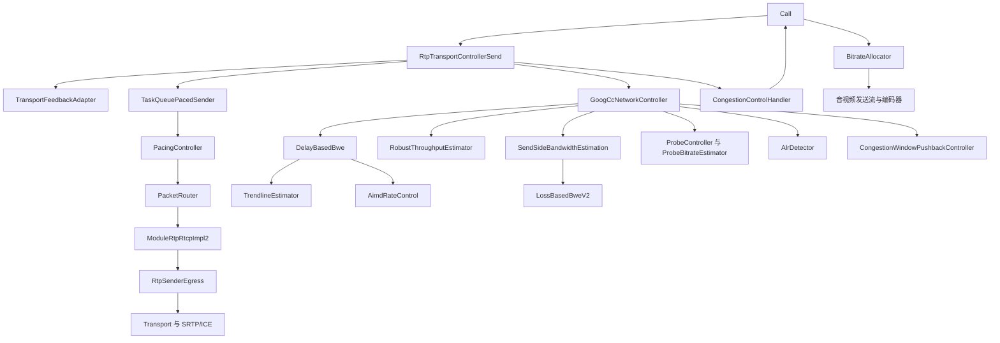
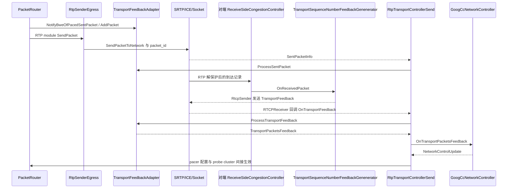
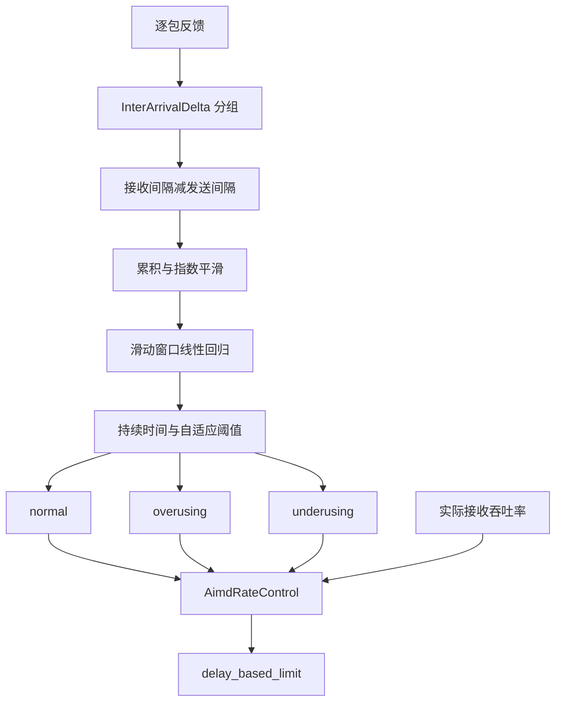
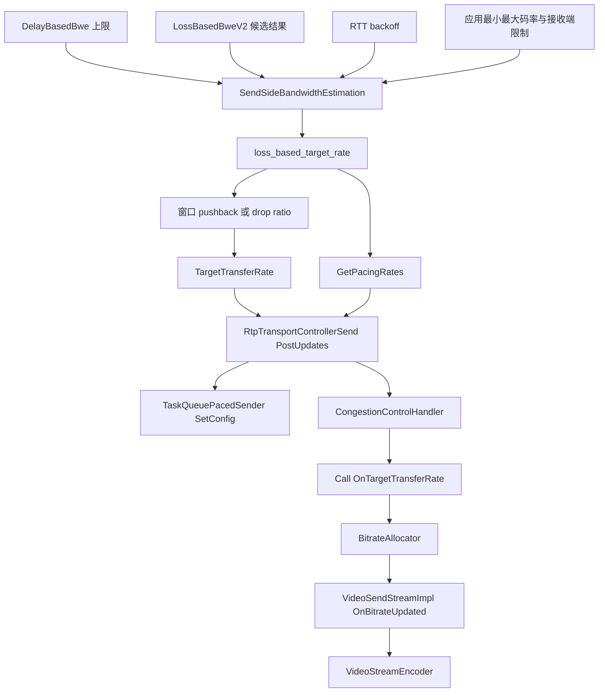

# GCC 与 TCC 技术方案：反馈、估计与发送闭环

本文基于本目录 `webrtc_src` 的提交 `9310b29acd9e0985ab65f454959122336e3b7e78`。文中的默认值指该提交的源码默认值；应用注入的 `FieldTrialsView`、自定义 `NetworkControllerFactoryInterface` 和实际 SDP 协商均可能改变运行路径。

阅读导航：[总览](README.md) · [项目架构](webrtc-architecture.md) · [媒体收发](dtls-srtp-packet-flow.md) · [网络指标](network-metrics.md) · [dcSCTP 拥塞控制](dcsctp-congestion-control.md) · [常见问题](transport-faq.md)。

## 1. GCC 与 TCC 的职责边界

**GCC 是发送速率控制算法及其实现体系，TCC/TWCC 是为控制器提供逐包观测的反馈机制。** 二者并不是两个并列的拥塞控制算法。

- GCC 根据发送记录、接收反馈、RTT、丢包、探测结果和应用约束产生目标码率、pacing 配置及拥塞窗口信息。
- TWCC 为 RTP 包分配传输序列号，由对端报告这些包是否收到及到达时间差。
- 反馈本身不决定编码码率，也不自动要求重传。RTP 丢包恢复由 NACK/RTX/FEC 等模块负责。
- SCTP association 使用自己的 SACK、拥塞窗口和重传机制；普通 DataChannel 数据不进入 RTP transport sequence number 反馈链。

本版本还支持 RFC 8888 congestion control feedback，不能把所有 `TransportPacketsFeedback` 都当成线上 TWCC 格式。控制器入口使用统一结构，而线上反馈存在不同编码。RFC 8888 定义的反馈包含按 SSRC/RTP 序列号组织的接收状态、到达信息及 ECN 信息，见 [RFC 8888](https://www.rfc-editor.org/rfc/rfc8888.html)。

源码入口：[`GoogCcNetworkController`](../webrtc_src/modules/congestion_controller/goog_cc/goog_cc_network_control.h)、[`NetworkControllerInterface`](../webrtc_src/api/transport/network_control.h)、[`RtpTransportControllerSend`](../webrtc_src/call/rtp_transport_controller_send.h)。

## 2. 总体对象关系与线程



这里的箭头表示持有或调用关系，不表示每个 RTP 包依次通过所有估计器。GCC 的多个估计分支消费同一批反馈，最终由 `SendSideBandwidthEstimation` 和外层控制器汇总。

`RtpTransportControllerSend` 通过 `sequence_checker_` 串行化控制状态，周期任务运行在其 `task_queue_`。网络线程上的实际发送通知进入 `OnSentPacket()` 后，必要时以 `SafeTask` 投递到该队列。不能假设所有 BWE 调用都直接发生在 network thread。

本版本 `RtpSenderEgress::SendPacket()` / `CompleteSendPacket()` 明确检查 `worker_queue_`；pacer 采用任务队列调度。线程名由调用环境决定，源码中的 queue/sequence 约束比抽象的“发送线程”更准确。

关键定位：[`RtpTransportControllerSend::OnSentPacket`](../webrtc_src/call/rtp_transport_controller_send.cc) 第 459 行、`StartProcessPeriodicTasks` 第 838 行；[`RtpSenderEgress::SendPacket`](../webrtc_src/modules/rtp_rtcp/source/rtp_sender_egress.cc) 第 146 行。

## 3. 从一次发送到反馈返回的完整链路

### 3.1 发送记录必须区分创建、出队和实际发送

`PacketRouter::SendPacket()` 为需要跟踪的包设置递增的内部 transport sequence number，再调用选中的 RTP module 发送。`RtpSenderEgress::SendPacket()` 随后在已经协商的 RTP 扩展中写入其 16 位表示；RFC 8888 路径可以仅使用内部编号而不发送该扩展。

`RtpTransportControllerSend::NotifyBweOfPacedSentPacket()` 调用 `TransportFeedbackAdapter::AddPacket()` 登记包大小、SSRC、RTP 序列号、transport sequence number、route、probe cluster 和创建时间。这时不能把登记时间当成网络发送时间。

`RtpSenderEgress::CompleteSendPacket()` 把 transport sequence number 放入 `PacketOptions::packet_id`，设置 `included_in_feedback` / `included_in_allocation` 等属性，再走媒体传输路径。底层成功发送产生 `SentPacketInfo`；`Call::OnSentPacket()` 对 BUNDLE 造成的重复通知去重，交给发送控制器。

`TransportFeedbackAdapter::ProcessSentPacket()` 根据 `packet_id` 找到历史项，填入实际发送时间并更新 in-flight bytes。它还处理未单独进入反馈但需要计入带宽分配的先前字节 `prior_unacked_data`。

关键定位：[`PacketRouter::SendPacket`](../webrtc_src/modules/pacing/packet_router.cc) 第 171 行；[`NotifyBweOfPacedSentPacket`](../webrtc_src/call/rtp_transport_controller_send.cc) 第 612 行；[`TransportFeedbackAdapter::AddPacket / ProcessSentPacket`](../webrtc_src/modules/congestion_controller/rtp/transport_feedback_adapter.cc) 第 118 / 165 行；[`Call::OnSentPacket`](../webrtc_src/call/call.cc) 第 1245 行。

### 3.2 接收端生成反馈

RTP 经 SRTP 解保护并进入接收流程后，`ReceiveSideCongestionController::OnReceivedPacket()` 选择反馈分支：

1. 已启用并协商 RFC 8888：交给 `CongestionControlFeedbackGenerator`。
2. 存在 `TransportSequenceNumber` 或 `TransportSequenceNumberV2` 扩展：交给 `TransportSequenceNumberFeedbackGenenerator`。
3. 其余视频路径：使用 receive-side BWE，根据发送时间扩展选择估计器并发送 REMB。
4. 没有传输序列号的音频不在该分支启用 receive-side BWE。

`Genenerator` 是当前源码真实拼写。`RtpTransportFeedbackGenerator` 是这些反馈生成器的抽象接口，定义 `OnReceivedPacket()`、`Process()` 和 `OnSendBandwidthEstimateChanged()`，自身不承担状态编码。

TWCC 生成器解开 16 位序列号回绕，将首次接收时间写入 `packet_arrival_times_`。重复收到同一包不会覆盖首次到达时间。周期反馈用序列号区间编码接收和缺失状态；迟到包可在后续反馈中补充。

默认周期为 100 ms。带宽通知到来后，以估算反馈开销占带宽的 5% 调整间隔，限制在 50～250 ms。这里的 5% 是此生成器的调度启发式，不是每份报文都严格达到的占比。

V2 扩展可携带反馈请求，触发 `SendFeedbackOnRequest()`。本版本一旦收到 `TransportSequenceNumberV2`，该生成器在本次通话剩余时间内关闭周期反馈，`Process()` 返回无限等待；后续依赖请求驱动。不要把 V1 周期模式和 V2 请求模式混写成每个 RTP 包都立即返回一个 RTCP 包。

关键定位：[`ReceiveSideCongestionController::OnReceivedPacket`](../webrtc_src/modules/congestion_controller/receive_side_congestion_controller.cc) 第 121 行；[`TransportSequenceNumberFeedbackGenenerator`](../webrtc_src/modules/remote_bitrate_estimator/transport_sequence_number_feedback_generator.cc) 第 72、123、143 行；[`RtpTransportFeedbackGenerator`](../webrtc_src/modules/remote_bitrate_estimator/rtp_transport_feedback_generator.h)。

### 3.3 反馈经 RTCP/SRTCP 返回并进入 GCC



`RTCPReceiver` 解析 RTCP feedback 并通知 `NetworkLinkRtcpObserver`；`RtpTransportControllerSend` 实现相应回调。`OnTransportFeedback()` 处理 TWCC，`OnCongestionControlFeedback()` 处理 RFC 8888，二者经 adapter 后汇入 `HandleTransportPacketsFeedback()`。

adapter 用本地发送历史补齐每个包的发送时间、长度和探测信息，再形成 `PacketResult`。没有接收记录的包以非有限 `receive_time` 表示未收到。找不到发送历史、从其他 route 返回的旧反馈不能盲目参与当前链路估计。

关键定位：[`OnTransportFeedback / OnCongestionControlFeedback / HandleTransportPacketsFeedback`](../webrtc_src/call/rtp_transport_controller_send.cc) 第 679 / 692 / 755 行；[`TransportFeedbackAdapter::ProcessTransportFeedback`](../webrtc_src/modules/congestion_controller/rtp/transport_feedback_adapter.cc) 第 205 行。

## 4. TWCC 的报文、序列号和时钟

### 4.1 三类序列号承担不同职责

- RTP sequence number：16 位，按 RTP SSRC 表示媒体包次序，用于 RTP 丢包、NACK、重排序。
- transport sequence number：TWCC 线上扩展为 16 位，覆盖由同一发送路由器编号的多个 RTP 流及相应修复/探测包；发送端内部使用展开后的整数。
- feedback packet count：8 位，编号反馈报文；不是 RTP 包号，也不是 ACK 的包数。

一个 RTX 包可能带有原始媒体包的关联信息，但它本身仍是一次新的网络发送，可获得新的 transport sequence number。因此 transport 级丢包与原始媒体恢复后的残余丢包不同。

### 4.2 RTCP TransportFeedback 结构

`rtcp::TransportFeedback` 使用 RTPFB，PT=205、FMT=15。固定结构包括 RTCP common header、sender SSRC、media SSRC，以及 8 字节反馈头：

1. base sequence number：16 位。
2. packet status count：16 位，表示覆盖的连续序列号跨度，包括缺失包。
3. reference time：24 位，单位 64 ms。
4. feedback packet count：8 位。
5. packet status chunks：每块 16 位，可用 run-length、1-bit vector 或 2-bit vector 编码状态。
6. receive deltas：对已收到的包编码时间差，单位 250 μs；小 delta 用 1 字节，大 delta 用带符号的 2 字节。

差值相对参考时间或上一个已收到包构建；缺失包没有对应到达时间。大的时间跨度或状态区间需要分割反馈，不能假设任意长区间都能放进单份报文。

关键定位：[`transport_feedback.cc`](../webrtc_src/modules/rtp_rtcp/source/rtcp_packet/transport_feedback.cc) 第 33～81 行格式说明、`TransportFeedback::LastChunk`；[`transport_feedback.h`](../webrtc_src/modules/rtp_rtcp/source/rtcp_packet/transport_feedback.h) 第 47～49 行格式编号和时间粒度。

### 4.3 不需要两端绝对时钟同步

GCC 的 delay 分支使用相邻组的接收间隔减发送间隔：

```text
send_delta = send_time[i] - send_time[i-1]
receive_delta = receive_time[i] - receive_time[i-1]
delay_delta = receive_delta - send_delta
```

两个时间差分别在各自时钟域内计算，固定时钟偏移抵消。持续时钟漂移、时钟突跳、接收批量调度和反馈量化仍然会影响估计。

adapter 把远端 reference time 和 delta 映射到一个便于本地表示的时间基准；源码明确说明这不是真实的两端统一时钟。`ProcessTransportFeedback()` 还将部分 delta 向下量化到毫秒。不能以 `PacketResult.receive_time - sent_packet.send_time` 直接宣称测出了绝对上行单向时延。

## 5. GCC 的反馈处理顺序

`GoogCcNetworkController::OnTransportPacketsFeedback()` 主要执行：

1. 使用 in-flight 数据更新拥塞窗口控制状态。
2. 根据反馈到达时间和发送时间计算 feedback RTT，并估计 propagation RTT。
3. 检查 ALR 是否刚结束，通知吞吐率估计器及 probe controller。
4. 把按接收时间排序的已收包交给 acknowledged bitrate estimator。
5. 收集 probe cluster 的逐包结果，得到探测速率。
6. 可选调用注入的 network state estimator。
7. 将吞吐率、probe 结果和反馈交给 `DelayBasedBwe`。
8. 更新 delay-based limit，并让 `LossBasedBweV2` 处理丢包观测。
9. 更新目标码率、pacer、probe 和拥塞窗口相关输出。

源码位于 [`goog_cc_network_control.cc`](../webrtc_src/modules/congestion_controller/goog_cc/goog_cc_network_control.cc) 第 400～542 行。周期 `OnProcessInterval()` 还会推动估计、探测和窗口更新，默认工厂周期为 25 ms，因此不是只有收到反馈时才可能产生新输出。

## 6. Delay-based BWE：分组、趋势线与 AIMD

### 6.1 `InterArrivalDelta` 先消除发包突发的影响

一个视频帧可能拆成很多 RTP 包，逐包时间差很容易受批量发送、调度和压缩突发影响。`DelayBasedBwe` 为音频和视频维护相应分组状态，用 `InterArrivalDelta` 聚合发送时间接近的包。

默认发送时间分组长度是 5 ms，但并非机械地每 5 ms 切一个窗口。若接收间隔很短且传播差值为负，包可被判断属于同一次 burst；相关阈值为接收间隔不超过 5 ms、burst 总长度小于 100 ms。

新组出现时，比较两个已经完成的组，输出 `send_delta`、`recv_delta` 和大小差。发送时间倒退的包会被跳过；连续接收乱序或明显时钟偏移会触发重置。这样得到的是组之间的排队变化信号。

关键定位：[`DelayBasedBwe::IncomingPacketFeedback`](../webrtc_src/modules/congestion_controller/goog_cc/delay_based_bwe.cc) 及第 43 行；[`InterArrivalDelta::ComputeDeltas / BelongsToBurst`](../webrtc_src/modules/congestion_controller/goog_cc/inter_arrival_delta.cc) 第 33 / 121 行附近。

### 6.2 趋势线的实际计算

设组间延迟变化为 `d_i = recv_delta_i - send_delta_i`：

```text
accumulated_i = accumulated_(i-1) + d_i
smoothed_i = 0.9 * smoothed_(i-1) + 0.1 * accumulated_i
x_i = arrival_time_i - first_arrival_time
y_i = smoothed_i
slope = sum((x_i - mean_x) * (y_i - mean_y)) / sum((x_i - mean_x)^2)
modified_trend = min(number_of_deltas, 60) * slope * 4.0
```

默认回归窗口包含 20 个趋势样本。窗口未满时沿用已有斜率；窗口大小可由 field trial 改变。斜率为正意味着队列趋向增加，为负意味着趋向消退，接近零意味着延迟变化较稳定。

这里的 `accumulated` 是从任意起点累积的相对变化，不是可直接导出给用户的绝对网络延迟。趋势线也不是 RFC RTP jitter，后者计算绝对间隔差的指数平滑。

关键定位：[`TrendlineEstimator::UpdateTrendline`](../webrtc_src/modules/congestion_controller/goog_cc/trendline_estimator.cc) 第 194 行、`LinearFitSlope`；默认窗口见 [`TrendlineEstimatorSettings`](../webrtc_src/modules/congestion_controller/goog_cc/trendline_estimator.h)。

### 6.3 自适应阈值与过载判定

初始阈值为 12.5。`modified_trend` 超过正阈值时，并不立刻宣布 overuse，还要求持续超过时间门槛、多于一次样本且趋势没有回落。低于负阈值表示 underuse，中间范围表示 normal。

阈值按以下规则适应正常波动：

```text
k = abs(modified_trend) < threshold ? 0.039 : 0.0087
dt = min(now_ms - previous_update_ms, 100)
threshold += k * (abs(modified_trend) - threshold) * dt
threshold = clamp(threshold, 6, 600)
```

当样本明显超过阈值加允许偏移时，不用该尖峰抬高阈值，避免容量突然下降反而被“学习”为正常。可选 slope cap 和 sort 默认关闭，不能写成主路径必经步骤。

关键定位：[`TrendlineEstimator::Detect / UpdateThreshold`](../webrtc_src/modules/congestion_controller/goog_cc/trendline_estimator.cc) 第 266 / 307 行附近；`TrendlineEstimatorTest.Normal / Overusing / Underusing` 核对三种状态。



### 6.4 `AimdRateControl` 决定如何调速

`DelayBasedBwe` 将状态与实际吞吐率传给 `AimdRateControl`。核心状态为 hold、increase、decrease：normal 可进入 increase，underuse 转入 hold，overuse 转入 decrease。

- 容量尚不明确时采用乘法增长：基础增长因子 1.08，按距上次更新的时间调整，单次时间因子上限为 1 秒，且设最小增长量。
- 已有较可信链路容量时使用加法增长；增长速度与近容量状态、响应时间和包大小估算相关。
- 过载时主要按实际吞吐率乘 backoff factor 降低，默认 factor 为 0.85；另有链路容量估计及配置上下限约束。
- 降低动作受 RTT/最小间隔约束，避免每个 feedback 包都反复乘 0.85。
- probe 结果可设置新的估计起点；ALR 状态影响增长决策。

因此“GCC 始终固定每秒加某个 kbps，丢包就乘固定系数”不能代表当前实现。

关键定位：[`AimdRateControl::ChangeBitrate / MultiplicativeRateIncrease / AdditiveRateIncrease / ChangeState`](../webrtc_src/modules/remote_bitrate_estimator/aimd_rate_control.cc) 第 223 / 355 / 369 / 377 行；[`DelayBasedBwe`](../webrtc_src/modules/congestion_controller/goog_cc/delay_based_bwe.cc)。

## 7. Acknowledged bitrate：估计已成功交付的吞吐率

当前 `AcknowledgedBitrateEstimatorInterface::Create()` 默认选择 **RobustThroughputEstimator**。只有关闭其设置后，才选择 `AcknowledgedBitrateEstimator` 及其 `BitrateEstimator` 路径。后者的贝叶斯式更新不能当成当前唯一默认实现。

默认 robust 窗口参数为至少 20 包与约 1 秒观察跨度，最多 500 包、最多 5 秒；初始至少 10 包才输出。低速时窗口可能比 1 秒长，高速时可能因包数上限而短于 1 秒。

主要处理过程：

1. 对已收到且具有有效发送时间的反馈按接收时间维护窗口。
2. 严重乱序或时间偏移变化时重置，避免将旧时间戳混入新窗口。
3. 接收速率分母扣掉最大到达间隙，再加回第二大间隙，减轻孤立暂停后突发交付造成的估计下降。
4. 接收字节数扣掉窗口首包；发送字节数扣掉末包，匹配“首末时间差只有 N−1 个间隔”的计算边界。
5. 发送样本充分时，输出不超过发送速率的接收速率估计，防止批量到达导致高估。

这代表当前发送负载下的可观察交付率；应用只发 100 kbps 时，即使链路可提供 10 Mbps，也不能仅凭普通流量证明全部容量。

关键定位：[`AcknowledgedBitrateEstimatorInterface::Create`](../webrtc_src/modules/congestion_controller/goog_cc/acknowledged_bitrate_estimator_interface.cc)、[`RobustThroughputEstimatorSettings`](../webrtc_src/modules/congestion_controller/goog_cc/acknowledged_bitrate_estimator_interface.h)、[`RobustThroughputEstimator::bitrate`](../webrtc_src/modules/congestion_controller/goog_cc/robust_throughput_estimator.cc) 第 98 行附近。

## 8. LossBasedBweV2：区分固有丢包与拥塞丢包

### 8.1 模型不是固定丢包阈值分段

本版本 `LossBasedBweV2` 默认启用，默认按字节损失量构建目标函数。待观测充分后，它成为 `SendSideBandwidthEstimation` 的主要 loss-based 分支；旧的 RR 丢包阈值逻辑仍可能在禁用或尚未就绪时执行。

模型包含两个待估参数：容量候选 `C` 和固有丢包概率 `p0`。对于观测发送速率 `R`：

```text
if R <= C:
    p = p0
else:
    p = p0 + (1 - p0) * (R - C) / R
p = clamp(p, 0.000001, 0.999999)
```

发送速率未超过容量时，丢包解释为固有损失；超过容量时，在固有损失之外叠加超发部分的拥塞损失。这是估计模型，并不代表实现能逐包证明损失发生在无线链路还是拥塞队列。

例：`p0=1%`、`R=1.2 Mbps`、`C=1 Mbps`，模型损失约为 `1% + 99% × 0.2/1.2 = 17.5%`。若同样的实际损失在明显较低发送速率下持续存在，模型会考虑提高固有损失估计，避免无休止降码率。

关键定位：[`GetLossProbability`](../webrtc_src/modules/congestion_controller/goog_cc/loss_based_bwe_v2.cc) 第 57 行。

### 8.2 观测与候选搜索

`PushBackObservation()` 按发送时间跨度聚合反馈，默认观察跨度下限 250 ms，环形窗口保存 15 个观测。这里的 15 个窗口不保证严格对应 3.75 秒，实际反馈节奏、空闲与聚合会改变覆盖时间。

每个观测保存发送速率、总包数/字节数、丢失包数/字节数。未收到包按展开序列号进入 `lost_packets`，后续收到的相应反馈可从当前部分观测中移除。其统计更新规则应按本实现理解，不能将整个算法表述为一个全局永不修订的丢包计数器。

容量候选来自当前估计乘默认因子 `{1.02, 1.0, 0.95}`，并可加入 acknowledged bitrate、较高的 delay estimate 等候选。ALR 下通常不把低应用吞吐率直接当成容量下降候选。

关键定位：[`LossBasedBweV2::GetCandidates`](../webrtc_src/modules/congestion_controller/goog_cc/loss_based_bwe_v2.cc) 第 896 行、`PushBackObservation` 第 1149 行附近。

### 8.3 目标函数与 Newton 更新

对每个容量候选，使用近期观测的加权对数似然评估解释能力。用 `L_i`、`S_i` 表示丢失和收到的计量值，默认是 KB，可配置为包数；权重随观测年龄衰减，默认因子为 0.9：

```text
objective(C, p0) = sum_i weight_i * (
    L_i * log(p_i) + S_i * log(1 - p_i)
    + high_bandwidth_bias(C) * (L_i + S_i)
)
```

high-bandwidth bias 使在解释能力接近时倾向较高容量，同时受实际损失水平调制。实现不是对连续容量做任意梯度下降，而是枚举有限容量候选，再对固有丢包参数执行阻尼 Newton 更新。

实现的 `GetDerivatives()` 汇总 `L/p - S/(1-p)` 和负的二阶项；`NewtonsMethodUpdate()` 执行 `p0 -= step_size × first / second`，默认迭代 1 次、步长 0.75，再裁剪到可行固有丢包范围。应以源码实际更新式为准，不额外声称代码完整求解了所有参数的联合 Hessian。

最后选择最高目标函数的候选，并施加瞬时上下限、增长幅度、hold/recovery、acknowledged bitrate 和 delay-based estimate 等约束。当前状态包含 delay-based、decreasing、increasing 和 increase-using-padding 等语义；模型最优候选不直接等于最终编码码率。

关键定位：[`GetDerivatives / GetObjective / NewtonsMethodUpdate`](../webrtc_src/modules/congestion_controller/goog_cc/loss_based_bwe_v2.cc) 第 944 / 1034 / 1134 行；配置默认值见第 408～478 行。

## 9. Probe 与 ALR

### 9.1 主动探测

`ProbeController` 决定何时、以多高速率建立 probe cluster；`TaskQueuePacedSender` / `PacingController` / `BitrateProber` 调度实际包，包的 `PacedPacketInfo` 保存 cluster 标识；`ProbeBitrateEstimator` 在逐包反馈中恢复探测结果。

默认启动探测倍率配置为当前起始码率的 3 倍和 6 倍，进一步探测倍率为 2。它们还受到配置最大码率、网络状态、实际可用流量、padding 能力、loss-limited 状态等条件约束，不能理解成无条件把所有流量拉到 6 倍。

probe estimator 校验接收包数、字节覆盖、发送/接收时间跨度和速率比例。当前按配置探测包数和字节量的 80% 计算门槛，其中包数转为整数时向下取整；若接收速率明显低于发送速率，会保守采用接收速率的 95% 等策略。

关键定位：[`ProbeControllerConfig / InitiateExponentialProbing`](../webrtc_src/modules/congestion_controller/goog_cc/probe_controller.cc)、[`ProbeBitrateEstimator::HandleProbeAndEstimateBitrate`](../webrtc_src/modules/congestion_controller/goog_cc/probe_bitrate_estimator.cc) 第 67 行。

### 9.2 应用受限区间

`AlrDetector` 根据实际发送字节与目标速率预算判断应用是否没有填满估计容量。默认预算速率为目标估计的 65%，进入/退出预算阈值分别为 80% / 50%，形成滞回。

ALR 表示“缺少足够负载来观测全部容量”，不等于网络拥塞，也不等于发送已经暂停。它会影响吞吐率估计的使用、loss candidate 的选择，以及是否需要周期探测；周期 ALR probing 是否开启还取决于配置和上层请求。

场景：摄像头画面静止后编码量骤降，实际吞吐率随之下降；若把它当成网络容量下降，画面恢复运动时将无法及时恢复质量。ALR 与 probe 配合解决这个信息不足问题。

关键定位：[`AlrDetector::OnBytesSent / SetEstimatedBitrate`](../webrtc_src/modules/congestion_controller/goog_cc/alr_detector.cc) 第 60 / 90 行；默认值见 [`alr_detector.h`](../webrtc_src/modules/congestion_controller/goog_cc/alr_detector.h)。

## 10. 拥塞窗口、pushback 与最终执行

### 10.1 媒体侧窗口是保护机制

`UpdateCongestionWindowSize()` 保存最近最多 32 份反馈的最大 feedback RTT，并取这些值的最小值，加入配置的额外排队时间，再乘 loss-based target 得到字节窗口。窗口至少为 `2 × 1500` 字节，并与旧窗口做二分平滑。

默认 `RateControlSettings` 使用 `QueueSize:350,MinBitrate:30000,DropFrame:true`。这里 350 ms 是接受额外排队时间的配置，不是 TCC 周期，也不是 RTT 固定值。

`CongestionWindowPushbackController` 根据 outstanding bytes，及配置要求时加入 pacer queue bytes，计算填充率。填充率超过 1.5 时编码倍率乘 0.9，超过 1 时乘 0.95，低于 0.1 时恢复为 1，其余区间逐步恢复。

这是媒体生产速率的抑制机制，不是 SCTP 那样以 `cwnd` 和 SACK 直接控制可靠字节流。若启用 DropFrame-only 模式，目标消息保持原码率并携带 `cwnd_reduce_ratio`，由编码路径处理降负载；不能只看 `target_rate` 判断 pushback 未生效。

关键定位：[`GoogCcNetworkController::UpdateCongestionWindowSize`](../webrtc_src/modules/congestion_controller/goog_cc/goog_cc_network_control.cc) 第 383 行；[`CongestionWindowPushbackController::UpdateTargetBitrate`](../webrtc_src/modules/congestion_controller/goog_cc/congestion_window_pushback_controller.cc) 第 45 行；[`RateControlSettings`](../webrtc_src/rtc_base/experiments/rate_control_settings.cc)。

### 10.2 估计值如何成为编码目标和发送速率



`SendSideBandwidthEstimation::UpdateTargetBitrate()` 先裁剪 delay-based limit、配置最大值及适用的 receiver limit，再执行配置最小值。设置最小码率可能使请求值超过当前可用容量，文档和监控不能把配置下限解释为已验证容量。

外层 `MaybeTriggerOnNetworkChanged()` 再产生 pushback 结果与 `TargetTransferRate`。`RtpTransportControllerSend::PostUpdates()` 分别执行 pacing 配置、probe cluster、拥塞窗口及目标码率通知。`Call::OnTargetTransferRate()` 通知 `BitrateAllocator`，由其按活跃流、上下限和优先级分配。

视频路径经 `VideoSendStreamImpl::OnBitrateUpdated()`、`RtpVideoSender` 的媒体/保护开销核算，最终调用 `VideoStreamEncoder::OnBitrateUpdated()`。总 transport target 不应直接当成某一路视频的纯编码 payload bitrate。

**pacer rate 基于 pushback 前的目标。** 这是为了降生产速率时继续排空已有队列。默认未收到 transport feedback 时 pacing multiplier 为 2.5；已收到发送侧反馈后为 1.1，显式 pacing factor 可以覆盖。padding rate 还有单独上限，不能把 pacing rate 当成持续真实发送吞吐率。

关键定位：[`SendSideBandwidthEstimation::GetUpperLimit / UpdateTargetBitrate`](../webrtc_src/modules/congestion_controller/goog_cc/send_side_bandwidth_estimation.cc) 第 557 / 587 行；[`MaybeTriggerOnNetworkChanged / GetPacingRates`](../webrtc_src/modules/congestion_controller/goog_cc/goog_cc_network_control.cc) 第 581 / 650 行附近；[`PostUpdates`](../webrtc_src/call/rtp_transport_controller_send.cc) 第 876 行；[`Call::OnTargetTransferRate`](../webrtc_src/call/call.cc) 第 1269 行；[`VideoSendStreamImpl::OnBitrateUpdated`](../webrtc_src/video/video_send_stream_impl.cc) 第 990 行。

## 11. 当前默认、可选路径与历史解释

在未被应用配置覆盖的前提下：

- 工厂默认创建 `GoogCcNetworkController`。
- delay 分支默认使用 `InterArrivalDelta`、`TrendlineEstimator`、`AimdRateControl`；不能用历史 Kalman filter 图替代当前主链。
- acknowledged bitrate 默认使用 robust throughput estimator。
- LossBasedBweV2 默认启用、默认按字节损失建模；需满足就绪条件。
- 未协商 transport feedback 的视频仍有 receive-side estimate/REMB 路径。
- RFC 8888、SCReAM、ECN 与组合控制器依赖协商和 field trial，不是所有连接必经。

`GoogCcNetworkControllerFactory` 名称不能保证返回类型一定是 GCC。`WebRTC-Bwe-ScreamV2/Enabled/` 在 RFC 8888 已协商时可选择 `ScreamNetworkController`；`mode:always` 可覆盖选择；`mode:only_after_ce` 对应先运行 GCC、收到 CE 后切换的组合控制器。`mode:goog_cc_with_ect1` 也是独立配置路径。

关键定位：[`GoogCcNetworkControllerFactory::Create / ParseMode`](../webrtc_src/api/transport/goog_cc_factory.cc) 第 52 / 84 行；[`ReceiveSideCongestionController::SetPreferredRtcpCcAckType`](../webrtc_src/modules/congestion_controller/receive_side_congestion_controller.cc) 第 110 行。

## 12. 与 dcSCTP 的关系及排障读法

媒体和 DataChannel 即使经 BUNDLE 共用 ICE transport、候选对甚至 UDP socket，也不因此共享同一个拥塞控制器。GCC 主要调节 RTP 媒体及其 pacing；dcSCTP 使用 association 内的 `cwnd`、`ssthresh`、SACK、RTO 和部分可靠策略。

二者会通过真实网络队列间接竞争容量：大块 DataChannel 数据可能增加媒体时延，媒体 probe 也会改变 SCTP 看到的 RTT/丢包。共享五元组不意味着 GCC 能为全部 SCTP 字节逐包生成 TCC，或统一做公平调度。

排障时建议沿证据顺序读取：

1. 核对 SDP、反馈类型、实际 controller factory 与 field trials。
2. 检查 RTP 是否带已协商的 transport sequence number，发送历史是否成功关联实际发送通知。
3. 检查是否有反向 RTCP、覆盖区间是否连续、是否出现 route 不匹配或历史查找失败。
4. 对照 acked rate、probe rate、delay state、loss estimate 与最终 target，找出实际生效的限制。
5. 最后检查 allocator、编码器、pacer queue、padding、RTX/FEC 与 SCTP 的实际占用。

RTT、丢包与 jitter 的单位和窗口见 [网络指标](network-metrics.md)；SCTP 算法见 [dcSCTP 拥塞控制](dcsctp-congestion-control.md)。

## 13. 构建归属、测试证据与验证范围

源码构建归属已核对：[`modules/congestion_controller/goog_cc/BUILD.gn`](../webrtc_src/modules/congestion_controller/goog_cc/BUILD.gn) 的 `goog_cc`、`goog_cc_unittests`；[`modules/congestion_controller/rtp/BUILD.gn`](../webrtc_src/modules/congestion_controller/rtp/BUILD.gn) 的反馈 adapter；[`call/BUILD.gn`](../webrtc_src/call/BUILD.gn) 的发送控制器及测试；[`modules/rtp_rtcp/BUILD.gn`](../webrtc_src/modules/rtp_rtcp/BUILD.gn) 的报文实现与 `rtp_rtcp_unittests`。

以下测试用于核对实现语义，而非声称本次已经执行测试二进制：

- [`trendline_estimator_unittest.cc`](../webrtc_src/modules/congestion_controller/goog_cc/trendline_estimator_unittest.cc)：normal、overusing、underusing 与小包处理。
- [`delay_based_bwe_unittest.cc`](../webrtc_src/modules/congestion_controller/goog_cc/delay_based_bwe_unittest.cc)：`TestTimestampGrouping`、`RateIncreaseReordering`、容量变化和时间偏移。
- [`loss_based_bwe_v2_test.cc`](../webrtc_src/modules/congestion_controller/goog_cc/loss_based_bwe_v2_test.cc)：未就绪、ALR、acknowledged rate 下界、恢复、按字节损失及尖峰处理。
- [`robust_throughput_estimator_unittest.cc`](../webrtc_src/modules/congestion_controller/goog_cc/robust_throughput_estimator_unittest.cc)：速率窗口、突发与重排序。
- [`transport_feedback_adapter_unittest.cc`](../webrtc_src/modules/congestion_controller/rtp/transport_feedback_adapter_unittest.cc)：发送历史、反馈解析和 route 关联。
- [`transport_feedback_unittest.cc`](../webrtc_src/modules/rtp_rtcp/source/rtcp_packet/transport_feedback_unittest.cc)：TWCC 状态块、时间差和回绕。

本篇是指定提交的源码技术说明，不包含真实链路带宽测试或算法调参结论。实时媒体拥塞控制的目标还包括避免持续队列、与其他流量共存及应对应用受限等，规范背景可参阅 [RFC 8836](https://www.rfc-editor.org/rfc/rfc8836.html)；具体算法与默认参数仍以本篇引用的当前源码为准。
