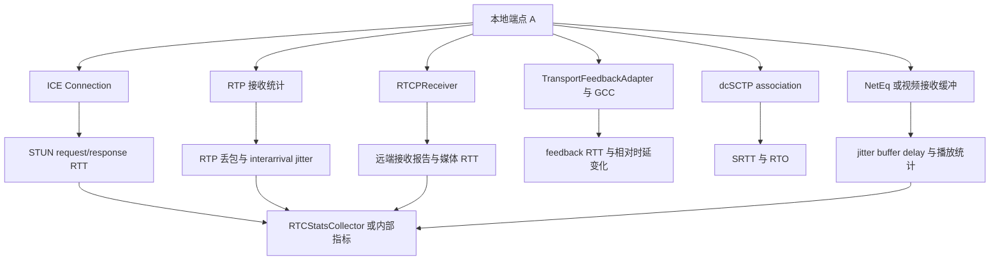
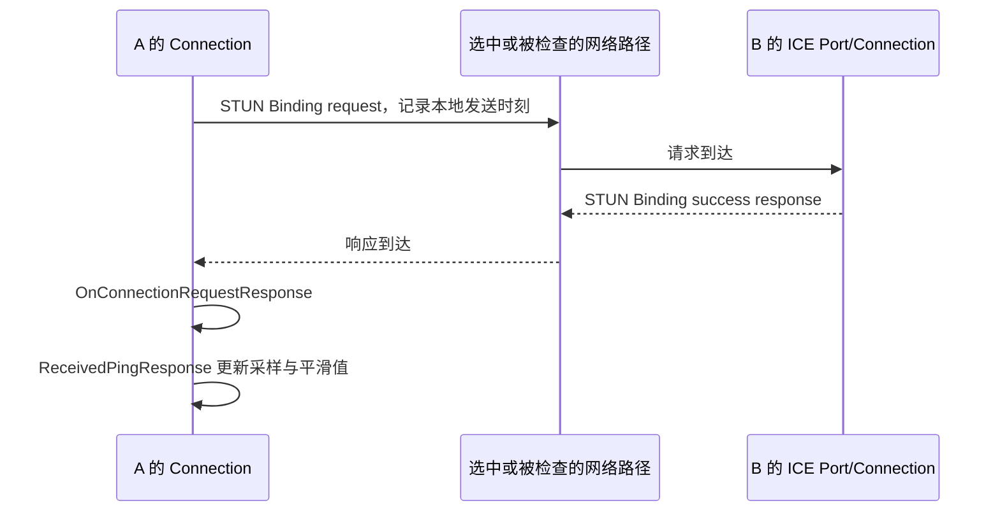
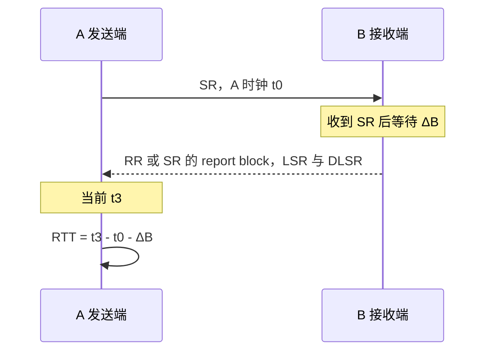
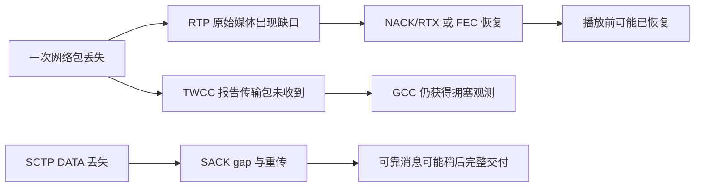

# 链路网络指标：RTT、丢包、jitter 与上下行时延

本文基于 `webrtc_src` 提交 `9310b29acd9e0985ab65f454959122336e3b7e78`。目标是把“用户看到的一个网络指标”追溯到 **哪个端点、哪层协议、哪段时间、哪些包、什么单位**。

阅读导航：[文档目录](README.md) · [GCC/TCC](gcc-tcc.md) · [ICE/STUN/TURN](socket-ice-stun-turn.md) · [DTLS/SRTP 收发](dtls-srtp-packet-flow.md) · [DataChannel](datachannel-dcsctp.md) · [dcSCTP 拥塞控制](dcsctp-congestion-control.md) · [常见问题](transport-faq.md)。

## 1. 先确定指标口径，再比较数值

一个 PeerConnection 中同时存在 ICE、RTP/RTCP、transport feedback、SCTP 和播放缓冲等测量点。同一个连接出现多个不同 RTT 或 jitter 值通常是正常现象。



方向约定：A→B 为 A 的上行、B 的下行；B→A 反之。若 B 是 SFU，则此处上行通常到 SFU 为止，不自动包含 SFU→其他订阅者。

`RTCInboundRtpStreamStats` 是本地接收的媒体流；`RTCRemoteInboundRtpStreamStats` 是对端报告的、本地发送流在对端的接收情况。名称中的 remote 表示统计观测来自对端，并不表示该 stats 对象由远端完整序列化传输。

字段定义入口：[`rtcstats_objects.h`](../webrtc_src/api/stats/rtcstats_objects.h)；实际赋值入口：[`RTCStatsCollector`](../webrtc_src/pc/rtc_stats_collector.cc)。字段缺失应保留为缺失，不能默认为零 RTT、零丢包或零 jitter。

## 2. ICE RTT：候选对级 STUN 往返时间

### 2.1 测量链路

`Connection::OnConnectionRequestResponse()` 处理已经经过校验的 STUN 连通性检查响应，调用 `StunRequest::Elapsed()` 取得自请求最近一次发送后的经过时间，再调用 `ReceivedPingResponse()`。`StunRequest::SendInternal()` 每次发送都会更新 `tstamp_`，因此不能把该值描述为必然从事务首次发送开始计时。

另有通过响应关联已发送 ping 的路径，以 `now - SentPing.sent_time` 得到样本。两者均围绕该 ICE `Connection` 的检查请求和响应，不是 RTP 播放时间或 SCTP 确认时间。



基本测量式为：

```text
rtt_sample = response_receive_time - request_send_time
```

它包含请求方向网络耗时、对端处理及调度、响应方向网络耗时和本端接收处理边界上的延迟。STUN 请求路径若走 TURN 中继，测量也包含实际选定路径中的中继开销。

### 2.2 同一 `Connection` 内也有不同 RTT 数值

`ReceivedPingResponse()` 更新：

- `current_round_trip_time_`：最新有效样本。
- `total_round_trip_time_`：有效样本累加值。
- `rtt_`：用于内部判断的平滑值，首个样本直接赋值，后续为 `(3 × old + sample) / 4`。
- `rtt_estimate_`：另外的时间加权统计对象，用于估计平均和方差，不能与上一个简单 EWMA 混为一谈。

例如旧平滑 RTT 为 100 ms，新样本 180 ms，则新的 `rtt_` 为 120 ms，而 `current_round_trip_time_` 为 180 ms。日志与 getStats 展示不同字段时，二者并不矛盾。

### 2.3 导出字段与注意事项

`candidate-pair.currentRoundTripTime` 与 `totalRoundTripTime` 在 collector 中从毫秒转换成秒。该候选对统计可能不是当前选中的传输路径；应先通过 transport 的 selected candidate pair 关联，或核对 `info.best_connection`。

ICE 平滑 RTT 还参与可写性和路径管理，但某些超时决策会进一步 clamp/放大值。日志中的超时判定值不是未经处理的 RTT 样本。

关键定位：[`Connection::OnConnectionRequestResponse / ReceivedPingResponse`](../webrtc_src/p2p/base/connection.cc) 第 1513 / 1263 行；[`StunRequest::Elapsed`](../webrtc_src/p2p/base/stun_request.cc) 第 287 行；[`candidate_pair_stats` 赋值](../webrtc_src/pc/rtc_stats_collector.cc) 第 1662 行附近。

## 3. RTP/RTCP RTT：扣除远端等待时间

### 3.1 SR/RR 计算

发送端 A 发出 RTCP Sender Report，携带 NTP 时间。B 接收后，在后续 report block 中回显 LSR，并报告自收到 SR 后经过的 DLSR。

- LSR 是上次接收 SR 的 NTP 时间中间 32 位。
- DLSR 是从收到该 SR 到发出 report block 的时间间隔，单位 `1/65536 s`。
- A 收到 report block 时，把本地当前 NTP 时间转为同样的 compact NTP 表示。

```text
RTT_compact = A_now_compact - LSR - DLSR
RTT_seconds = RTT_compact / 65536
```

固定的两端绝对时钟偏差不需要直接相减：LSR 回显 A 自己的时间，DLSR 是 B 端的时间差。时钟漂移、量化及不单调时间仍可能影响结果。



例：SR 发出后 600 ms 收到 RR，对端在收到 SR 后等待 480 ms 才发送 RR，则媒体 RTT 约为 120 ms。直接把 600 ms 当 RTT 会把 RTCP 等待时间一起算进去。

`RTCPReceiver` 只处理针对本地注册 SSRC 的 report block；LSR 为零表示尚无可用 SR 关联，不生成该样本。

### 3.2 源码中的截断与聚合

`CompactNtpRttToTimeDelta()` 将 compact NTP 差值转换成时间；当前实现把过小或被视为负数的值抬到至少 1 ms。因此负时钟偏差不会以负 RTT 原样输出，看到持续 1 ms 也应检查时间基础和报文关联。

`ReportBlockData::AddRoundTripTimeSample()` 保存最新 RTT、累计 RTT 和样本数。这使得：

```text
lifetime_mean_rtt = totalRoundTripTime / roundTripTimeMeasurements
interval_mean_rtt = delta(totalRoundTripTime) / delta(roundTripTimeMeasurements)
```

差分平均仅适用于同一 stats 身份、累计计数未重置且样本数增量大于零。重复读取同一个最新 RTT 不会增加统计样本数。

关键定位：[`RTCPReceiver` report block 处理](../webrtc_src/modules/rtp_rtcp/source/rtcp_receiver.cc) 第 581～600 行；[`CompactNtpRttToTimeDelta`](../webrtc_src/modules/rtp_rtcp/source/ntp_time_util.cc) 第 49 行；[`ReportBlockData::AddRoundTripTimeSample`](../webrtc_src/modules/rtp_rtcp/include/report_block_data.cc) 第 45 行。

### 3.3 stats 映射

`remote-inbound-rtp.roundTripTime` 是本地发送流由接收到的 RTCP report block 得出的最新 RTT；`totalRoundTripTime` 与 `roundTripTimeMeasurements` 来自对应 `ReportBlockData`。

collector 从 `report_block.last_rtt().seconds<double>()` 等值导出秒。不要将它与某些 native API 或日志中的毫秒字段直接比较。

关键定位：[`CreateRemoteInboundRtpStreamStats`](../webrtc_src/pc/rtc_stats_collector.cc) 第 918～932 行。

## 4. RTCP XR RTT：没有媒体 SR 时的另一条路径

RTCP XR 的 RRTR/DLRR 支持 non-sender RTT 测量。RRTR 携带时间，DLRR 回显 LRR 并携带自收到 RRTR 后的等待时间。

计算形式仍是：

```text
RTT = local_now_compact - last_rr - delay_since_last_rr
```

本地 `RTCPReceiver` 更新 `xr_rr_rtt_` 和 `non_sender_rtts_`。`last_rr` 为零时该测量不可用，源码会使相关统计失效，而不是产生零 RTT。

部分接收流的 native stats 会将这类非发送端 RTT 带入 `RTCRemoteOutboundRtpStreamStats`。是否出现取决于流类型、XR 配置及是否实际交换对应报文；不能承诺所有音视频 remote-outbound 条目始终有 RTT。

关键定位：[`RTCPReceiver` DLRR 处理](../webrtc_src/modules/rtp_rtcp/source/rtcp_receiver.cc) 第 832～851 行；[`remote-outbound` RTT 映射](../webrtc_src/pc/rtc_stats_collector.cc) 第 595～603 行。

## 5. TCC/GCC RTT：反馈等待与传播估计

### 5.1 feedback RTT

发送端掌握每个已发 RTP 包的实际本地发送时间，收到 TCC 后可以计算：

```text
feedback_rtt_i = feedback_arrival_time - local_send_time_i
```

这个量通常包含：数据正向传输、接收端等待反馈、反馈反向传输、本地处理。一个 RTCP feedback 覆盖多个包，越早发送的包通常等待越久，所以同一反馈内会出现多个不同 feedback RTT。

### 5.2 GCC 当前如何估计 propagation RTT

`GoogCcNetworkController` 找出反馈中最大的接收时间 `max_receive_time`，对每个已收到包计算：

```text
pending_i = max_receive_time - receive_time_i
propagation_rtt_i = feedback_rtt_i - pending_i
max_feedback_rtt = max_i(feedback_rtt_i)
min_propagation_rtt = min_i(propagation_rtt_i)
```

例：某反馈在 A 时钟 150 ms 收到；包 1 于 0 ms 发送、包 2 于 20 ms 发送。对端观测包 1 和包 2 的到达间隔为 20 ms，则二者 feedback RTT 分别为 150、130 ms；扣除各自相对最后到达包的等待后，都得到 130 ms。

这个计算扣除了“早到包等待同批较晚包”的部分，但未必扣掉最后一个包之后的反馈定时等待。因此变量虽命名 propagation RTT，也不应解释为已消除全部接收端处理的物理传播时延。

最近最多 32 份反馈的最大 feedback RTT 还参与媒体 congestion window 估计；它与 ICE 的 EWMA 以及 SR/RR 的 RTT 聚合不是同一个窗口。

关键定位：[`GoogCcNetworkController::OnTransportPacketsFeedback`](../webrtc_src/modules/congestion_controller/goog_cc/goog_cc_network_control.cc) 第 419～443 行、`UpdateCongestionWindowSize` 第 383 行。

### 5.3 这些内部值不等于一个通用 getStats RTT 字段

`TransportFeedbackAdapter` 维护 feedback 时间基准，`SendSideBandwidthEstimation` 接受 RTT / propagation RTT 输入并做控制判断。内部网络控制估计、event log、应用自行导出的 BWE 指标，可能与 `remote-inbound-rtp.roundTripTime` 数值不同。

排查必须先识别字段写入处，不能仅凭名字中都含 RTT 就认为它们来自同一个函数。

## 6. SCTP RTT、SRTT 与 RTO

### 6.1 SCTP 样本来源

`RetransmissionQueue::HandleSack()` 的处理过程中会调用 `UpdateRTT()`，由 `OutstandingData::MeasureRTT()` 使用被累计确认的 TSN 对应发送时间形成样本。

Karn 原则要求不使用已重传的数据计算 RTT，因为无法确定确认对应首次发送还是重传。当前实现检查 `has_been_retransmitted()`。

另外，`HeartbeatHandler` 收到包含创建时间的 heartbeat ACK 时，可测得往返样本并交给 association 的 `TransmissionControlBlock::ObserveRTT()`。

SACK 可以延迟发送。当前 `RetransmissionQueue::UpdateRTT()` 注释明确指出 delayed acknowledgement 会增大测量值；它不像 RTCP DLSR 一样在 SACK 中统一扣除接收端等待时间。

关键定位：[`OutstandingData::MeasureRTT`](../webrtc_src/net/dcsctp/tx/outstanding_data.cc) 第 509 行；[`RetransmissionQueue::UpdateRTT`](../webrtc_src/net/dcsctp/tx/retransmission_queue.cc) 第 342 行；[`HeartbeatHandler`](../webrtc_src/net/dcsctp/socket/heartbeat_handler.cc) 第 161 行附近。

### 6.2 平滑与超时算法

`RetransmissionTimeout::ObserveRTT()` 对有效样本计算：

```text
first sample:
    SRTT = RTT
    RTTVAR = RTT / 2
later samples:
    RTTVAR = 0.75 * RTTVAR + 0.25 * abs(old_SRTT - RTT)
    SRTT = 0.875 * old_SRTT + 0.125 * RTT
RTTVAR = max(RTTVAR, configured_min_variance / 8)
RTO = clamp(SRTT + 4 * RTTVAR, configured_min_rto, configured_max_rto)
```

先用旧 SRTT 更新方差，再更新 SRTT，顺序不能交换。负样本或超过配置最大 RTT 的样本会被忽略。源码对 minimum variance 的 `/8` 保留历史启发式，因此不能只抄通用 RFC 公式而漏掉实现约束。

例：首个样本 100 ms，则未裁剪前 SRTT=100 ms、RTTVAR=50 ms、RTO=300 ms。第二个样本 120 ms 后，RTTVAR=42.5 ms、SRTT=102.5 ms，未裁剪 RTO=272.5 ms。实际值还需经过整数时间精度、方差下限及 RTO 上下限处理。

`RTO` 是“等待多久后重传”的控制参数，不是网络往返耗时。不能把 RTO 当作展示给用户的 RTT。

### 6.3 可观察字段

`DcSctpSocket::GetMetrics()` 把 association 当前 SRTT 导出为 `Metrics::srtt_ms`，单位毫秒。它不是 `RTCDataChannelStats` 的标准 `roundTripTime` 字段；如果应用展示 DataChannel RTT，应明确是 dcSCTP SRTT、ICE RTT，还是业务 ping/pong。

关键定位：[`RetransmissionTimeout::ObserveRTT`](../webrtc_src/net/dcsctp/tx/retransmission_timeout.cc) 第 39 行；[`DcSctpSocket::GetMetrics`](../webrtc_src/net/dcsctp/socket/dcsctp_socket.cc) 第 686 行附近；[`Metrics::srtt_ms`](../webrtc_src/net/dcsctp/public/dcsctp_socket.h) 第 230 行。

## 7. RTP 丢包统计：累计、区间和恢复语义

### 7.1 基础序列号统计

`ReceiveStatisticsImpl` 为不同 SSRC 管理 `StreamStatisticianImpl`。后者展开 16 位 RTP 序列号，记录首个序列号、最高序列号、累计损失和上次报告基线。

基本关系为：

```text
expected = extended_highest_sequence - first_sequence + 1
cumulative_lost = expected - received_count
```

实际代码用增量更新实现：每收到包先减少累计损失，在新的顺序包推进最高序列号时加上跨度。还处理重排序、序列号回绕、流重启和可选重传检测。

如果先收到 100、101、103，缺少 102，暂计损失 1；随后 102 迟到，则累计损失可减少。重复包也会影响接收计数，因此内部累计损失不必单调增加，甚至可能为负。

**packetsLost 的变化不等于“这一秒永久丢掉的包数”。** 需要结合迟到、重复、RTX 解封装后的统计入口和采样边界理解。

关键定位：[`StreamStatisticianImpl::UpdateCounters / UpdateOutOfOrder`](../webrtc_src/modules/rtp_rtcp/source/receive_statistics_impl.cc) 第 121 行及其前部。

### 7.2 RTCP fraction lost 是报告区间值

发送 report block 时计算：

```text
expected_interval = current_highest - previous_report_highest
lost_interval = current_cumulative_lost - previous_report_cumulative_lost
```

只有二者都大于零时才生成正损失比例，随后更新报告基线。这不是最近固定 1 秒的值，窗口由报告生成时机决定。

当前版本的一个实现细节必须单独记录：

- `StreamStatisticianImpl::MaybeAppendReportBlockAndReset()` 生成 raw 字段使用整数 `255 * lost_interval / expected_interval`。
- `ReportBlockData::fraction_lost()` 将收到的 raw 字段按 `raw / 256.0f` 解码。
- GCC 某些 legacy `fraction_loss` 导出路径则使用 `/255.0`。

因此不能在所有层统一使用一个除数并认为完全等价。RTCP 标准字段采用 8 位定点分数，规范背景见 [RFC 3550 第 6.4.1 节](https://www.rfc-editor.org/rfc/rfc3550.html#section-6.4.1)；本文保留当前源码生成与读取的实际差别。

例：一个报告区间期望 100 包、丢失 5 包，本版本生成 raw=12；接收侧 `ReportBlockData` 解码为 `12/256 = 4.6875%`。不能用该量化值倒推恰好丢了 4.6875 个包。

关键定位：[`MaybeAppendReportBlockAndReset`](../webrtc_src/modules/rtp_rtcp/source/receive_statistics_impl.cc) 第 241～289 行；[`ReportBlockData::fraction_lost`](../webrtc_src/modules/rtp_rtcp/include/report_block_data.h) 第 44 行。

### 7.3 累计丢包导出与百分比

RTCP cumulative lost 字段是有符号 24 位，当前发送实现将负值钳为零并维护 offset，同时对超出 `0x7fffff` 的值封顶。内部原始累计损失与实际发出的 RTCP 值可能不同。

`StreamStatisticianImpl::GetFractionLostInPercent()` 则以流自开始以来的 `expected_packets` 为分母，返回整数百分比；无有效接收或分母不可用时返回空，累计损失非正时返回零。

本地 `inbound-rtp.packetsLost`、远端 report block 进入的 `remote-inbound-rtp.packetsLost`、应用拿相邻 stats 做差得到的 loss ratio，分别具有本地累计、远端报告和应用时间窗三种口径。

应用如需要区间比例，可在同一 SSRC 和同一统计生命周期内计算 `delta(lost) / delta(expected)`；若仅用 stats，则 `delta(packetsReceived)+delta(packetsLost)` 常被用于近似期望数，但需确认重复包、修复包和计数范围。遇到负增量、重置或分母为零，应标识不可比较或按产品定义处理，不能取绝对值制造丢包。

关键定位：[`GetFractionLostInPercent`](../webrtc_src/modules/rtp_rtcp/source/receive_statistics_impl.cc) 第 292 行；[`remote_inbound->packets_lost / fraction_lost`](../webrtc_src/pc/rtc_stats_collector.cc) 第 925 行。

## 8. TCC 丢包、GCC 损失与媒体残余损失

TCC 的缺失状态针对 transport sequence number，覆盖被反馈机制跟踪的网络发送；RTP 的 loss 针对 SSRC 的 RTP sequence number；SCTP 的 SACK gap 针对 TSN。三者不应混为一个 lost ratio。



例如一个视频原始包丢失、RTX 成功：网络确实发生过一次丢包，TCC 的原始发送记录仍可反映它；媒体经过恢复后可能没有解码缺失。若只看最终可解码率，无法据此断言网络没有丢包。

`RtpTransportControllerSend::OnReport()` 会按 SSRC 比较连续 RTCP report blocks 的扩展最高序列号与累计损失，然后把多个流的增量相加，形成 `TransportLossReport`。

而 `LossBasedBweV2` 根据逐包 `PacketResult` 聚合观测，默认窗口下限 250 ms、15 个观测、默认使用字节损失，并带时间权重及尖峰处理。这个内部 loss signal 不能用某个 SSRC 的 RR fraction lost 完整替代。

RFC 8888 路径还记录首次报告丢失、后续报告恢复、ECT(1)、CE 等计数。`packetsReportedAsLostButRecovered` 不表示业务一定经历过重传，也可能由迟到或后续反馈补报触发，应按反馈状态变化理解。

关键定位：[`RtpTransportControllerSend::OnReport`](../webrtc_src/call/rtp_transport_controller_send.cc) 第 893 行、`ComputeStatsFromCongestionControlFeedback` 第 706 行；[`LossBasedBweV2::PushBackObservation`](../webrtc_src/modules/congestion_controller/goog_cc/loss_based_bwe_v2.cc) 第 1149 行附近。

## 9. RTP interarrival jitter 的计算

### 9.1 公式与时钟单位

对于相邻有效样本，接收端先把本地接收时间差换算到 RTP clock 的采样单位，再减 RTP timestamp 差：

```text
D = (arrival_i - arrival_previous) * rtp_clock_rate
    - (rtp_timestamp_i - rtp_timestamp_previous)
J = J + (abs(D) - J) / 16
jitter_seconds = J / rtp_clock_rate
```

它反映包到达间隔相对媒体时间间隔的变化，使用绝对值平滑，因此不是有符号队列增长趋势，也不是绝对延迟。

当前实现用 Q4 定点数维护 `jitter_q4_`，避免每个包进行浮点运算：先将 `abs(D)` 左移 4 位，再按 1/16 更新；导出时右移 4 位，随后除以 clock rate 转换成秒。

例：音频 clock rate 为 48 kHz，两包 RTP timestamp 差 960，即 20 ms；实际接收间隔 25 ms，则 `D=240` samples，即 5 ms。若旧 J=96 samples，即 2 ms，理想浮点更新后 J=105 samples，即 2.1875 ms；Q4 舍入可能造成末位差异。

关键定位：[`StreamStatisticianImpl::UpdateJitter`](../webrtc_src/modules/rtp_rtcp/source/receive_statistics_impl.cc) 第 158 行、`GetStats` 第 222 行。

### 9.2 当前实现的样本选择

并非任意两次 `recvfrom()` 都更新 jitter。`UpdateCounters()` 在顺序包路径且 RTP timestamp 改变、已有足够有效包时调用 `UpdateJitter()`；同一视频帧的相同 RTP timestamp 包不会逐个以相同规则产生新样本。

旧的乱序包在相应处理路径提前返回；异常的大 timestamp 差也会被过滤。若 payload type 对应 clock rate 改变，`ReviseFrequencyAndJitter()` 会按新旧频率比例缩放已有 jitter，防止把混合采样单位当成一个值。

举例：视频 clock rate 90 kHz，report block jitter=900，表示 10 ms；不能按音频 48 kHz 去除而解释为 18.75 ms。payload type 编号本身不等于 clock rate，需查 codec 映射。

RTCP 算法背景见 [RFC 3550 附录 A.8](https://www.rfc-editor.org/rfc/rfc3550.html#appendix-A.8)，样本选择与定点实现以当前源码为准。

### 9.3 stats 映射与上行 jitter

`inbound-rtp.jitter` 反映本地接收流；`remote-inbound-rtp.jitter` 来自远端 RTCP report block，并按本地关联 codec clock rate 转为秒。

以 A 为观察端，A 的 `remote-inbound-rtp.jitter` 可以用于描述 **A→B 上行在 B 接收点观察到的 RTP jitter**。它不是 A 自己测量的上行发送调度抖动，也不是 A→B→其他订阅者整个会议分发链的抖动。

collector 明确假设双方 codec 相同；动态切换 codec 时，刚收到的 report block 可能仍对应旧 clock rate，而关联 codec 已更新，应考虑短暂换算偏差。

关键定位：[`ReportBlockData::jitter`](../webrtc_src/modules/rtp_rtcp/include/report_block_data.cc) 第 22 行；[`remote_inbound->jitter`](../webrtc_src/pc/rtc_stats_collector.cc) 第 969～981 行。

## 10. jitter、jitter buffer delay 和 GCC delay delta 的区别

RTP jitter 的单位可转换为毫秒，但它并不表示播放缓冲必须恰好增加同样的毫秒数。NetEq 或视频缓冲还需要考虑乱序、丢包恢复、解码、帧间依赖及音视频同步。

`jitterBufferDelay` 是累计缓冲等待量，`jitterBufferEmittedCount` 是相应输出单位计数。平均值应计算：

```text
mean_buffer_delay = jitterBufferDelay / jitterBufferEmittedCount
interval_mean = delta(jitterBufferDelay) / delta(jitterBufferEmittedCount)
```

音频计数常对应样本，视频计数对应帧；不能把音视频累计值直接相加后除以任意共同“包数”。`jitterBufferTargetDelay` 与 `jitterBufferMinimumDelay` 也分别表达目标和最低需求的累计统计，不等于网络 transit time。

GCC 的 `delay_delta = receive_delta - send_delta` 是有符号相对变化，经累积、平滑、回归判断队列趋势。RTP jitter 则平滑 `abs(D)`；两者即使使用相似的间隔概念，算法和控制目标仍不同。

NetEq 的 `relativePacketArrivalDelay` 是另一项相对到达延迟统计，不是通用 `uplink delay`。本地接收方向、累计方式及其分母都需要保留，不能改名后与 TCC 指标混合。

关键定位：[`jitter buffer stats 映射`](../webrtc_src/pc/rtc_stats_collector.cc) 第 422 行附近；[`ReceiveStatisticsProxy::OnDecodableFrame`](../webrtc_src/video/receive_statistics_proxy.cc) 第 496 行；[`StatisticsCalculator`](../webrtc_src/modules/audio_coding/neteq/statistics_calculator.cc) 第 341 行附近；[`TrendlineEstimator`](../webrtc_src/modules/congestion_controller/goog_cc/trendline_estimator.cc)。

## 11. uplink delay 到底能测量什么

### 11.1 当前上游源码没有统一同名字段

在本次核对的上游代码中，没有找到统一的 `uplink_jitter` / `uplink_delay` 指标定义。业务 SDK、日志系统或看板使用这些名称时，必须继续查具体写入处、计算式和观测端点。

这不妨碍说明候选口径：上行 jitter 通常可能映射到远端 RTP interarrival jitter；上行 delay 则可能指单向网络耗时、相对排队时延、发送队列等待或端到端媒体耗时，四者没有自动等价关系。

### 11.2 绝对单向时延需要处理时钟偏移

真实 A→B 单向网络耗时是 B 接收时刻减 A 发送时刻，但两个时钟存在偏移：

```text
observed_difference = one_way_delay + clock_offset
```

若没有时钟同步或可靠偏移估计，不能单凭两个绝对时间戳分离这两个未知量。RTT/2 只是在假设上下行对称时的近似，不是单向时延实测；蜂窝网络、TURN、上下行不同队列等场景可明显不对称。

RTP timestamp 表示媒体时间轴，不直接表示 socket 实际发送时间。RTCP SR 将媒体时间映射到发送端 NTP 时间，仍不能自动消除发送端与接收端 wall clock 偏移。

### 11.3 TCC 可以观测时延变化

相邻包/组两端时间差相减后，固定偏移抵消：

```text
delay_change = (B_arrival_i - B_arrival_j) - (A_send_i - A_send_j)
```

例：A 两组发送间隔 20 ms，B 两组到达间隔 35 ms，则相对延迟增加 15 ms。无法仅凭这一条记录判断原本单向延迟是 10 ms、50 ms 还是 200 ms。

把变化值从某个最低点累积得到的“排队时延估计”仍依赖起点和路径稳定性。切换 ICE candidate pair、发送时钟变化或接收时钟跳变时需要重新解释基线。

### 11.4 本地发送队列耗时

当前 `totalPacketSendDelay` 来源链为：`PrioritizedPacketQueue` 在取包时记录 `RtpPacketToSend::time_in_send_queue()` → `RtpPacketCounter::total_packet_delay` 累计 → 音视频 media stats → `RTCOutboundRtpStreamStats`。

队列计算使用非暂停状态下的时间，扣除了 pause 时间。因此它不是完整“从采集画面到 UDP 发出”的耗时，也不包含网络传播和对端处理。

区间平均可用同一 outbound stream 的 `delta(totalPacketSendDelay) / delta(packetsSent)` 进行解释，但应确认计数与累积量覆盖一致，特别是 RTX、FEC、多个 SSRC 的聚合。分母为零时无新样本，不能输出新的零延迟。

例：采样区间发送计数增加 100 包，累计 queue delay 增加 2 秒，则每包平均队列等待 20 ms。这不说明上行网络耗时是 20 ms。

关键定位：[`PrioritizedPacketQueue`](../webrtc_src/modules/pacing/prioritized_packet_queue.cc) 第 397～409 行；[`RtpPacketCounter`](../webrtc_src/modules/rtp_rtcp/include/rtp_rtcp_defines.cc) 第 60、86 行；[`outbound_stats->total_packet_send_delay`](../webrtc_src/pc/rtc_stats_collector.cc) 第 741 行。

### 11.5 端到端媒体耗时

采集、编码、pacer、网络、接收缓冲、解码和渲染均会贡献端到端延迟。若业务用 watermark 或 frame ID 在两端测量，其统计可能比 ICE RTT/2 大很多，并不代表网络测量错误。

业务 ping/pong 的 RTT 也可能包含 DataChannel 排队、SCTP 重传、应用线程调度等。若对方收到后先处理业务再回包，这个处理时间要么显式扣除，要么保留并命名为业务往返时间。

## 12. 常见现象的源码解释

**ICE RTT 很低，DataChannel 消息很慢。** ICE 检查不经过 SCTP 消息排队、分片重组和有序交付；查看 SCTP SRTT、RTO、cwnd、发送队列、receiver window、重传与应用 `buffered_amount`。

**jitter 很低，但媒体延迟很大。** 如果每个包稳定地多等待 300 ms，间隔变化仍可很小；检查单向基线、pacer 队列、缓冲、解码和渲染。

**丢包率回落甚至出现负差分。** 迟到或重复包可能减少累计损失；相邻统计对象身份、SSRC 和重启基线也可能变化。先确认计数语义，再判断网络恢复。

**上行 jitter 显示为零。** 可能是确实较低，也可能没有收到远端报告、clock rate 映射缺失、字段未定义被业务错误补零。检查字段存在性和报告时间。

**同一时刻 RTT 差几十毫秒。** 核对 ICE 最新采样、RTCP 扣除 DLSR 的样本、TCC 等待反馈的样本、SCTP delayed SACK 和平滑窗口。

**availableOutgoingBitrate 与测速结果不同。** collector 取选中候选对关联的发送带宽估计；它是当前控制系统估计，不是专门测速后的物理链路上限。ALR、上层约束与反馈类型都会影响它。

## 13. 工程采集与比较规则

建议每条指标同时记录：方向、测量端、transport/candidate pair、SSRC 或 SCTP association、单位、采样时间、累计/瞬时属性、来源字段及 field trials。

不同层级的比较应使用关联 ID 和同一时间区间，而不是把最近一次非空值拼成一行。RTCP 报告、ICE 检查与 TCC 周期不同，统计新鲜度也不同。

累计值做差前检查身份连续性；计数下降可能表示重置或切换。对 RTT 和 jitter 的秒值展示为毫秒时乘 1000；fraction 是 0～1 范围时展示百分比才乘 100。

多流合并时，丢包率应优先汇总对应分子分母再除，不应简单平均各 SSRC 的百分比；RTT 应按样本数加权，而不是按视频码率加权；jitter 一般保留各流和时钟口径，避免输出缺少定义的“会议整体 jitter”。

## 14. 构建、测试证据与边界

已核对构建归属：[`p2p/BUILD.gn`](../webrtc_src/p2p/BUILD.gn) 的 `connection` / `rtc_p2p_unittests`；[`modules/rtp_rtcp/BUILD.gn`](../webrtc_src/modules/rtp_rtcp/BUILD.gn) 的接收统计、RTCP receiver、`rtp_rtcp_unittests`；[`net/dcsctp/tx/BUILD.gn`](../webrtc_src/net/dcsctp/tx/BUILD.gn) 的 `retransmission_timeout` / `dcsctp_tx_unittests`。

本次通过阅读以下现有测试核对边界语义，未将“阅读测试”表述为“执行测试通过”：

- [`receive_statistics_unittest.cc`](../webrtc_src/modules/rtp_rtcp/source/receive_statistics_unittest.cc)：`SimpleLossComputation`、`LossComputationWithReordering`、`LossComputationWithDuplicates`、序列号回绕与重启、`SimpleJitterComputation`、`ReviseJitterTest`。
- [`rtcp_receiver_unittest.cc`](../webrtc_src/modules/rtp_rtcp/source/rtcp_receiver_unittest.cc)：`InjectSrPacketCalculatesRTT`、`InjectSrPacketCalculatesNegativeRTTAsOneMs`、多 report block 和 XR RTT。
- [`connection_unittest.cc`](../webrtc_src/p2p/base/connection_unittest.cc)：RTT estimate 样本、收敛与重置。
- [`retransmission_timeout_test.cc`](../webrtc_src/net/dcsctp/tx/retransmission_timeout_test.cc)：稳定/不稳定 RTT、负值、过大样本、RTO 上下限及 minimum variance。
- [`rtc_stats_collector_unittest.cc`](../webrtc_src/pc/rtc_stats_collector_unittest.cc)：字段映射、单位及 `total_packet_send_delay`。

本文没有替业务 SDK 定义未给出的 `uplink delay/jitter` 字段。若需要将具体日志或看板字段对应到这里的算法，应以该字段的生产代码和统计窗口为准；仅凭显示名称无法唯一确定测量语义。
