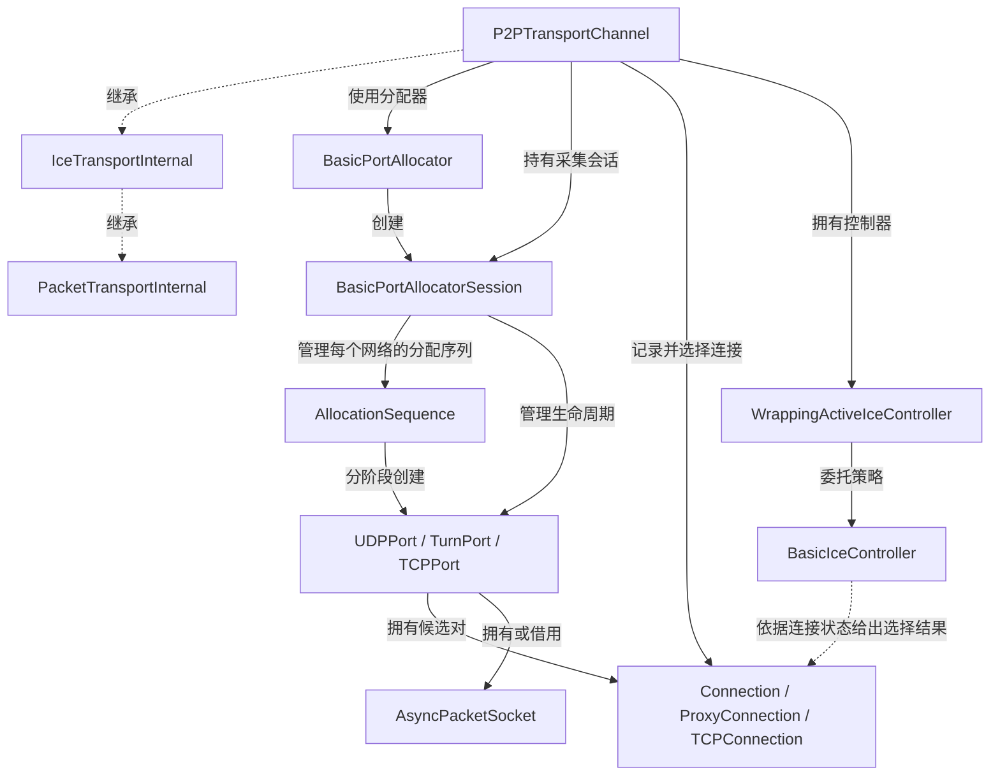
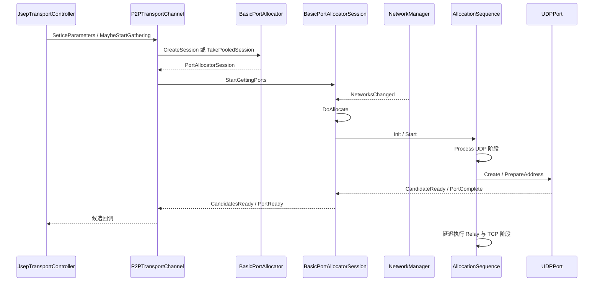
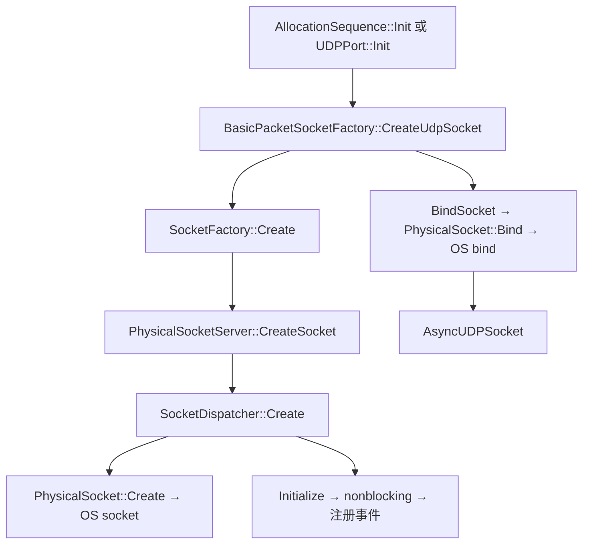
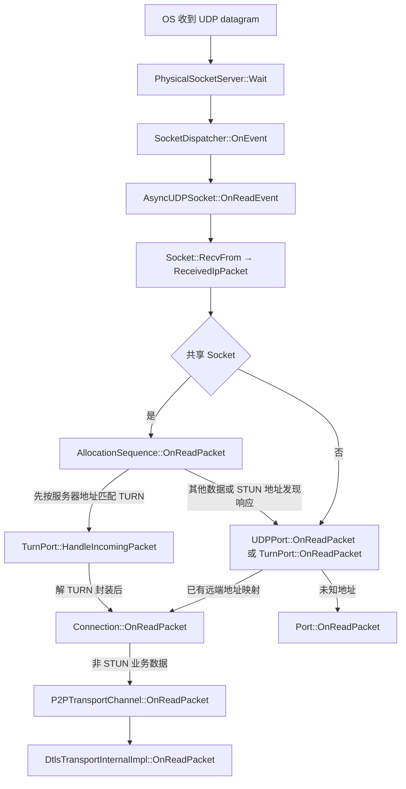
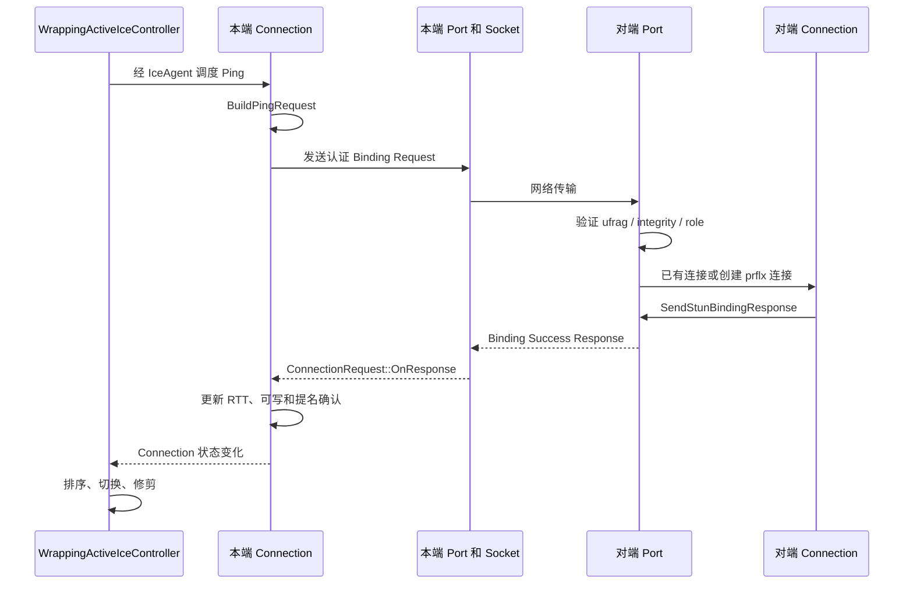
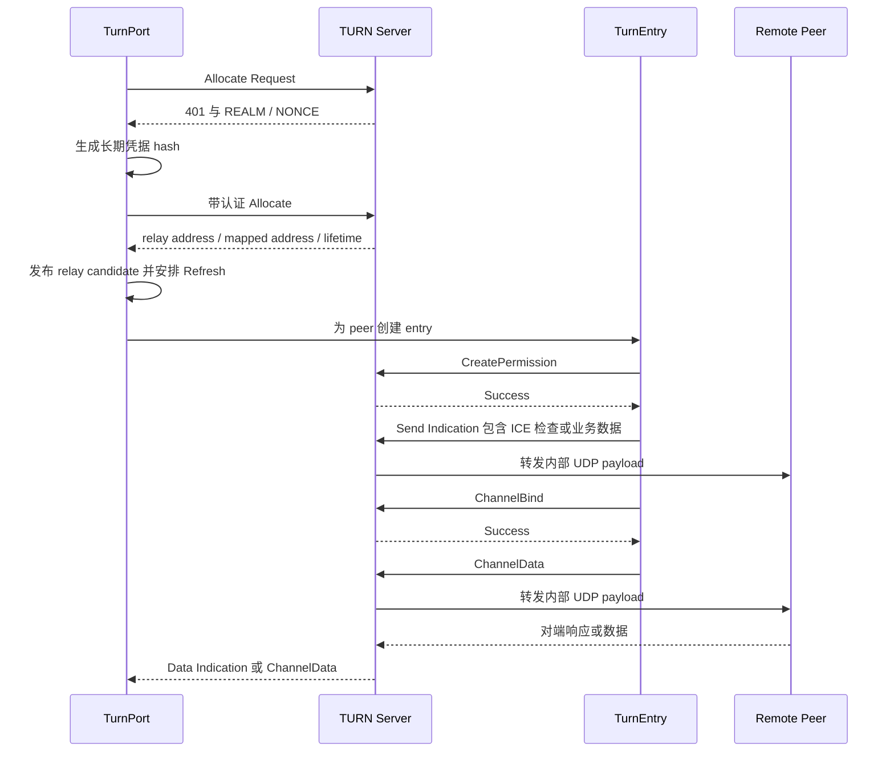
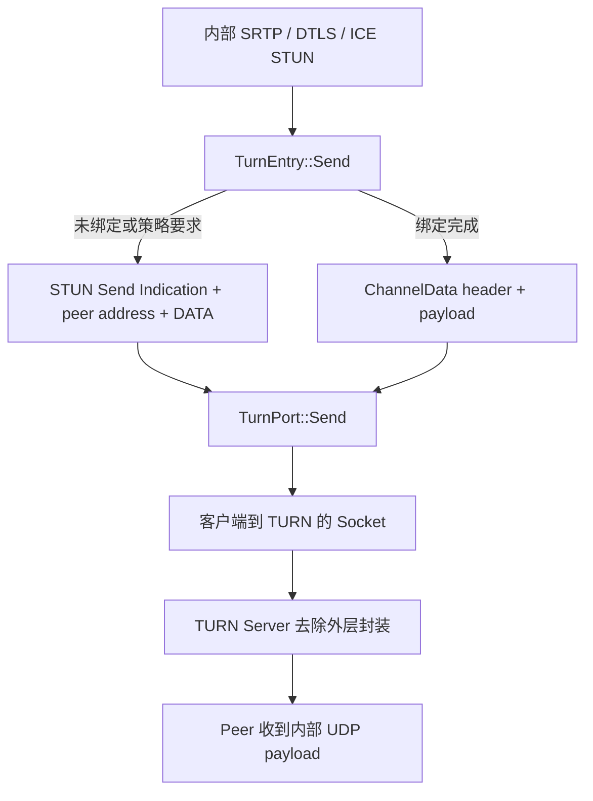

# Socket、STUN、TURN 与 ICE 传输架构

本文以 `webrtc_src` 提交 `9310b29acd9e0985ab65f454959122336e3b7e78` 为基线，说明从创建操作系统 Socket，到选出可用网络路径，再到双向搬运报文的实现。行号对应这一提交；后续版本请优先按类名和函数名定位。

本篇的上边界是 `IceTransportInternal` 的报文接口，下边界是本仓库默认 Socket 实现的系统调用。DTLS、SRTP、SCTP 消息处理分别见 [安全传输与报文路径](dtls-srtp-packet-flow.md) 和 [DataChannel 与 dcSCTP](datachannel-dcsctp.md)。整体对象装配见 [项目架构](webrtc-architecture.md)。

## 1. 先分清四种对象

`Socket` 表示本地 I/O 资源；`Port` 表示基于某个本地网络和传输方式提供候选地址的 ICE 端点；`Candidate` 是可通过信令交换的地址和属性；`Connection` 是一个本地候选与一个远端候选形成的候选对及其运行状态。

因此不能用“一个候选对应一个 Socket”理解本实现。一个 UDP Socket 可以同时产生 host 和 srflx 候选，也可以被 `UDPPort` 与多个 UDP `TurnPort` 共享。一个 `Port` 还可以建立多个面向不同远端地址的 `Connection`。

`P2PTransportChannel` 管理这些连接，从中选择发送路径。它提供的是可发送报文的 ICE transport，不负责把 SCTP 消息分片，也不负责加密 RTP。其继承入口是 [p2p_transport_channel.h](../webrtc_src/p2p/base/p2p_transport_channel.h) 第 98 行。



图中虚线仅表示接口继承或策略依赖，实线上的文字说明创建、持有和调用关系。`TCPConnection` 自身还持有已连接 TCP Socket，不能把 UDP 的 Port-Socket 关系原样套到 TCP。

## 2. 从 PeerConnection 配置进入候选采集

`JsepTransportController::CreateIceTransport()` 在 [jsep_transport_controller.cc](../webrtc_src/pc/jsep_transport_controller.cc) 第 474 行构造 `IceTransportInit`，传入 allocator、DNS resolver、网络线程和本地网络访问许可工厂，调用配置的 ICE factory。

默认 [DefaultIceTransportFactory::CreateIceTransport](../webrtc_src/p2p/base/default_ice_transport_factory.cc) 第 49 行创建 `P2PTransportChannel`，由 `DefaultIceTransport` 持有。上层看到 `IceTransportInterface`，内部通过 `internal()` 操作 `IceTransportInternal`。

`P2PTransportChannel::MaybeStartGathering()`，见 [p2p_transport_channel.cc](../webrtc_src/p2p/base/p2p_transport_channel.cc) 第 843 行，在已有本地 ICE ufrag/password 后启动采集。它优先获取候选池中的 session，否则调用 `PortAllocator::CreateSession()`，随后 `StartGettingPorts()`。

`BasicPortAllocatorSession` 使用 `NetworkManager` 获取网络变化。`DoAllocate()` 在 [basic_port_allocator.cc](../webrtc_src/p2p/client/basic_port_allocator.cc) 第 796 行遍历可用网络，综合 IPv6、网络过滤、服务器和禁用标志，为需要处理的网络创建 `AllocationSequence`。这里的网络可以是 Wi-Fi、以太网、蜂窝或同一接口的不同地址族。

`AllocationSequence::Process()` 在同文件第 1396 行执行 UDP、Relay、TCP 三个阶段。UDP 阶段同时处理 UDPPort 与 STUNPort；Relay 阶段创建 TURN 端口；阶段间通过 network thread 的延迟任务推进。阶段完成只代表这一轮候选分配结束，不代表 ICE 已选路或 DTLS 已握手。



## 3. UDP Socket 的真实创建路径

两种入口最终调用相同 packet socket factory：

1. 开启 `PORTALLOCATOR_ENABLE_SHARED_SOCKET` 时，`AllocationSequence::Init()`（第 1273 行）先创建共享 UDP Socket，再把非拥有指针交给相关 Port。
2. 非共享模式下，`UDPPort::Init()` 在 [stun_port.cc](../webrtc_src/p2p/base/stun_port.cc) 第 216 行自行创建并持有 Socket。

默认 [BasicPacketSocketFactory::CreateUdpSocket](../webrtc_src/p2p/base/basic_packet_socket_factory.cc) 第 42 行依次执行：

- 调用底层 `SocketFactory::Create(address.family(), SOCK_DGRAM)`。
- `BindSocket()` 根据传入地址和端口范围执行 bind；端口 0 由系统分配，限定范围则按实现尝试可用端口。
- 将已绑定的 `Socket` 交给 `AsyncUDPSocket`，注册读、写就绪等回调。

当底层工厂是 `PhysicalSocketServer` 时，`CreateSocket()` 在 [physical_socket_server.cc](../webrtc_src/rtc_base/physical_socket_server.cc) 第 1354 行创建 `SocketDispatcher`。它继承 `PhysicalSocket`，由 `PhysicalSocket::Create()` 第 229 行调用 `::socket(family, type, 0)`。

`SocketDispatcher::Initialize()` 第 885 行设置非阻塞模式：Windows 使用 `ioctlsocket(FIONBIO)`，POSIX 使用 `fcntl(O_NONBLOCK)`，然后向 `PhysicalSocketServer` 注册 dispatcher。POSIX 分支还尝试启用接收时间戳，iOS 分支处理 `SO_NOSIGPIPE`。

`PhysicalSocket::Bind()` 第 271 行可能先使用注入的 `NetworkBinderInterface` 把 Socket 绑定到指定网络，再调用 `::bind()` 分配本地地址/端口。绑定网络与绑定端口是两个不同动作；网络绑定失败并不总是可以忽略后继续发送。



这是本仓库默认原生实现路径。嵌入方可注入其他 `PacketSocketFactory` 或 `SocketFactory`，浏览器环境还可能有进程间网络代理；仅凭本目录不能断言某个产品进程最终直接执行 `sendto()`。

## 4. 事件循环如何把网络数据带回协议栈

network `Thread` 运行任务与 Socket 事件循环。其等待过程调用 SocketServer 的 `Wait()`，见 [thread.cc](../webrtc_src/rtc_base/thread.cc) 第 473 行。`PhysicalSocketServer` 根据平台等待 I/O，再调用 `SocketDispatcher::OnEvent()`。

本版本的选择由 [physical_socket_server.h](../webrtc_src/rtc_base/physical_socket_server.h) 第 24～39 行确定：Linux 使用 epoll；Mac 与 Fuchsia 使用 poll；其他 POSIX 平台默认 select；Windows 使用独立的 WSA 事件等待实现。不要把本仓库的 macOS 路径写成 kqueue。

可读事件进入 [AsyncUDPSocket::OnReadEvent](../webrtc_src/rtc_base/async_udp_socket.cc) 第 137 行，调用 `Socket::RecvFrom(ReceiveBuffer&)`，经 `PhysicalSocket` 读取数据、来源地址、接收时间及可用的 ECN 信息。POSIX 的相应分支使用 `recvmsg()` 获取 ancillary data；平台差异封装在底层 Socket 内。

若内核未提供接收时间，`AsyncUDPSocket` 使用当前时钟；若提供时间，则校准到 `Environment` 的时钟域，避免未来时间戳。随后构造 `ReceivedIpPacket`，调用 `NotifyPacketReceived()`。



共享 Socket 分流在 [AllocationSequence::OnReadPacket](../webrtc_src/p2p/client/basic_port_allocator.cc) 第 1666 行；UDP 接收分流在 [UDPPort::OnReadPacket](../webrtc_src/p2p/base/stun_port.cc) 第 404 行。这里先定位 Port/Connection，再区分 STUN 与上层业务数据，不是拿到任意 UDP 包就直接交给 DTLS。

## 5. 候选类型与优先级

**host** 来自本地可用地址和绑定端口。`UDPPort::OnLocalAddressReady()` 第 382 行附近添加 host 候选；地址可能经 mDNS 隐藏或因网络权限、候选过滤策略而不直接暴露。

**srflx** 来自向 STUN 服务器发送 Binding Request 后得到的反射地址。`UDPPort::OnStunBindingRequestSucceeded()` 第 546 行添加 srflx 候选，并对重复反射地址及与本地地址相同的情况进行去重。NAT 外侧地址是候选信息，不是本机新创建的 Socket。

**prflx** 来自连通性检查发现的地址。未知远端地址发送了通过认证的 Binding Request 时，`P2PTransportChannel::OnUnknownAddress()` 第 983 行可能创建远端 prflx 候选与 Connection；成功响应中的映射地址也可能触发本地候选更新，见 `Connection::MaybeUpdateLocalCandidate()` 第 1761 行。

**relay** 是 TURN 服务器分配的中继地址。客户端使用连接 TURN 服务器的 Socket 发送外层封装，远端看到的源地址则是 relay 地址。Relay 候选的地址族、协议和客户端到 TURN 的传输协议要分别理解。

[Candidate::GetPriority](../webrtc_src/api/candidate.cc) 第 444 行实现候选优先级：

```text
candidate_priority = type_preference × 2^24
                   + local_preference × 2^8
                   + 256 - component
```

本实现的 `local_preference` 包含网络、地址和中继相对优先级等因素，不能只按候选类型进行完整排序。候选对优先级在 [Connection::priority](../webrtc_src/p2p/base/connection.cc) 第 302 行：

```text
pair_priority = min(G, D) × 2^32 + 2 × max(G, D) + indicator(G > D)
G = controlling 端候选优先级
D = controlled 端候选优先级
```

这只是选路依据之一。可写、接收状态、网络偏好、代际和切换稳定性约束同样影响最终选择。

## 6. STUN 报文、认证与事务

通用编解码位于 [api/transport/stun.h](../webrtc_src/api/transport/stun.h) 与 [stun.cc](../webrtc_src/api/transport/stun.cc)。当前头部常量在第 126 行附近：固定头部 20 字节、事务 ID 12 字节、Magic Cookie 为 `0x2112A442`。

头部包含 16 位消息类型、16 位消息体长度、32 位 Magic Cookie 和 96 位事务 ID。属性使用 type/length/value 格式，按 4 字节对齐。事务 ID 用于把响应关联到请求；地址属性中的 XOR 编码用于地址表示，不是密码学加密。

ICE Binding Request 的主要属性由 [Connection::BuildPingRequest](../webrtc_src/p2p/base/connection.cc) 第 1121 行构造：

- `USERNAME`：`remote_ufrag:local_ufrag`，接收端从中验证自己的 ufrag。
- `PRIORITY`：用于必要时构造 prflx 候选的优先级。
- `ICE-CONTROLLING` 或 `ICE-CONTROLLED`：包含 64 位 tie-breaker。
- `USE-CANDIDATE`，或双方协商支持的 `NOMINATION` 扩展：表达提名意图。
- `MESSAGE-INTEGRITY`：以对应 ICE 凭据认证消息。
- `FINGERPRINT`：用于报文识别与完整性快速检查，不能代替基于密钥的认证。

本版本还支持网络信息、GOOG PING、piggyback acknowledgement、DTLS-in-STUN 等扩展，是否出现取决于配置、协商及 field trial，不能把它们画成所有标准 STUN 包都必有的属性。

`Port::GetStunMessage()`，见 [port.cc](../webrtc_src/p2p/base/port.cc) 第 452 行，检查 Fingerprint、完整结构、用户名与 Message Integrity。缺少必要属性、未知本地 ufrag、错误完整性或未知强制理解属性，分别触发相应拒绝逻辑。GOOG PING 有单独的识别分支。

ICE 的短期凭据与 TURN 的长期凭据不能混用。对端 ICE password 用于向对端发送的连通性检查；TURN 的 username/realm/password 用于生成服务器认证密钥。普通 STUN 地址发现又是另一种请求上下文，不应要求它携带 ICE 对端用户名。

本版 `AddMessageIntegrity()` / `ValidateMessageIntegrity()` 使用 HMAC-SHA1，普通 Message Integrity 属性为 20 字节；`FINGERPRINT` 是前序报文的 CRC32 再与 `0x5354554E` 异或。相关实现见 `stun.cc` 第 459、501、520 行。二者保护的输入需要按 STUN 的长度字段和属性顺序规则处理，不能简单对整份最终 UDP payload 直接计算一个 HMAC。

`ComputeStunCredentialHash()` 在同文件第 1414 行计算 `MD5(username + ":" + realm + ":" + password)` 作为传统 TURN 长期凭据密钥；本函数直接拼接传入字符串，没有在函数内部执行密码的 SASLprep。引用较新 STUN/TURN 规范时，不应把新的密码算法协商能力自动归于这一代码路径。

## 7. 通用 STUN 重试和 ICE 检查不是同一套定时器

[StunRequestManager](../webrtc_src/p2p/base/stun_request.cc) 按 transaction ID 保存请求。`CheckResponse()` 第 109 行查找请求、校验认证及响应类型，在回调前从容器移除请求，避免回调重入时重复命中旧事务。

`StunRequest::SendInternal()` 第 292 行序列化消息并发送，然后创建安全的延迟任务。通用基类的参数是初始 RTO 250 ms、指数翻倍、上限 8000 ms、最多重传 8 次，即总发送 9 次。数值在同文件第 44～55 行，不能直接用 RFC 的推荐初值替换源码事实。

**ICE 的 `ConnectionRequest` 覆盖了这一行为。** [connection.cc](../webrtc_src/p2p/base/connection.cc) 第 220～230 行的 `OnSent()` 立即把该事务标记为到期后结束，每个请求只发送一次；之后是否发送新的检查由 ICE controller 决定。多个 ping 事务有各自事务 ID，并结合连接级未响应记录判断可写状态。

所以日志中的多个 Binding Request，不一定是同一 STUN 事务的指数退避重传；可能是 ICE 控制器发起的新事务，或者 UDPPort 面向 STUN 服务器的保活请求。

## 8. 连通性检查、角色与提名

远端候选进入 `AddRemoteCandidate()` 后，`CreateConnections()` 对可兼容本地 Port 建立候选对。地址族、协议、候选代际、DNS/mDNS 和本地网络访问权限都可能影响创建，参见 [p2p_transport_channel.cc](../webrtc_src/p2p/base/p2p_transport_channel.cc) 第 1206、1311、1414、1458 行。

`controlling` 和 `controlled` 是 ICE 选路角色；它们与 DTLS client/server、SDP offerer/answerer 不应混为同一个概念。出现双方同时 controlling 或 controlled 时，`Port::MaybeIceRoleConflict()` 第 682 行使用 tie-breaker 和 487 错误处理冲突。



本版 `IceConfig::default_nomination_mode` 默认是 `SEMI_AGGRESSIVE`，见 [ice_transport_internal.h](../webrtc_src/p2p/base/ice_transport_internal.h) 第 164 行。具体行为在 [BasicIceController::GetUseCandidateAttr](../webrtc_src/p2p/base/basic_ice_controller.cc) 第 848 行：面向 full ICE 时，选中连接或比现有选中连接更优的连接等场景可带 `USE-CANDIDATE`；面向 ICE-lite 则要求选中且可写。

不要把枚举 `REGULAR` 的存在理解为本版本实现了完整 regular nomination 流程；该分支当前直接返回 false。双方均开启 renomination 时，`P2PTransportChannel::PingConnection()` 第 2095 行改用 nomination 数值扩展。

## 9. 选路、保活、失败与 ICE restart

默认控制栈是 `P2PTransportChannel` → `WrappingActiveIceController` → `BasicIceController`。前者保存连接并执行操作，中间层驱动任务与检查节奏，后者提供比较、ping 和切换策略；嵌入方也可注入 active controller。

[BasicIceController::CompareConnections](../webrtc_src/p2p/base/basic_ice_controller.cc) 第 723 行先比较连接状态，再考虑 controlled 端的远端提名与最近数据接收，最后比较网络和候选优先级。`CompareConnectionStates()` 第 605 行优先可写和正在接收的连接；`ShouldSwitchConnection()` 第 498 行还处理切换条件及稳定性。

这里的 `selected_connection_` 决定本端发送路径，但 **接收不只允许当前选中的连接**。`P2PTransportChannel::OnReadPacket()` 第 2254 行接受属于本 transport 的已知连接数据；controlled 端还可能因其他连接收到数据而请求切换。这是网络迁移时不能只按发送路径反转绘制接收流程的原因。

至少要区分四类维护工作：

- ICE 检查：确认对端路径和授权仍可用，更新 RTT、接收与可写状态。
- STUN 服务器 Binding 保活：维护/验证反射候选对应的 NAT 映射。
- TURN Refresh：延长服务器 allocation 生命周期。
- TURN Permission/ChannelBind 刷新：维持对特定 peer 的转发授权和通道映射。

它们使用的服务器、状态、周期和统计口径不同。ICE 定时策略由连接是否强连接、是否备用连接和配置决定；不应写成整个 WebRTC 固定每 N 秒发一个统一“心跳”。

`Connection::UpdateState()` 第 1003 行依据未响应检查和超时参数更新写状态。选择连接失效后，controller 可切换备用路径；若无可用连接，上层接收到不可写或 ICE 状态变化。失败不是立即关闭所有 Socket 后重建整个 PeerConnection。

ICE restart 由 ICE 凭据变化标识。`MaybeStartGathering()` 比较 session 的 ufrag/password，必要时停止旧采集并添加新 session；远端参数及候选 generation 也随之更新。旧代候选会被过滤或修剪，新旧连接可以在迁移期间并存。ICE restart 与 DTLS restart 的触发条件不同，后者见下一篇。

## 10. TURN 的三层状态

[TurnPort](../webrtc_src/p2p/base/turn_port.cc) 管理服务器连接与 allocation；`TurnEntry` 管理一个 peer 地址的 permission/channel 状态；`Connection` 则继续负责该 relay 候选对的 ICE 检查。TURN allocation 成功只说明拥有中继端点，尚不能推导与目标 peer 已通过 ICE 检查。

`TurnPort::CreateTurnClientSocket()` 第 434 行选择客户端到 TURN 服务器的 UDP、TCP、TLS 或源码支持的 DTLS 分支。TCP/TLS 模式使用对应适配器和报文成帧；实际可用协议受配置、工厂及服务器支持限制。

`TurnAllocateRequest` 第 1366 行设置 `REQUESTED-TRANSPORT=UDP`。因此 **客户端到 TURN 使用 TCP/TLS，并不意味着 relay 到 peer 也变成 TCP**。本实现该 allocation 请求的中继侧传输仍是 UDP。



收到 401 challenge 后，`AddRequestAuthInfo()` 第 1189 行加入 USERNAME、REALM、NONCE 和 Message Integrity，`UpdateHash()` 第 1208 行调用长期凭据派生函数。收到 stale nonce 时，相关请求更新 nonce 后重试；Allocate 还区分 alternate server、allocation mismatch 和超时等分支。

Permission 按 peer IP 约束允许的转发，ChannelBind 则把 channel number 映射到具体 peer 地址与端口；二者不能等同于 Socket 的 `connect()`。`TurnEntry` 保存这些协议状态，而不是为每个 DataChannel 创建一条 TURN 通道。

`TurnPort::ScheduleRefresh()` 第 1152 行根据服务器返回 lifetime 调度：通常提前 60 秒刷新，小于 120 秒时按半个 lifetime，大于一小时则对调度上限做截断。Permission 和 ChannelBind 的相关刷新使用 5 分钟 permission timeout 提前 1 分钟的策略，见第 1773、1886 行。

## 11. TURN 的数据封装与解封装

`TurnEntry::Send()` 第 1837 行有两个分支：尚未绑定或 customizer 禁止 ChannelData 时，构造 Send Indication，包含 `XOR-PEER-ADDRESS` 和 `DATA`；绑定完成且允许时，使用 16 位 channel number、16 位 payload length 加内部报文的紧凑 ChannelData 格式。

第一次发送真实业务数据时可触发 ChannelBind；等待绑定期间仍以 Send Indication 发送，而不是把所有业务阻塞到绑定完成。`payload` 参数用于区分控制与业务发送语义，不能误解为只有 RTP 才是可转发的数据。



接收方向先识别 TURN 服务器来源，再由 `HandleIncomingPacket()` 第 754 行判断 ChannelData、Data Indication 或请求响应。`HandleChannelData()` 第 1101 行通过 channel 找到 peer；`HandleDataIndication()` 第 1057 行解析 peer address 和 DATA；最后 `DispatchPacket()` 第 1143 行把恢复了 peer 来源语义的内部报文交给 `Connection` 或 `Port`。

中继服务器外层地址与业务报文的 peer 地址不同。排查“收到 TURN 数据却找不到 Connection”时，应同时检查外层服务器地址匹配、通道映射和解封装后的 peer 地址。

## 12. 三种发送路径及错误返回

直接 UDP 的业务发送路径是：

```text
P2PTransportChannel::SendPacket
  → selected_connection_->Send
  → ProxyConnection::Send
  → UDPPort::SendTo
  → AsyncUDPSocket::SendTo
  → PhysicalSocket::SendTo → DoSendTo → OS sendto
```

对应入口分别位于 [p2p_transport_channel.cc](../webrtc_src/p2p/base/p2p_transport_channel.cc) 第 1627 行、[connection.cc](../webrtc_src/p2p/base/connection.cc) 第 1905 行、[stun_port.cc](../webrtc_src/p2p/base/stun_port.cc) 第 311 行、[async_udp_socket.cc](../webrtc_src/rtc_base/async_udp_socket.cc) 第 87 行和 [physical_socket_server.cc](../webrtc_src/rtc_base/physical_socket_server.cc) 第 470、695 行。

TURN 路径把 `UDPPort::SendTo` 替换为 `TurnPort::SendTo → TurnEntry::Send → TurnPort::Send`，在同一个内部业务报文外增加中继封装，再选择到服务器的 Socket。

ICE TCP 路径使用 `TCPConnection::Send()`，见 [tcp_port.cc](../webrtc_src/p2p/base/tcp_port.cc) 第 391 行，检查 TCP 连接状态并通过自己的 `AsyncPacketSocket` 发送。TCP 是字节流，需要 `AsyncTCPSocket` 等适配器恢复报文边界；不能直接把一次 TCP read 等同一次 RTP/SCTP 报文。

两种 TCP 成帧也不同：[AsyncTCPSocket](../webrtc_src/rtc_base/async_tcp_socket.cc) 在业务 packet 前添加 16 位网络字节序长度，接收端累计足够字节后再交付；TURN 使用的 [AsyncStunTCPSocket](../webrtc_src/p2p/base/async_stun_tcp_socket.cc) 从 STUN 或 ChannelData 自带的长度字段恢复边界，并处理 ChannelData 的 4 字节对齐填充。它不会再统一添加前一种两字节前缀。

`P2PTransportChannel::SendPacket()` 拒绝非零 flags；SRTP 的 bypass 标志应已由上层 DTLS transport 消费。没有可发送的选中连接时设置 `ENOTCONN`，底层发送失败则沿 Connection 的 `GetError()` 返回错误。成功发送计数并不代表对端收到，更不代表 SCTP 消息已被确认。

可写事件由 Socket 向 Port/Connection/transport 回传；它只表示当前可以尝试发送。UDP 接收侧的 ICMP 等错误也不总会被映射成会话级失败，见 `AsyncUDPSocket::OnReadEvent()` 的错误分支。

Socket 适配器的返回值也需要按具体类理解：本版 `AsyncTCPSocket::Send()` 和 `AsyncStunTCPSocket::Send()` 在已有未清空输出缓冲时会丢弃本次新 packet，但仍返回它的长度；部分写出后也可能报告整个 packet 长度。TCP 的字节流可靠性不等于这层适配器已经接受并最终交付所有调用方 packet。DTLS stream 对底层错误的额外边界见 [安全传输文档](dtls-srtp-packet-flow.md) 第 16 节。

## 13. 生命周期与线程约束

allocator session、Port、Connection、ICE controller 与 Socket 回调主要运行在 network thread。源码广泛使用 `RTC_DCHECK_RUN_ON`，并通过安全任务标志及 epoch 防止过时的采集/定时任务继续操作新状态；这些标志不是跨线程任意访问共享对象的许可。

`BasicPortAllocatorSession` 在第 277 行的析构中先停止网络更新并取消订阅，再清理 sequence 对 Port 的映射，销毁 Ports，最后销毁 sequences。共享 Socket 由 sequence 持有，Port 借用它，因而销毁顺序是正确性的组成部分。

`Port` 管理 Connection 容器，Connection 通过弱引用访问 Port；Connection 的销毁通知让 `P2PTransportChannel` 和 controller 删除记录、清理选中连接。不要在回调后假设 Connection 仍然有效；例如 STUN manager 在调用响应回调前就已转移了请求所有权。

## 14. 与媒体和 DataChannel 的复用关系

同一个 BUNDLE transport 下，媒体 SRTP 与 DataChannel 的 DTLS 报文可以进入同一个 `P2PTransportChannel`，经同一条已选 UDP 路径和 Socket 发送。该事实与 allocator 的 shared-socket 选项有关联，但不是同一个概念：前者是上层 m-section 的 transport 复用，后者是候选采集阶段 Port 对 Socket 的复用。

未 BUNDLE、多 BUNDLE、未 RTCP mux、多网卡候选、路径切换、TURN TCP/TLS 等情况都可能使“整个 PeerConnection 只有一个 UDP Socket”失效。接收阶段还有未选中但仍有效的连接。更精确的判断方法见 [传输常见问题](transport-faq.md)。

## 15. 构建归属、测试证据与阅读顺序

本篇涉及的主要 GN targets 位于 [p2p/BUILD.gn](../webrtc_src/p2p/BUILD.gn)：`basic_packet_socket_factory` 第 95 行、`basic_port_allocator` 第 121 行、`p2p_transport_channel` 第 444 行、`stun_port` 第 688 行、`stun_request` 第 727 行、`turn_port` 第 826 行。相关底层目标见 [rtc_base/BUILD.gn](../webrtc_src/rtc_base/BUILD.gn) 的 Socket、threading、async UDP/TCP 部分。

本次文档核查阅读了以下测试源码，用于验证边界语义；这不表示已执行这些测试：

- [stun_request_unittest.cc](../webrtc_src/p2p/base/stun_request_unittest.cc)：`TestBackoff`、`TestTimeout`、重入和未知强制属性处理。
- [basic_port_allocator_unittest.cc](../webrtc_src/p2p/client/basic_port_allocator_unittest.cc)：共享 Socket、STUN keepalive、网络权限及 TURN 服务器兼作 STUN 的场景。
- [turn_port_unittest.cc](../webrtc_src/p2p/base/turn_port_unittest.cc)：`TestTurnConnectionUsingSharedSocket`、`TestRefreshCreatePermissionRequest`、`TestTurnSendDataTurnTcpToUdp`、permission 失败及 ChannelData customizer。
- [p2p_transport_channel_unittest.cc](../webrtc_src/p2p/base/p2p_transport_channel_unittest.cc)：候选、选路、提名、连接失败与 ICE restart 的场景集合。

规范补充可参照已核验的 [ICE RFC 8445](https://www.rfc-editor.org/rfc/rfc8445)、[STUN RFC 8489](https://www.rfc-editor.org/rfc/rfc8489) 和 [TURN RFC 8656](https://www.rfc-editor.org/rfc/rfc8656)。规范版本更新不意味着本提交实现了其中所有扩展；本篇对常量、分支和行为的结论以链接源码为准。

下一步沿 `P2PTransportChannel::NotifyPacketReceived` 向上阅读 [DTLS、SRTP 与双向报文流程](dtls-srtp-packet-flow.md)。若重点是丢包、RTT 和发送速率，请同时阅读 [网络指标](network-metrics.md) 与 [GCC/TCC](gcc-tcc.md)。
