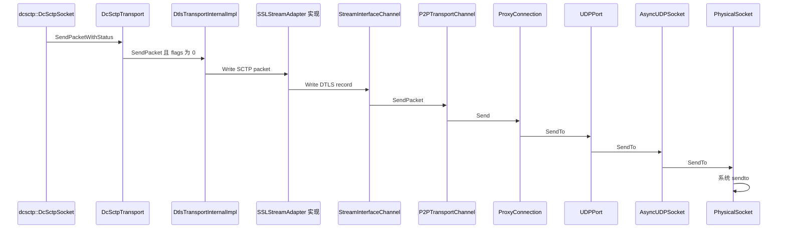
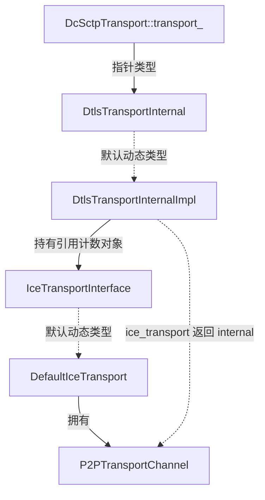
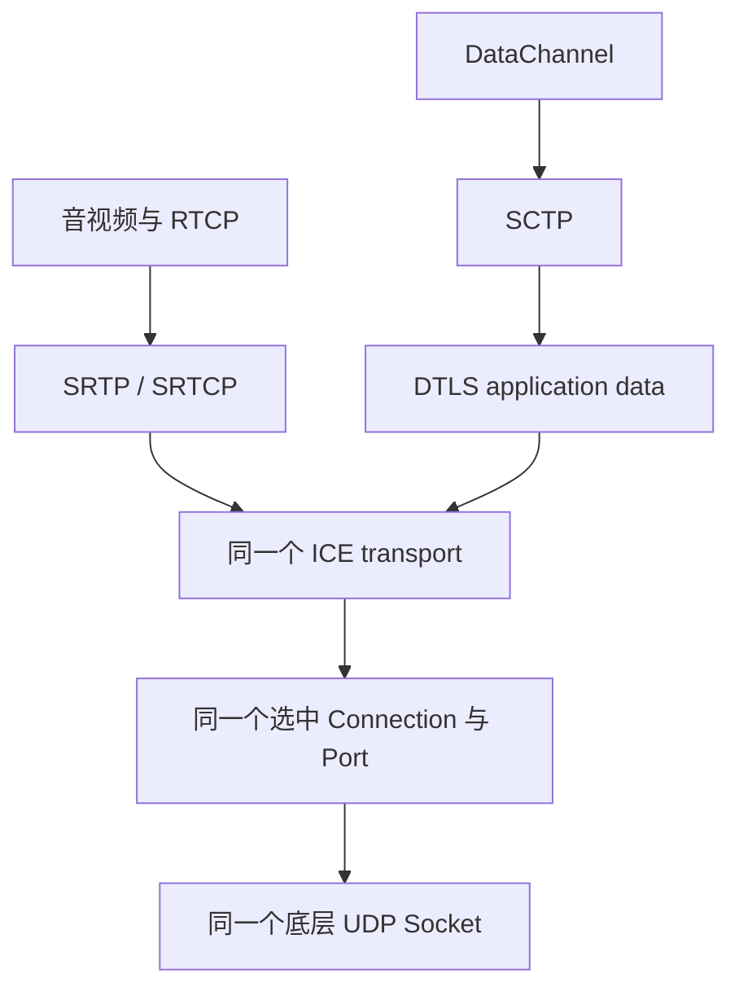

# WebRTC 传输源码 FAQ

> 基线提交：`9310b29acd9e0985ab65f454959122336e3b7e78`。以下回答针对本地原生 C++ 实现；默认内置工厂路径与替代实现分别说明。完整导航见 [README](README.md)。

## 1. dcsctp_transport.cc 第 468–470 行的 SendPacket 有哪些实现，最终调用谁

### 1.1 先确定变量的类型和来源

问题中的代码位于 [`DcSctpTransport::SendPacketWithStatus`](../webrtc_src/media/sctp/dcsctp_transport.cc) 约第 447 行：

```cpp
auto result =
    transport_->SendPacket(reinterpret_cast<const char*>(data.data()),
                           data.size(), AsyncSocketPacketOptions(), 0);
```

[`DcSctpTransport`](../webrtc_src/media/sctp/dcsctp_transport.h) 的 `transport_` 是非拥有的 `DtlsTransportInternal*`。因此这里首先执行 C++ 虚调用分派，按它实际指向的对象选择方法，而不是按源文件名或最相近的 `SendPacket` 名称选择。

默认创建证据是 [`JsepTransportController::CreateDtlsTransport`](../webrtc_src/pc/jsep_transport_controller.cc) 约第 536 行：没有注入 DTLS 工厂时，构造 `DtlsTransportInternalImpl`。同文件 `MaybeCreateJsepTransport` 再把该内部对象的指针交给 SCTP 工厂；[`SctpTransportFactory`](../webrtc_src/media/sctp/sctp_transport_factory.cc) 在 dcSCTP 构建开启时构造 `DcSctpTransport`。

**默认直接落点是 `DtlsTransportInternalImpl::SendPacket`，随后才会调用 `P2PTransportChannel::SendPacket`。**

### 1.2 相关同名方法分别做什么

- [`PacketTransportInternal::SendPacket`](../webrtc_src/p2p/base/packet_transport_internal.h) 约第 52 行是纯虚接口。它定义带数据长度、发送选项和 flags 的 packet transport 发送入口。
- [`DtlsTransportInternalImpl::SendPacket`](../webrtc_src/p2p/dtls/dtls_transport.cc) 约第 640 行是内部 DTLS 的生产实现，负责状态检查，以及 DTLS application data 或已保护媒体的分支选择。
- [`P2PTransportChannel::SendPacket`](../webrtc_src/p2p/base/p2p_transport_channel.cc) 约第 1627 行是 ICE 的生产实现，检查选中连接能否发送，再调用 `selected_connection_->Send`。
- [`FakeDtlsTransport::SendPacket`](../webrtc_src/p2p/dtls/fake_dtls_transport.h)、[`FakeIceTransportInternal::SendPacket`](../webrtc_src/p2p/test/fake_ice_transport.h)、[`FakePacketTransport::SendPacket`](../webrtc_src/p2p/test/fake_packet_transport.h) 用于测试，不实现完整的生产 DTLS/ICE/Socket 行为。
- [`RtpTransport::SendPacket`](../webrtc_src/pc/rtp_transport.cc) 和 [`BaseChannel::SendPacket`](../webrtc_src/pc/channel.cc) 是媒体层的不同签名方法，处理 RTP/RTCP 选择与媒体上下文，不是 `transport_` 在这里的候选动态类型。

注入的 `DtlsTransportFactory` 可以返回另一种合法的内部 DTLS 实现。排查具体进程时需要查看构造分支或对象动态类型；搜索仓库中的同名函数只能帮助定位，不能证明实际调用关系。

### 1.3 默认 UDP 直连的完整发送链



关键源码入口：

- [`dtls_transport.cc`](../webrtc_src/p2p/dtls/dtls_transport.cc)：`DtlsTransportInternalImpl::SendPacket` 约第 640 行；`StreamInterfaceChannel::Write` 约第 180 行。
- [`connection.cc`](../webrtc_src/p2p/base/connection.cc)：`ProxyConnection::Send` 约第 1905 行。
- [`stun_port.cc`](../webrtc_src/p2p/base/stun_port.cc)：`UDPPort::SendTo` 约第 311 行。
- [`async_udp_socket.cc`](../webrtc_src/rtc_base/async_udp_socket.cc)：`AsyncUDPSocket::SendTo` 约第 87 行。
- [`physical_socket_server.cc`](../webrtc_src/rtc_base/physical_socket_server.cc)：`PhysicalSocket::SendTo` 约第 470 行。

TURN 路径会由 `TurnPort` 进行中继封装，TCP 路径也有不同的 Port/Socket 实现。它们共享上层 SCTP/DTLS/ICE 分层，但不能强行套用最后几级 UDP 直连调用。

### 1.4 flags 和返回值有哪些易错点

这里的 flags 为 `0`。正常 DTLS 连接建立后，它走 `dtls_->Write`，SCTP 包进入 DTLS application data；媒体路径的 `PF_SRTP_BYPASS` 则直接转给 ICE，因为数据此前已经过 SRTP 保护。

`DcSctpTransport::SendPacketWithStatus` 先检查 transport 存在和 writable，再将上层可见的负返回值按 blocking error 区分为临时失败或错误。返回成功 **不表示对端确认或应用消费完成**。

本提交还有一个需要准确描述的实现边界：`StreamInterfaceChannel::Write` 调用 `ice_transport_->SendPacket` 后没有把该返回值转换为失败，而是设置已写入长度并返回 `SR_SUCCESS`。因此 DTLS 层的成功也不能当作底层每次 Socket 调用都成功的证明。诊断时应分别观察 SCTP 状态、DTLS write、ICE 返回值和实际 sent-packet/抓包证据。

详见 [DTLS 收发与错误边界](dtls-srtp-packet-flow.md) 和 [DataChannel 发送流程](datachannel-dcsctp.md)。

## 2. DtlsTransportInternal* 与 P2PTransportChannel 有什么关联

它们通过 **组合与委托** 关联。前者是 DTLS 层的接口指针，后者通常是它下方 ICE 层的实际实现。



具体关系：

1. [`DtlsTransportInternal`](../webrtc_src/p2p/dtls/dtls_transport_internal.h) 继承 `PacketTransportInternal`，增加证书、DTLS 状态、角色和安全参数接口。
2. [`DtlsTransportInternalImpl`](../webrtc_src/p2p/dtls/dtls_transport.h) 实现这个接口，并持有 `IceTransportInterface`。
3. 它的 `ice_transport()` 调用包装对象的 `internal()`，取得 `IceTransportInternal*`。
4. 默认 [`DefaultIceTransportFactory`](../webrtc_src/p2p/base/default_ice_transport_factory.cc) 创建的内部对象是 `P2PTransportChannel`。
5. 向下是发送委托，向上是接收、可写状态、网络路由等事件订阅。具体订阅和退订也受 network thread 生命周期约束。

`DtlsTransportInternal*` 本身不证明下层一定是 `P2PTransportChannel`；测试替身和自定义工厂可以改变下层实现。默认工程路径有明确构造证据。

详见 [总体架构的所有权与接口关系](webrtc-architecture.md)。

## 3. P2PTransportChannel 与 DtlsTransportInternalImpl 有什么区别

### 3.1 P2PTransportChannel 管理“通过哪条路径传输”

[`P2PTransportChannel`](../webrtc_src/p2p/base/p2p_transport_channel.h) 是 `IceTransportInternal` 的实现。主要管理候选收集会话、Port/Connection 集合、ICE 凭据与角色、检查调度、连通性状态和选中连接。发包时，它将上层已经准备好的 payload 交给选中连接。

它不解析 SCTP 用户消息，不建立 SRTP 密钥，不用证书认证对端。STUN 检查认证使用的 ICE 凭据，与 DTLS 证书指纹是不同机制。

### 3.2 DtlsTransportInternalImpl 管理“安全协议如何运行”

[`DtlsTransportInternalImpl`](../webrtc_src/p2p/dtls/dtls_transport.h) 管理本地证书、远端指纹、client/server 角色、DTLS 握手状态、SSL stream adapter 和密钥导出等安全上下文。

它使用 ICE 提供的 packet transport 发送 DTLS record；接收时区分 DTLS record 和 SRTP 报文。SRTP 的实际逐包认证和解保护由上层 `SrtpTransport`/`SrtpSession` 完成，不能把所有安全工作都归到 DTLS 类。

### 3.3 为什么两个对象都有 writable 和 SendPacket

二者都是 `PacketTransportInternal` 的派生体系，因此向上提供类似的 packet transport 操作，但条件不同：

- ICE 可写表明存在满足发送条件的选中路径。
- DTLS 可写还受其安全状态约束。
- 上层媒体是否可发送还需考虑 SRTP session 和通道配置。
- DataChannel 是否可发送还需考虑 SCTP association 和通道状态。

排查“ICE connected 但数据不通”时，应继续看 DTLS、SRTP/SCTP，不能因为两个对象都有 `SendPacket` 就绕过未完成的安全层。

### 3.4 当前版本的命名陷阱

`p2p/base/dtls_transport.h` 是转发到 `p2p/dtls/dtls_transport.h` 的兼容头。真实内部类名是 `DtlsTransportInternalImpl`。

[`pc/dtls_transport.h`](../webrtc_src/pc/dtls_transport.h) 中的 `DtlsTransport` 实现公开 `DtlsTransportInterface`，提供信息与观察者接口，不是第一个问题中执行 `SendPacket` 的对象。它的 `Information()` 可跨线程读取，并不使内部 DTLS 方法自动线程安全。

## 4. dcSCTP 与媒体最终都通过一个 UDP Socket 收发吗

**在同一 BUNDLE 传输、启用 RTCP mux、当前选中 UDP 路径等典型条件下，可以共用同一底层 UDP Socket；这不是无条件保证。**

### 4.1 共享路径的代码证据

[`MaybeCreateJsepTransport`](../webrtc_src/pc/jsep_transport_controller.cc) 约第 1172–1194 行把同一个 `rtp_dtls_transport_ptr` 用于媒体 transport 的底层关联和 SCTP transport 的创建。

`HandleBundledContent` 又把同组 MID 映射到同一个 `JsepTransport`。于是媒体和 SCTP 在各自安全处理后，可以进入同一个 `P2PTransportChannel` 和 `selected_connection_`。



本图限定于当前选中 UDP 路径。它没有表达候选收集期间的其他 Socket，也没有表示所有配置都如此。

### 4.2 什么情况下不能这么说

- 不同 MID 未 BUNDLE，或映射到不同的传输组。
- 未使用 RTCP mux，RTCP 存在独立分量。
- 多网卡、IPv4/IPv6 或候选池产生多个本地 Socket。
- ICE 检查和切换期间，新旧连接或多个候选同时存在。
- 选中了 ICE TCP，或客户端连接 TURN 服务器的传输是 TCP/TLS。
- 应用注入了自定义 Socket/transport 工厂。

还要区分“客户端到 TURN 服务器的传输”与“TURN 分配出的 relay 地址如何与对端通信”。看到候选为 relay 不能推导整个端到端路径都是 TCP，也不能推导本机一定使用 UDP Socket。

### 4.3 同一个 Socket 如何区分接收到的数据

Socket 只提供字节和源地址。Port/Connection 先处理 STUN 或 TURN 外层，随后 [`DtlsTransportInternalImpl::OnReadPacket`](../webrtc_src/p2p/dtls/dtls_transport.cc) 约第 892 行识别 DTLS 与媒体。

- DTLS 解密出的应用数据带 `kDtlsDecrypted` 标记，`DcSctpTransport::OnTransportReadPacket` 只接收这种数据并交给 dcSCTP。
- SRTP 报文带 `kSrtpEncrypted` 标记，随后进入媒体的解保护与 RTP/RTCP 分流。
- SCTP 再按 stream 与 PPID 分流；媒体再按 MID、SSRC 等信息分流。

所以接收侧有协议识别、认证和流标识三个层次，不是给每个 DataChannel 单独绑定一个 UDP 端口。

详见 [Socket 与中继路径](socket-ice-stun-turn.md)、[接收分流](dtls-srtp-packet-flow.md)。

## 5. SRTP 与 DTLS 有什么区别

### 5.1 SRTP 负责媒体逐包保护

SRTP 保护 RTP，SRTCP 保护 RTCP。它们针对实时媒体报文格式维护密钥、包索引和重放保护状态，并进行加解密与认证。

WebRTC 的主要入口是 [`SrtpTransport`](../webrtc_src/pc/srtp_transport.cc) 与 [`SrtpSession`](../webrtc_src/pc/srtp_session.cc)，后者适配 libsrtp。具体 profile 决定认证标签、加密方式等细节；不能把某一种 profile 的开销写成所有配置的固定值。

SRTP 本身不完成 WebRTC 的证书交换和 DTLS 握手。

### 5.2 DTLS 负责握手与 record 保护

DTLS 在数据报传输上建立安全上下文，包括角色、握手、密钥协商及对端身份校验。WebRTC 将协商获得的远端证书指纹用于验证收到的证书，建立与信令描述的一致性。

DataChannel 的 SCTP packet 作为 DTLS application data 被加密。DTLS 不因此提供应用消息可靠交付；SCTP 的重传、顺序和拥塞控制仍负责相应消息语义。

### 5.3 DTLS-SRTP 把两者连接起来

[`DtlsSrtpTransport`](../webrtc_src/pc/dtls_srtp_transport.cc) 在合适的 DTLS 状态下读取协商出的 SRTP profile，导出 keying material，按 DTLS client/server 角色分配本地发送和接收密钥，再安装到 SRTP session。

媒体随后走 `ProtectRtp/ProtectRtcp` → `PF_SRTP_BYPASS` → ICE；不会再把每个 SRTP 包加密成 DTLS application data。名称 `DtlsSrtpTransport` 表示这种密钥建立与媒体保护的组合。

这里有三种不同的“角色/认证”：ICE controlling/controlled、DTLS client/server、SDP 中的证书指纹验证。它们有关联的协商过程，但含义不同，不能用一个角色替代另一个。

详细密钥方向、报文格式和失败路径见 [DTLS/SRTP 专题](dtls-srtp-packet-flow.md)。

## 6. WebRTC 如何计算 RTT、lost ratio、jitter、uplink jitter、uplink delay

首先确认指标来自哪个协议、哪一端、哪个统计对象。下面给出定位方法，公式与演算集中在 [网络指标专题](network-metrics.md)。

### 6.1 RTT 不止一个

- **ICE RTT**：本地 STUN 请求至匹配响应的往返耗时。入口在 [`Connection::OnConnectionRequestResponse` 与 `ReceivedPingResponse`](../webrtc_src/p2p/base/connection.cc)。candidate pair 的 RTT 不能直接当成某条视频流的 RTCP RTT。
- **RTCP RTT**：通过 report block 的 LSR/DLSR，或 XR 的 RRTR/DLRR 计算；远端停留时间会从对应往返计算中扣除。入口在 [`RTCPReceiver`](../webrtc_src/modules/rtp_rtcp/source/rtcp_receiver.cc)。
- **TCC feedback RTT**：发送数据至本地收到反馈的耗时，包含反馈生成/等待影响；GCC 还估计扣除部分等待影响的 propagation RTT。入口在 [`GoogCcNetworkController::OnTransportPacketsFeedback`](../webrtc_src/modules/congestion_controller/goog_cc/goog_cc_network_control.cc)。
- **SCTP RTT/SRTT**：按协议确认信息采样、平滑，进一步计算 RTO。入口在 [`OutstandingData`](../webrtc_src/net/dcsctp/tx/outstanding_data.cc)、[`RetransmissionQueue`](../webrtc_src/net/dcsctp/tx/retransmission_queue.cc) 与 [`RetransmissionTimeout`](../webrtc_src/net/dcsctp/tx/retransmission_timeout.cc)。

这些值不同不必然表示计算错误；它们的包、测量时刻、远端处理和滤波不同。

### 6.2 丢包率要先定义分母和窗口

RTP 接收统计通常依据序列号扩展后的期望包数与实际收到的包数生成累计丢包及报告区间统计，入口是 [`StreamStatisticianImpl`](../webrtc_src/modules/rtp_rtcp/source/receive_statistics_impl.cc)。

RTCP report block、stats 计数差分、TCC 接收状态和 GCC 的 loss estimator 不一定统计相同包集合，也不一定使用相同时间窗口或包/字节权重。乱序和迟到包还可能修正之前的统计。

因此仪表盘做差分时至少需要同一 SSRC/transport、同一计数器生命周期、同一方向和明确的时间区间；不能把不同层的百分比直接比较。

### 6.3 jitter 是到达间隔变化的平滑统计

RTP jitter 比较连续包的接收时间间隔与 RTP 时间戳间隔，再平滑差值的绝对值。内部计算需要把时间放到同一 RTP 时钟单位，导出 stats 时再转为对应单位。

它不是 RTT 的标准差，也不是 jitter buffer 当前存了多久。音频和视频的 RTP 时钟频率不同，忽略单位会得到数量级错误。

### 6.4 uplink jitter 要看测量者

如果“上行”指本地发送的媒体在对端接收时观测到的抖动，那么远端 RTCP report block 的 jitter，以及相应 `remote-inbound-rtp.jitter` 才是相关入口。映射可从 [`RTCStatsCollector`](../webrtc_src/pc/rtc_stats_collector.cc) 的远端接收统计生成代码追踪。

本地 `inbound-rtp.jitter` 描述本地接收方向，不能仅改个字段显示名称就当成上行抖动。

### 6.5 uplink delay 没有统一的默认解释

本基线没有统一同名指标。常见来源可能是单向网络时延估计、发送队列等待、相对排队变化，或包含采集/编码/解码/播放的端到端时延。

两个端点的时钟不同步时，不能直接用“远端收到时间 − 本地发出时间”得到可信的绝对单向网络时延。`RTT / 2` 只是在附加对称性假设下的估算；GCC 的 delay delta/trendline 则主要观测相对变化，也不是绝对上行时延。

工程对接应为这个字段补齐：谁测量、时间戳在哪采集、是否同步时钟、是否包含排队/处理、聚合窗口和单位。具体 SDK、日志或看板提供这些信息后，才能与本地实现逐项映射。

## 7. 调试时保留的最小上下文

为了让上述问题可以复现，建议在问题记录中同时保留：

1. 源码 commit、构建平台、是否自定义 transport/Socket/controller 工厂、相关 Field Trials。
2. 本地与远端 SDP 中的 BUNDLE、RTCP mux、ICE 凭据代次、DTLS 角色与指纹、SCTP 参数和反馈扩展。
3. 对应 MID、SSRC、SID、candidate pair 及选中路径的变化时间。
4. 事件日志/抓包时间基准、指标采样区间，以及问题发生时各层状态。
5. 成功或失败发生在哪个边界：API 入队、协议出包、Socket 发送、远端确认还是应用回调。

敏感凭据和媒体内容应按工程已有的日志处理规范管理。诊断本身不要求把所有媒体明文或完整凭据写入日志。

返回 [总体架构](webrtc-architecture.md) 或 [文档导航](README.md)。
