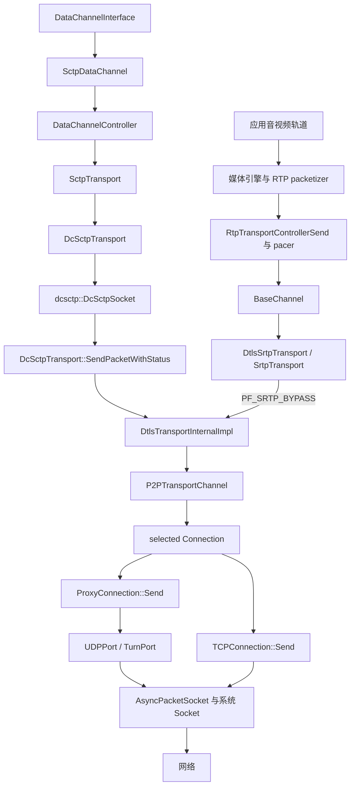
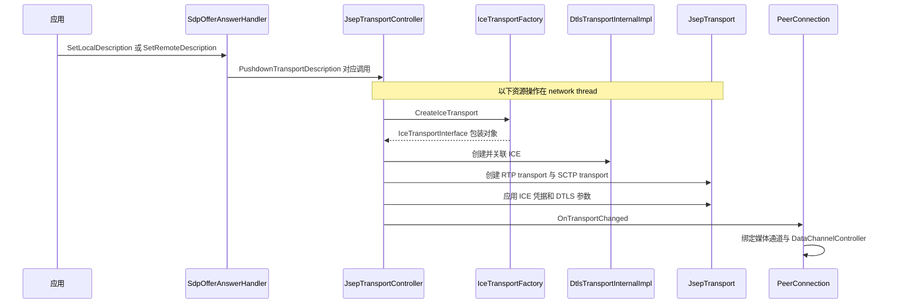
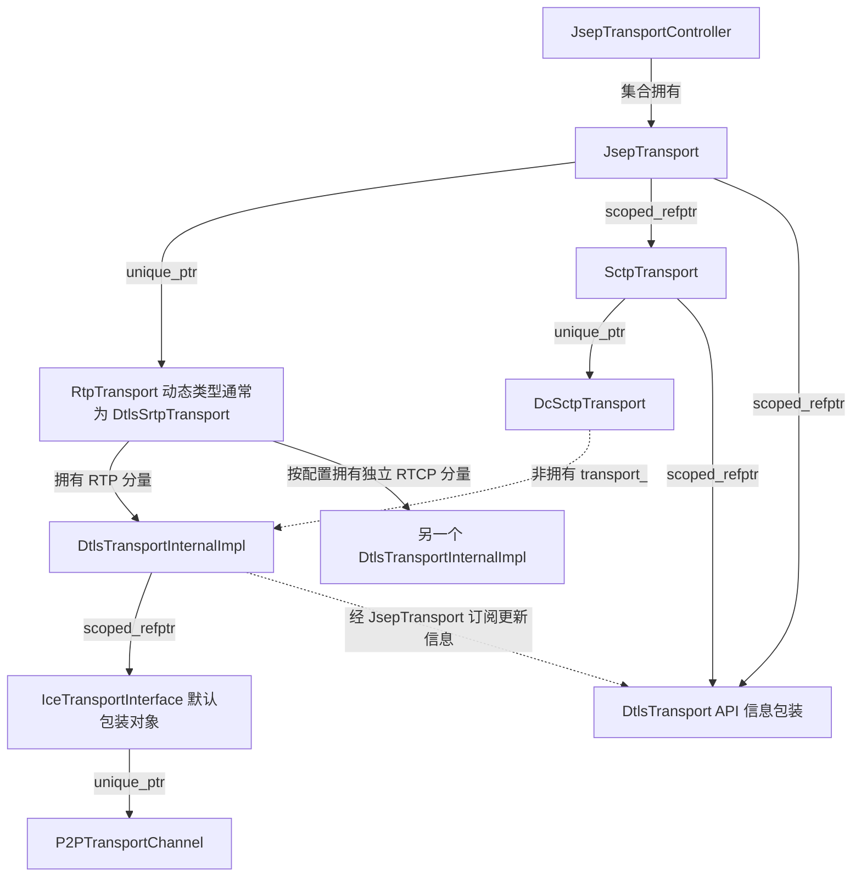
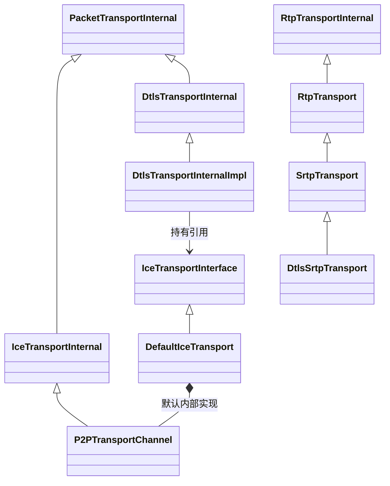
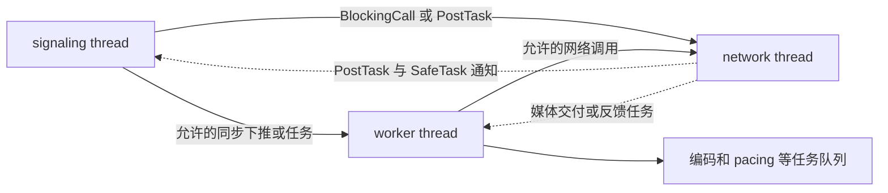
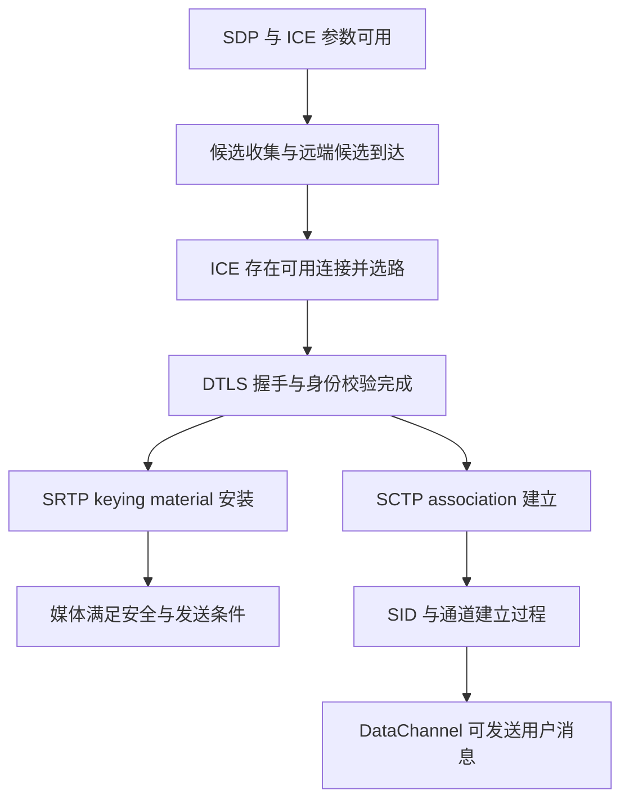

# WebRTC 传输总体架构：从对象创建到报文收发

> 源码基线：`9310b29acd9e0985ab65f454959122336e3b7e78`。文中默认使用内置工厂、启用加密和 dcSCTP 的原生 PeerConnection 路径。阅读导航见 [README](README.md)。

## 1. 工程上需要回答的三个问题

分析 WebRTC 传输时，应分别回答：谁决定传输参数、谁处理协议、谁拥有实际网络资源。三者经常由不同对象承担。

- **控制面**：应用提供配置和 SDP，`SdpOfferAnswerHandler` 与 `JsepTransportController` 下推 ICE、DTLS、BUNDLE、RTCP mux 参数。
- **数据面**：媒体进入 RTP/SRTP 路径；DataChannel 消息进入 SCTP/DTLS 路径；二者可以汇合到同一个 ICE transport。
- **资源面**：allocator 创建候选所需 Port 和 Socket，ICE 维护候选连接集合并选择发送路径；公开 API 的 transport 对象不一定拥有这些资源。

因此，“创建了 DataChannel”“ICE connected”“DTLS connected”“媒体可发送”“SCTP association established”是不同层次的事件，不能互相替代。

## 2. 目录与构建边界

### 2.1 API 与会话编排

[`api/`](../webrtc_src/api/) 声明应用接口、工厂依赖、统计类型、单位类型和 transport 接口。它定义可观察行为和注入边界，不等于所有功能的实现目录。

[`pc/`](../webrtc_src/pc/) 实现 PeerConnection、SDP offer/answer、媒体通道与传输绑定、DataChannel 编排、SRTP 适配和统计汇总。优先阅读：

- [`PeerConnection`](../webrtc_src/pc/peer_connection.h)：聚合会话资源和生命周期。
- [`ConnectionContext`](../webrtc_src/pc/connection_context.h)：工厂级共享资源、线程与默认依赖。
- [`SdpOfferAnswerHandler`](../webrtc_src/pc/sdp_offer_answer.h)：SDP 状态及应用描述。
- [`JsepTransportController`](../webrtc_src/pc/jsep_transport_controller.h)：建立并管理会话所需的传输对象。
- [`JsepTransportCollection`](../webrtc_src/pc/jsep_transport_collection.h)：保存传输对象和 MID 到 transport 的映射，支持映射调整与回滚。
- [`JsepTransport`](../webrtc_src/pc/jsep_transport.h)：单个协商传输单元的 ICE/DTLS/RTP/SCTP 关联与参数应用。

[`pc/BUILD.gn`](../webrtc_src/pc/BUILD.gn) 中存在 `peer_connection`、`jsep_transport_controller`、`jsep_transport`、`dtls_srtp_transport`、`srtp_transport`、`rtp_transport`、`sctp_transport`、`data_channel_controller` 和 `sctp_data_channel` 等独立目标。

### 2.2 连通性、安全与系统网络

[`p2p/base/`](../webrtc_src/p2p/base/) 和 [`p2p/client/`](../webrtc_src/p2p/client/) 承担 ICE、Port、Connection、STUN/TURN、候选收集和选路。当前 DTLS 的实际实现已经移入 [`p2p/dtls/`](../webrtc_src/p2p/dtls/)。

[`rtc_base/`](../webrtc_src/rtc_base/) 提供 Socket、SocketServer、异步 packet socket、网络接口发现、线程/任务调度以及 TLS stream adapter 等基础设施。此层不知道一个 payload 是视频帧还是 DataChannel 文本。

[`p2p/BUILD.gn`](../webrtc_src/p2p/BUILD.gn) 是上述 P2P 相关代码的构建入口；不要把兼容头路径当成独立实现。

### 2.3 消息传输与媒体拥塞控制

[`media/sctp/`](../webrtc_src/media/sctp/) 是 WebRTC transport 接口到 dcSCTP 库的适配层；[`net/dcsctp/`](../webrtc_src/net/dcsctp/) 实现 SCTP 协议、队列、定时器和重传算法。

[`call/`](../webrtc_src/call/) 编排媒体流及发送传输控制；[`modules/rtp_rtcp/`](../webrtc_src/modules/rtp_rtcp/) 处理 RTP/RTCP；[`modules/congestion_controller/`](../webrtc_src/modules/congestion_controller/) 与 [`modules/remote_bitrate_estimator/`](../webrtc_src/modules/remote_bitrate_estimator/) 包含媒体拥塞控制和反馈生成；[`modules/pacing/`](../webrtc_src/modules/pacing/) 实施发送节奏控制。

dcSCTP 不经过媒体编码器、RTP packetizer 或媒体 GCC。它有自己的消息队列、SACK、拥塞窗口和重传状态。

## 3. 总体数据通路

图中经过 `DtlsTransportInternalImpl` 不等于经过 DTLS 加密：带 `PF_SRTP_BYPASS` 的媒体已经由 SRTP 保护，该方法将它转发到 ICE；SCTP 包使用普通 flags，进入 DTLS application data 加密。

这张图是结构图，省略音视频内部的任务队列与异步发送细节。UDP/TURN 的业务发送经 `ProxyConnection` 委托给 Port；ICE TCP 的 [`TCPConnection::Send`](../webrtc_src/p2p/base/tcp_port.cc) 直接调用其 Socket，并不经 `TCPPort::SendTo`。完整媒体报文边界见 [DTLS/SRTP 收发](dtls-srtp-packet-flow.md)，媒体 pacing 和反馈闭环见 [GCC/TCC](gcc-tcc.md)。

## 4. 对象如何建立

### 4.1 工厂资源并不等于通话 Socket

[`ConnectionContext`](../webrtc_src/pc/connection_context.cc) 构造时接受应用注入的线程、网络管理器、Socket 工厂和 SCTP 工厂。未注入相应依赖时会建立默认对象，例如 `BasicNetworkManager` 和 `BasicPacketSocketFactory`。

创建 `BasicPacketSocketFactory` 仅建立创建 Socket 的入口，实际候选所需 Socket 通常随 allocator session 的收集过程创建。候选池可能提前收集，因此不能绝对地说“应用第一次 SetLocalDescription 之前不存在 Socket”。

`PeerConnection::InitializeNetworkThread` 位于 [`peer_connection.cc`](../webrtc_src/pc/peer_connection.cc) 约第 604 行：它整理 `JsepTransportController::Config`，传入 ICE/DTLS/RTP/SCTP 工厂，设置状态回调，再在 network thread 初始化 allocator 与 controller。

### 4.2 SDP 下推触发传输创建和绑定

入口是 [`SdpOfferAnswerHandler::PushdownTransportDescription`](../webrtc_src/pc/sdp_offer_answer.cc) 约第 5534 行。它把会话描述中的传输信息交给 controller；controller 的 `_n` 方法在 network thread 应用描述。

这是典型结构顺序，不表示所有协商都重新创建对象。`MaybeCreateJsepTransport` 会复用已有传输；BUNDLE 非首 MID 映射到已有对象；远端候选也可能通过 trickle ICE 随后到达。

### 4.3 默认工厂的动态类型

从 [`JsepTransportController::CreateDtlsTransport`](../webrtc_src/pc/jsep_transport_controller.cc) 约第 536 行沿下层追踪：

1. `CreateIceTransport` 返回 `IceTransportInterface`。
2. 默认 [`DefaultIceTransportFactory::CreateIceTransport`](../webrtc_src/p2p/base/default_ice_transport_factory.cc) 创建 `DefaultIceTransport`，拥有 `P2PTransportChannel`。
3. 若没有注入 DTLS 工厂，controller 创建 `DtlsTransportInternalImpl`。
4. 默认加密媒体路径由 `CreateRtpTransport` 选择 `DtlsSrtpTransport`；`disable_encryption` 和注入 RTP 工厂会改变分支。
5. [`SctpTransportFactory::CreateSctpTransport`](../webrtc_src/media/sctp/sctp_transport_factory.cc) 在 `WEBRTC_HAVE_DCSCTP` 构建条件下创建 `DcSctpTransport`，关联相同的 RTP DTLS 内部对象。

因此，从接口名称推断默认动态类型必须同时检查调用方和工厂，而不能只搜索 `SendPacket` 定义。

## 5. 所有权与接口关系

### 5.1 谁拥有谁

具体证据在 [`MaybeCreateJsepTransport`](../webrtc_src/pc/jsep_transport_controller.cc) 约第 1163 行，以及 [`JsepTransport` 构造和析构](../webrtc_src/pc/jsep_transport.cc) 约第 85、111 行。

`RtpTransport` 内部同时保存方便调用的 packet transport 指针与可选拥有成员。不能看到一个裸指针字段就推断“无人管理生命周期”。应继续看 `SetRtpPacketTransportOwned` 和 `SetDtlsTransportsOwned`。

`pc/dtls_transport.h` 的 `DtlsTransport` 保存受锁保护的信息快照和 `IceTransportWithPointer`。本版本通过 `OnInternalDtlsState` 接收内部对象状态更新；它不是 SCTP 发送时调用的内部 DTLS 协议对象。

### 5.2 继承和组合是不同关系

`P2PTransportChannel` 和 `DtlsTransportInternalImpl` 是不同分支的具体实现，通过对象组合衔接，不是父类和子类，也不是两个可随意替换的同层策略。

## 6. BUNDLE、RTCP mux 与 shared socket

### 6.1 BUNDLE 决定多个 MID 如何映射到传输

[`JsepTransportController::HandleBundledContent`](../webrtc_src/pc/jsep_transport_controller.cc) 约第 1058 行取得组内首 MID 对应的 `JsepTransport`，通过 `SetTransportForMid` 让其他 MID 指向它。

一个典型会话中，音频 MID、视频 MID 和 data MID 可以映射到同一个 `JsepTransport`。共享的对象提供媒体 RTP transport、DTLS 状态包装和 DataChannel transport；上层仍有各自的媒体流和 DataChannel 对象。

改变映射时，`JsepTransportController::OnTransportChanged` 通知 [`PeerConnection::OnTransportChanged`](../webrtc_src/pc/peer_connection.cc) 约第 2977 行。后者把新的 RTP transport 交给匹配 MID 的 transceiver，并把 DataChannel transport 交给 `DataChannelController`。

### 6.2 RTCP mux 决定 RTP 与 RTCP 是否使用同一分量

启用 RTCP mux 时，RTCP 与 RTP 使用同一 packet transport。未要求 mux 的配置可能先创建独立 RTCP DTLS/ICE 分量，协商后再调整。它与“音频、视频、data 是否 BUNDLE”不是同一个开关。

### 6.3 shared socket 是 Port 层的资源复用

`PORTALLOCATOR_ENABLE_SHARED_SOCKET` 影响候选收集与 Port 使用 Socket 的方式，见 [`PeerConnection::InitializePortAllocator_n`](../webrtc_src/pc/peer_connection.cc) 约第 2231 行。它解决 Socket 资源复用问题，不建立 SDP MID 的语义关系。

判断媒体和 DataChannel 是否实际走同一个 Socket，应按以下链条验证：

1. MID 是否映射到同一个 JSEP transport。
2. 是否引用同一个内部 DTLS/ICE transport。
3. 此刻选中了哪个 `Connection`。
4. 该 connection 使用哪个 Port、哪个 `AsyncPacketSocket` 和系统 Socket。
5. 底层路径是否 UDP，还是 ICE TCP 或 TURN TCP/TLS。

多网卡、IPv4/IPv6、候选池、尚未裁剪的候选连接和路径切换都可能同时留下多个 Socket。业务数据共用当前选中的路径，不意味着进程或 PeerConnection 仅创建过一个 UDP Socket。

## 7. 线程模型和调用约束

### 7.1 三个逻辑线程角色

- **signaling thread**：PeerConnection 会话 API、SDP 状态与应用层观察者编排。
- **worker thread**：媒体引擎、Call 与音视频流等媒体工作；编码、解码和 pacing 还可能使用各自任务队列。
- **network thread**：ICE、Port/Connection、Socket 回调、内部 DTLS、SCTP transport 和传输对象绑定。

这是逻辑角色，不保证应用一定创建三条不同 OS 线程。`ConnectionContext` 支持注入线程，有些角色可能合并。具体对象仍应遵守 `RTC_DCHECK_RUN_ON` 和 sequence checker 约束。

[`ConnectionContext` 构造函数](../webrtc_src/pc/connection_context.cc) 设置允许的同步调用方向，并在相应条件下禁止 network thread 阻塞调用。不能因 signaling 可以等待 network，就反向在 Socket 回调里同步等待 signaling。

### 7.2 回调线程要看当前版本

本版本 DataChannel 支持把 observer 回调安全性作为接口约定处理；其代理和适配器决定是否转发到 signaling thread。不要将“所有 DataChannel 回调永远在 signaling thread”写成不变规则。详见 [DataChannel 线程与回调](datachannel-dcsctp.md)。

`DtlsTransport::Information()` 允许跨线程读取，其信息快照由锁保护；这不意味着任意内部 `DtlsTransportInternalImpl` 方法都可以跨线程调用。

### 7.3 实时路径的工程约束

网络线程一次阻塞可能同时推迟 STUN、DTLS、SCTP、RTP/RTCP 和发送反馈处理。诊断时应把线程调度延迟与网络时延分开：包在抓包中已经到达，不代表协议回调已及时执行。

扩展日志或业务回调时，避免在这些路径上做同步文件 I/O、无界计算或等待应用线程；观察时优先使用已有 event log、受控采样和 stats。

## 8. 状态与可用性不能压缩成一个布尔值

典型依赖如下，箭头表示后续阶段所需的条件，不是一个唯一的全局状态机：

几个必须单独检查的条件：

- ICE 的 `writable`、`receiving`、gathering state 和标准化 connection state 含义不同。
- ICE 可写不代表 DTLS 指纹已验证，也不代表 SRTP session 已安装。
- DTLS connected 不代表 SCTP 已完成 association 握手。
- SCTP connected 不代表某个 DataChannel 的 SID、状态和消息大小条件已经满足。
- 可发送不代表接收端应用正在消费，也不代表路径没有拥塞。

快速恢复、候选池、trickle ICE、DTLS-in-STUN 或 SCTP 初始化相关可选能力会让部分阶段重叠；具体分支在各专题说明。

## 9. 收包有多层分流

接收不是把发送图机械反转。它至少包含四次不同的识别过程：

1. **Socket/Port 识别**：按本地 Socket、源地址、TURN 外层或 STUN 事务决定交给哪个 Port/Connection。
2. **ICE 与安全协议识别**：ICE 消费 STUN 检查；DTLS transport 识别 DTLS record 与媒体报文。
3. **安全层识别**：DTLS 解密后的应用数据送入 SCTP；媒体进入 SRTP/SRTCP 验证与解保护。
4. **业务标识识别**：媒体使用 MID、SSRC 等已协商信息分流；SCTP 使用 SID、PPID、消息序号和分片信息重组并交付。

这些层次分别解决“哪个链路”“哪个协议”“是否可信”“哪个流/消息”的问题。比如媒体认证失败不能通过修改 DataChannel SID 修复，未知 SSRC 也不等于 ICE 不通。

完整类与函数路径见 [收发专题](dtls-srtp-packet-flow.md) 和 [DataChannel 专题](datachannel-dcsctp.md)。

## 10. 关闭、重协商和生命周期

### 10.1 为什么公开 transport 可继续存在

应用可以持有引用计数的 `SctpTransportInterface` 或 `DtlsTransportInterface`。即使内部网络资源已停止，外部 API 对象仍可能存在，因此需要先清除内部关联、更新状态，再释放底层资源。

[`JsepTransport::~JsepTransport`](../webrtc_src/pc/jsep_transport.cc) 先对 SCTP wrapper 执行 `Clear()`，再取消内部 DTLS 状态订阅并清理公开 DTLS wrapper。成员所有权随后完成内部资源销毁；源码明确 ICE 最后释放。

### 10.2 PeerConnection 的关闭任务

[`PeerConnection::MakeCloseOnNetworkThreadTask`](../webrtc_src/pc/peer_connection.cc) 约第 741 行先拆除 DataChannel transport、丢弃候选池，再关闭 controller、释放 allocator 并标记 network safety flag 不再存活。

相关析构路径还会在 worker thread 释放 `Call` 和媒体资源，并取消或使已排队回调失效。`SafeTask`、sequence checker 与引用计数各解决不同问题：任务是否应执行、在哪执行、对象何时释放，不能互相替代。

### 10.3 重协商不是整栈重建的同义词

BUNDLE 映射变化、RTCP mux 激活、ICE restart、媒体流增删和 DataChannel stream reset 涉及不同对象。应先检查本次操作改变哪一层：

- 新 ICE 凭据会触发对应 ICE generation 的处理，不表示必然重新创建每个应用 DataChannel。
- 一个 DataChannel 关闭通常作用于 SCTP stream reset，不等于关闭共享 association。
- 一个 MID 被拒绝会影响其映射；若它是 BUNDLE 组的首 MID，还要遵守整组处理逻辑。

不能用一个统一的“重连”标签解释这些生命周期变化。

## 11. 排查与修改的工程入口

### 11.1 建议设置的断点

- 创建与注入：`PeerConnection::InitializeNetworkThread`、`JsepTransportController::MaybeCreateJsepTransport`、`CreateDtlsTransport`。
- 映射变化：`HandleBundledContent`、`PeerConnection::OnTransportChanged`。
- 发包分界：`BaseChannel::SendPacket`、`DcSctpTransport::SendPacketWithStatus`、`DtlsTransportInternalImpl::SendPacket`、`P2PTransportChannel::SendPacket`。
- 回调分界：`DtlsTransportInternalImpl::OnReadPacket`、`RtpTransport::OnReadPacket`、`DcSctpTransport::OnTransportReadPacket`。
- 生命周期：`JsepTransport::~JsepTransport`、`PeerConnection::MakeCloseOnNetworkThreadTask`。

断点应附带连接标识、MID、SID 或 Socket 地址过滤，避免在热路径暂停所有通话后再把超时当成原始问题。

### 11.2 可用于核对行为的测试

- [`jsep_transport_controller_unittest.cc`](../webrtc_src/pc/jsep_transport_controller_unittest.cc)：传输创建、协商与配置。
- [`peer_connection_bundle_unittest.cc`](../webrtc_src/pc/peer_connection_bundle_unittest.cc)：BUNDLE 关系。
- [`peer_connection_ice_unittest.cc`](../webrtc_src/pc/peer_connection_ice_unittest.cc)：ICE 配置和状态。
- [`dtls_srtp_transport_integrationtest.cc`](../webrtc_src/pc/dtls_srtp_transport_integrationtest.cc)：DTLS/SRTP 组合。
- [`peer_connection_data_channel_unittest.cc`](../webrtc_src/pc/peer_connection_data_channel_unittest.cc)：DataChannel 会话行为。

这些是源码验证入口，不是本次文档生成的执行结果。纯文档修改不需要重建 WebRTC；未来改动实现时，应按变更边界构建相关 GN 目标并运行对应测试。

下一篇：[Socket、ICE、STUN 与 TURN](socket-ice-stun-turn.md)。
